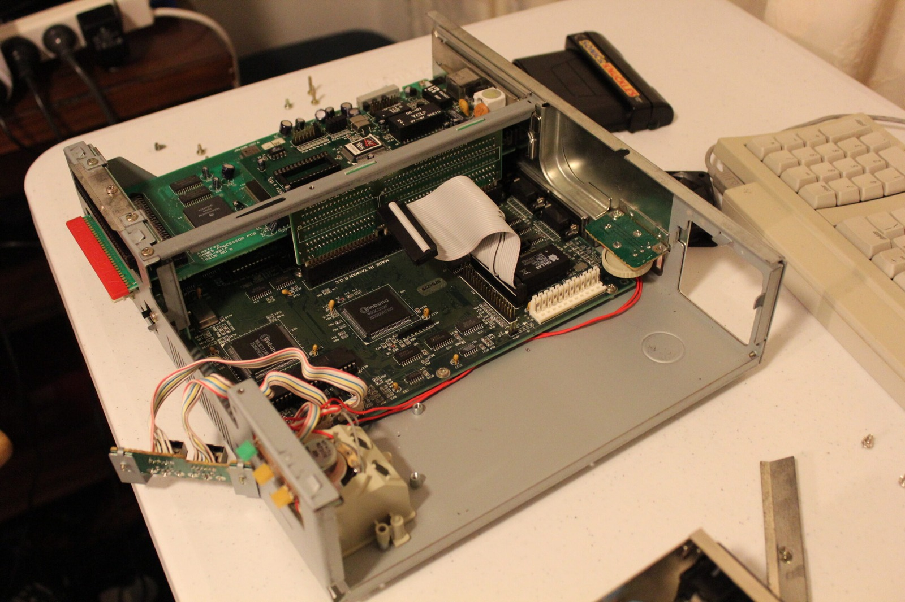
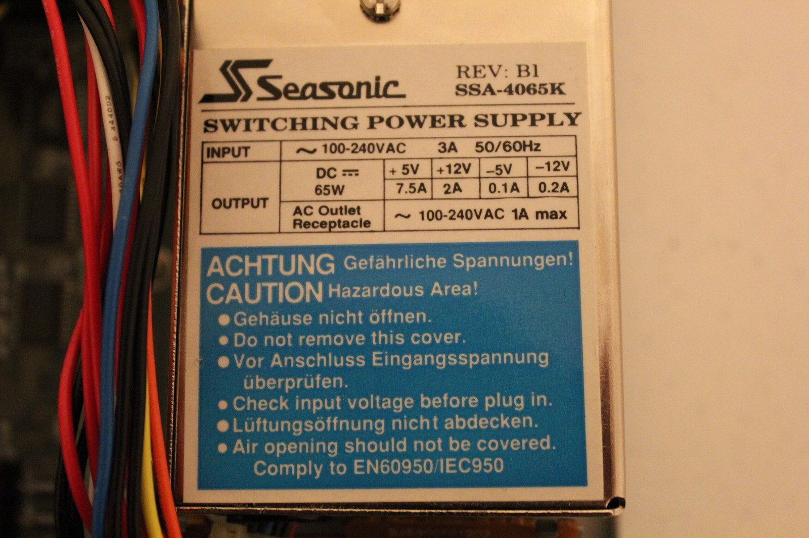
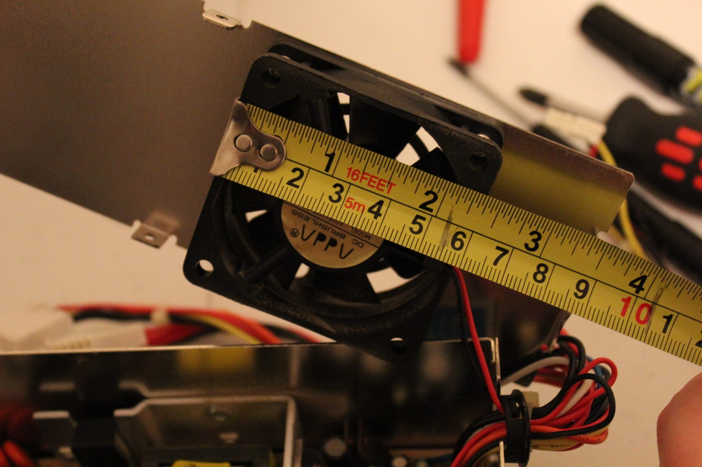
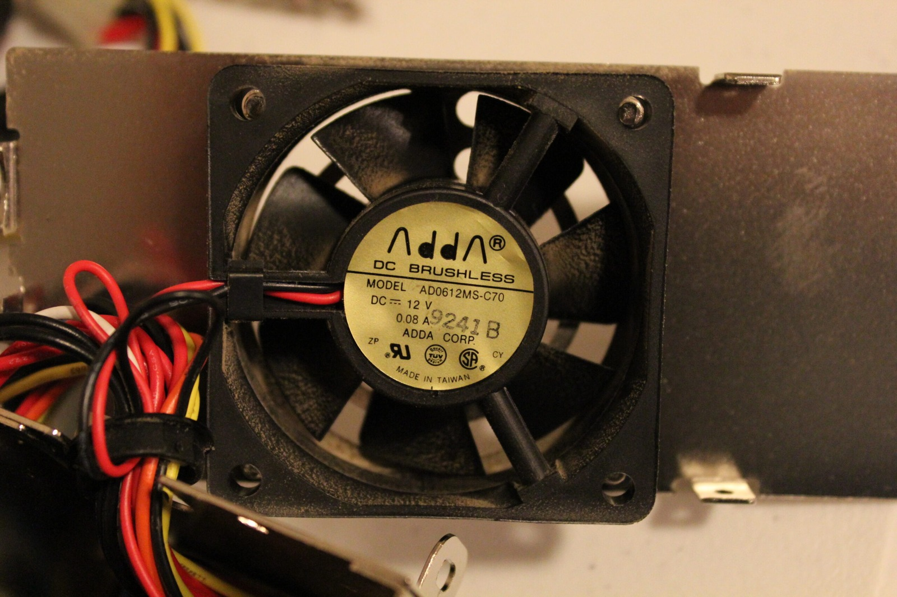
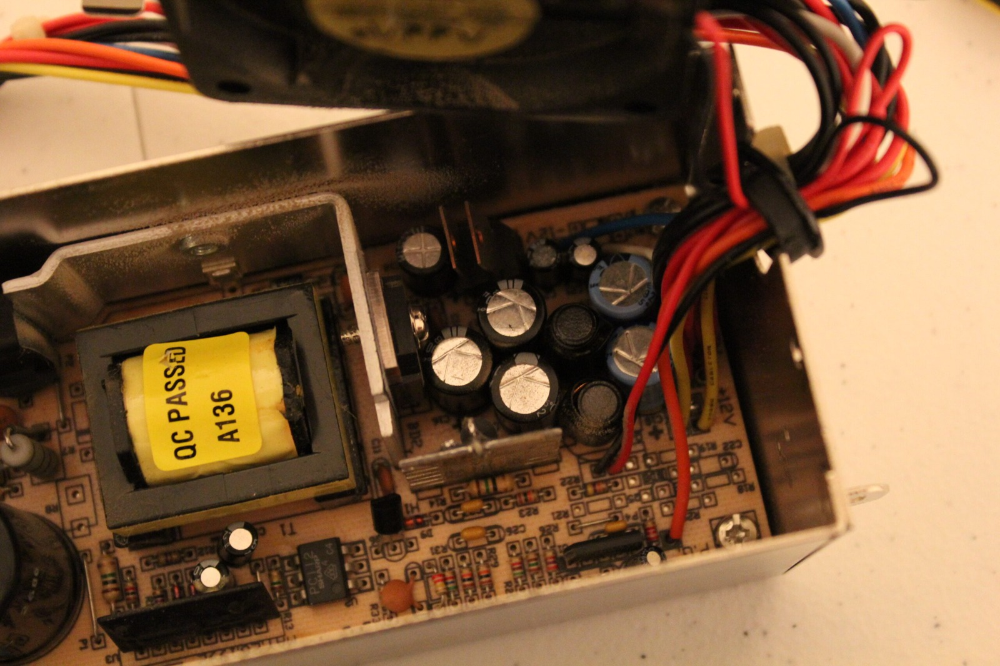
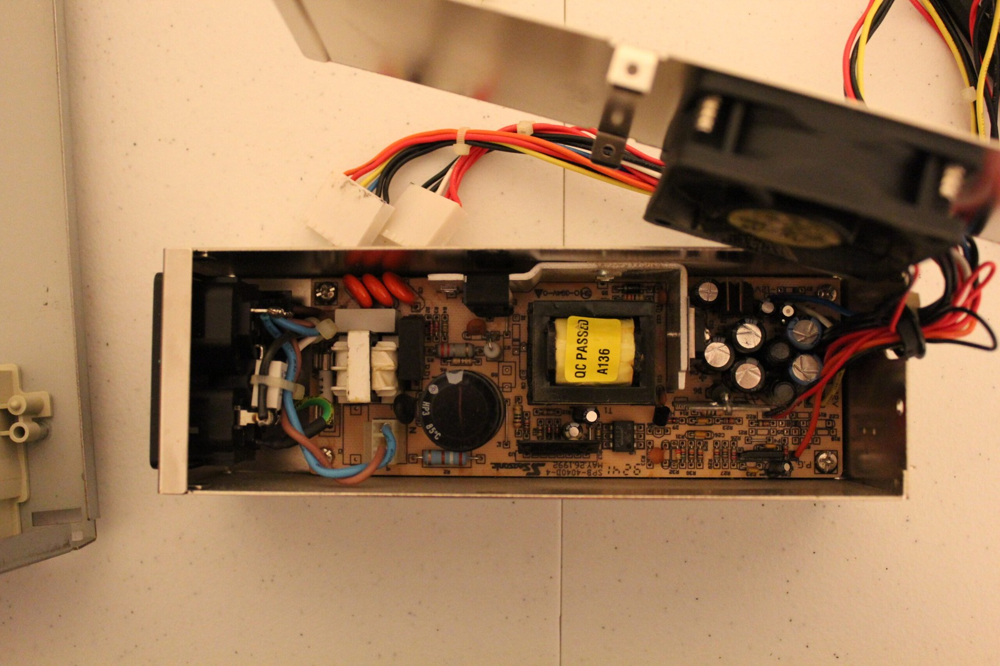



Sometimes it is good that things break. [CityEscaper](https://www.youtube.com/user/CityEscaper) asked whether I could pull the Mega PC out and test it on some different displays around the house. The video output works on my Samsung LCD TV and on my ViewSonic computer LCD from around 2004 to 2005. My newer Toshiba LCD TV wants nothing to do with it. Fair enough.

*Back inside the Mega PC, chasing a storage problem that turned out to involve the Disk on Module setup.*
{: .media-caption }

### Boot failure

More importantly, pulling the machine out uncovered a storage problem. The hard-drive LED kept blinking while the display came and went, sometimes leaving me with no video, a frozen keyboard or even garbled characters in the BIOS. I briefly wondered about the real-time clock battery, but removing the Disk on Module made the machine behave again even before I put the old hard drive back in.

The SSD or Disk on Module (DOM) setup was clearly involved in the boot failure. Returning the original 107 MB hard drive restored normal booting immediately. That told me the Mega PC itself was still capable of booting, but it did **not** isolate whether the problem was the DOM hardware, partitioning, BIOS geometry, boot configuration or some other compatibility issue.

So we wind the clock back and join 1992 with a 107 MB hard drive. I've installed MS-DOS 6.22 alongside Windows for Workgroups 3.11 with a touch of Calmira, and the machine is running with 16 MB of RAM. I couldn't bring myself to end the recording before showing it booting properly again, so there is even a little Solitaire at the end. I also forgot to enable the CPU cache in the BIOS. Must remember that tomorrow. It makes an enormous difference on this 486SLC.

### Power supply

I also got a chance to open the Mega PC power supply and document the internals. It is a Seasonic SSA-4065K, revision B1, rated at 65 W. Nothing immediately looks catastrophic. Usual warning, opening a mains power supply exposes hazardous circuitry, and capacitors can retain charge after disconnection.

*The power supply's specifications, photographed before I work out what to do about its noisy fan.*
{: .media-caption }

I also took down the fan details because it is far too noisy. The fan is a 60 mm, 12 V unit wired directly into the PSU and carries a 1992 date stamp. That should make replacement fairly straightforward one day, provided the replacement fan's electrical and airflow characteristics are suitable. One day!

*Measuring the original fan before finding a quieter replacement for the Mega PC.*
{: .media-caption }

*The original ADDA fan's model and electrical ratings are clear enough to make replacement shopping a little easier.*
{: .media-caption }

*A closer look inside the Seasonic. Nothing obviously exploded, but that's not a health check for a mains PSU.*
{: .media-caption }

*The whole 65 W supply laid open for documentation. Mains power supplies deserve more caution than the usual retro card.*
{: .media-caption }

### Sources

- [HSE: Electrical Safety FAQ (Isolation and Stored Energy)](https://www.hse.gov.uk/electricity/faq.htm)

### Related Posts

- [Amstrad Sega Mega PC 486SLC Upgrade Experiment](/amstrad-sega-mega-pc-486slc-upgrade-experiment/)
- [Amstrad Sega Mega PC 486SLC: Coprocessor and 16 MB RAM](/amstrad-sega-mega-pc-486slc-coprocessor-and-16mb-ram/)
