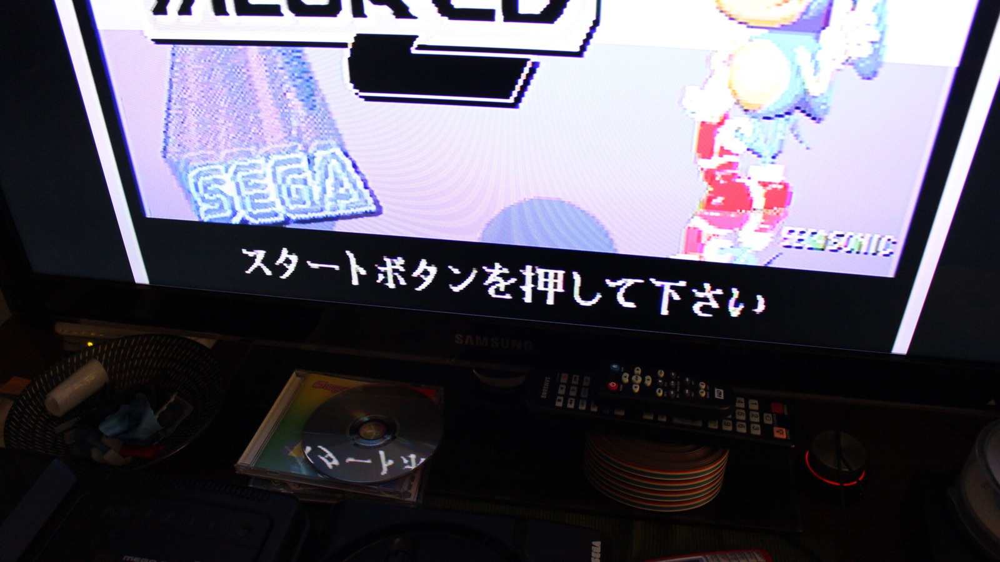
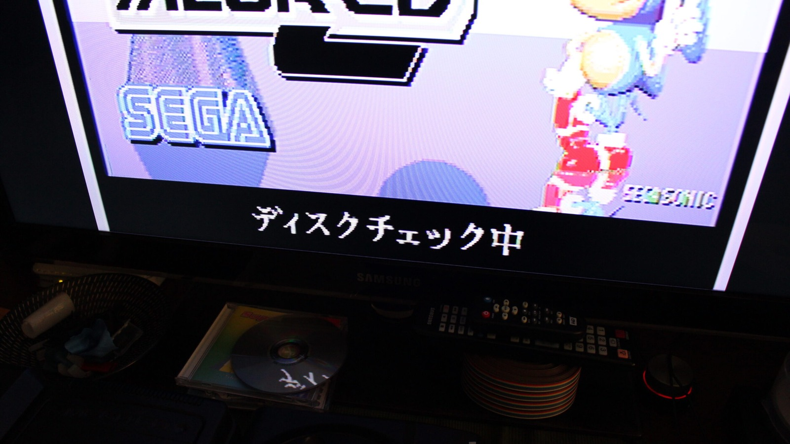
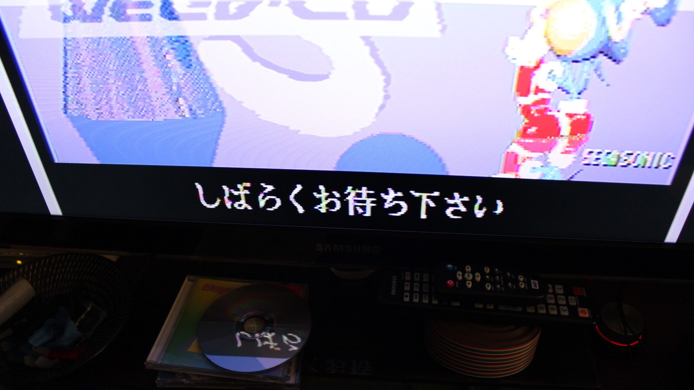

*First translation: 'Please press the Start button.' Now I know what the Aiwa is asking me to do!*
{: .media-caption }

...Please Press the Start Button...

*Second translation: 'Checking the disc.' A rather useful message when the CD mechanism is being stubborn.*
{: .media-caption }

...Checking the Disc...

*Third translation: 'Please wait a little bit.' Very polite for a machine that's giving me so much grief.*
{: .media-caption }

...Please Wait a Little Bit...

Thanks to [T_chan](https://web.archive.org/web/20191111223501/https://assemblergames.com/members/t_chan.13895/) from [ASSEMblergames.com](https://web.archive.org/web/20191113060735/https://assemblergames.com/threads/the-translation-thread.21989/page-23) for the quick translation. So now I finally have some idea what the poor Aiwa is yelling at me while I press all the wrong buttons. I'm keeping these here as a reference for when the CSD-GM1 units go back onto the bench for more testing and repairs. Knowing what the machine thinks it is doing should make the next round of troubleshooting considerably less mysterious.

### Related Posts

- [Aiwa Sega Mega-CD CSD-GM1 Initial Damage Report](/aiwa-sega-mega-cd-csd-gm1-initial-damage-report/)
- [Aiwa Sega Mega-CD CSD-GM1 KSS-210B Laser Replacement](/aiwa-sega-mega-cd-csd-gm1-kss-210b-laser-replacement/)
