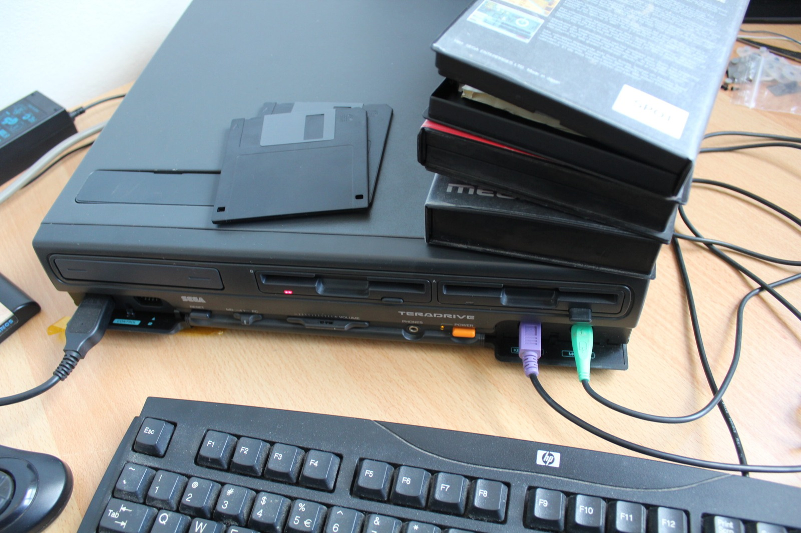

Another little piece of TeraDrive preservation today. I've dumped the machine's PC BIOS using DOS DEBUG.COM and uploaded the result to the [File Server](/goodies/). If anyone feels like pulling this dump apart and finding something interesting, please do!

On early PC-compatible systems, DEBUG can be used to copy BIOS code that's mapped into the processor's real-mode address space. The exact procedure depends on the size and layout of the BIOS, so it isn't one universal command sequence that will work on every PC.

### A TeraDrive with 6.5 MB RAM

While looking for more information I also came across a Japanese TeraDrive Model 2 owner with a particularly interesting configuration. Their machine reports:

> MEM : 6.5MB [2.5MB(SIMM)+4MB(ISA)]

The additional 4 MB came from an I-O DATA PIO-AX34F memory card installed in an ISA slot. They were also using QRAM, a memory manager designed to provide useful memory-management features on 286-class systems.

Now **that** has my attention. I have an ISA RAM card at work, so naturally I want to find out whether the TeraDrive can make any use of it. Extra RAM would be particularly useful in the Model 2 because the machine has no factory hard drive.

It also makes me wonder whether some of that extra memory could be turned into another RAM disk, similar to my earlier Windows experiments. The ISA card itself is only memory, of course. It doesn't magically become a bootable disk, so I'd need suitable RAM-disk software or another memory-management arrangement to make that happen. Another TeraDrive experiment for the list!

### Sources

- [Luckyboy: TeraDrive Configuration (6.5 MB, PIO-AX34F ISA RAM)](http://www.tvt.ne.jp/~luckyboy/room.html)
- [MESS Wiki Archive: Dump BIOS Using DOS DEBUG](https://web.archive.org/web/20160306064823/https://www.mess.org/dumping/dump_bios_using_debug)

### Related Posts

- [Sega TeraDrive Model 2 with Windows 3.11 in a RAM Disk](/sega-teradrive-model-2-with-windows-311-in-a-ram-disk/)
