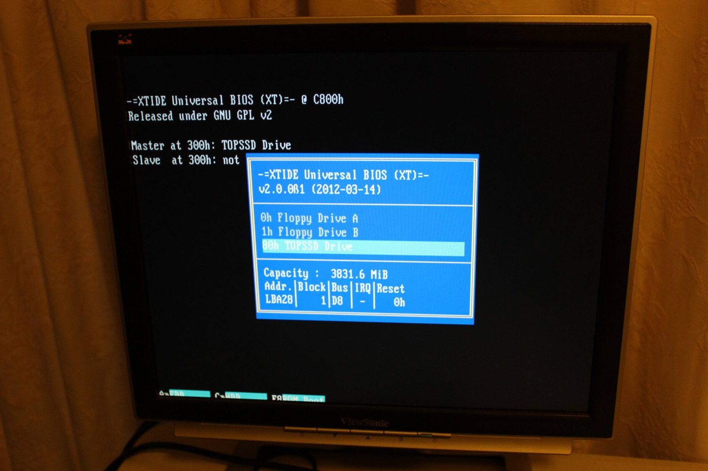
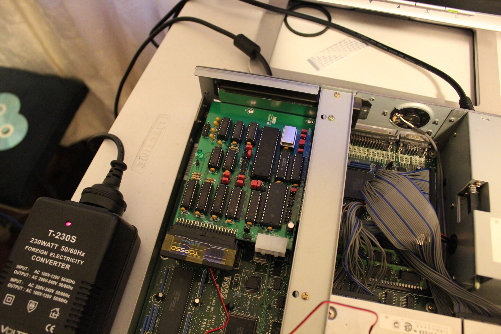
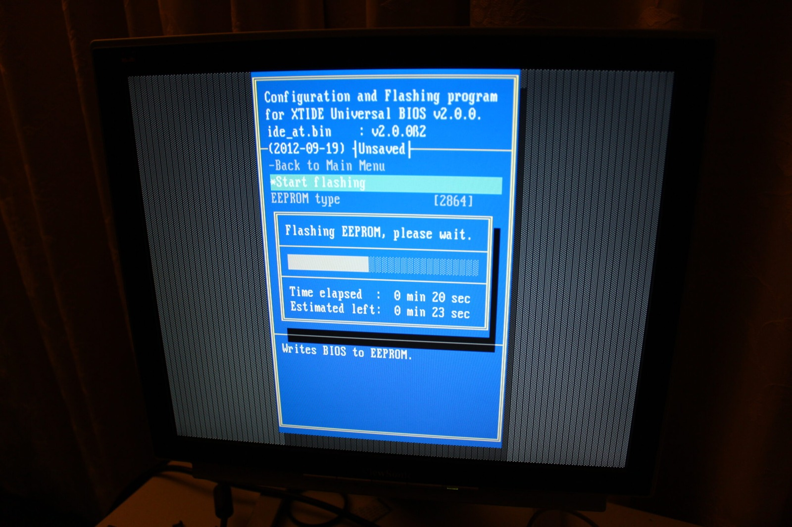



Here's a quick demonstration of the Sega TeraDrive Model 2 running from an XTIDE card and a 4 GB Disk on Module. After all the other videos I've made on this subject, I thought I'd record something a little shorter so you don't have to sit through eight hours of me discovering the same thing the slow way. I might even manage to keep it under two minutes!

Starting from a cold boot, the TeraDrive goes through its usual checks and presents the familiar DOS-in-ROM screen. I haven't worked out how to bypass that part yet, so I exit to DOS and let the XTIDE Universal BIOS take over. From there I can choose a floppy drive or the Disk on Module as the boot device. Naturally, I'll be choosing the module, because I've had quite enough of booting everything from floppy disks.

*The Model 2 can finally choose the TopSSD module from XTIDE's boot menu. Much more civilised than juggling floppies!*
{: .media-caption }

Above is XTIDE Universal BIOS 2.0.0 Beta 1 running the XT build and giving me the boot menu on the Model 2. The machine still has its 2.5 MB of RAM, but at least the storage situation is looking considerably more civilised.

*Here's the XTIDE card and TopSSD module fitted inside the Model 2. Lovely when the hardware finally plays nicely together.*
{: .media-caption }

Here's the XTIDE card itself, complete with its TopSSD Disk on Module. This is a revision-two card, with the appropriate jumper set to power the module, and there's an Atmel EEPROM holding the BIOS. There are plenty of variations on the basic XTIDE idea, with different board sizes, connectors and quantities of blinking LEDs. This particular arrangement works, which is presently my favourite feature.

*A separate XTIDECFG session flashing the EEPROM with the Beta 2 build. Not the same version as the earlier boot menu!*
{: .media-caption }

Finally, here's XTIDECFG programming the onboard EEPROM. The screen shows `ide_at.bin`, version 2.0.0 Beta 2, dated 19 September 2012. This is separate from the Beta 1 boot-menu screenshot above, so don't mistake the two versions for a single screen.

**Update:** One important detail I didn't know at the time is that XTIDE Universal BIOS 2.0.0 Beta 2 changed the logical CHS behaviour used by Beta 1 and older releases. Upgrading an already-partitioned drive can change the geometry DOS sees and risk data corruption. The later project documentation calls for recreating and formatting the affected partitions after upgrading.

So there we go, a TeraDrive Model 2 booting from modern storage without relying on a pile of floppy disks. One of my quickest demonstrations yet! Or it would have been if I hadn't carried on talking until after the two-minute mark.

### Sources

- [XTIDE Universal BIOS Documentation (Beta 1/Beta 2 Logical CHS Warning)](https://www.xtideuniversalbios.org/)

### Related Posts

- [XTIDE Settings for the Sega TeraDrive](/xtide-settings-for-the-sega-teradrive/)
- [Sega TeraDrive Model 2 XTIDE Boot Success](/sega-teradrive-model-2-xtide-boot-success/)
