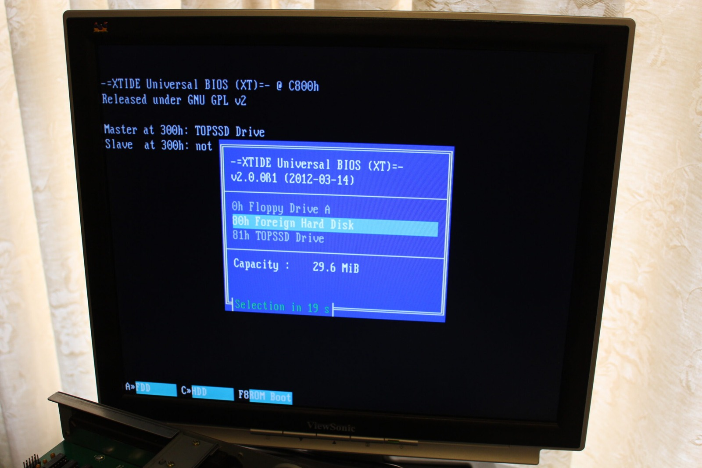
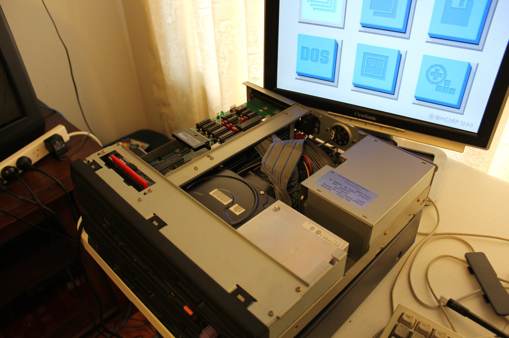



With the XTIDE card working nicely in my Sega TeraDrive Model 2, I figured it was time to give the Model 3 a go as well. I'd copied the BIOS configuration across to my second XTIDE card, so perhaps I shouldn't have been surprised when it started working. Still, I wasn't sure how the machine would behave with its original hard drive connected at the same time.

The Model 3 has a rather unusual internal hard-drive arrangement, with a proprietary 44-pin power-and-data connector. This particular machine still has its original-style IBM hard drive installed, so I've left that connected and added the XTIDE card alongside it. Both the old drive and the Disk on Module appear in the boot menu, which is a rather welcome sight.

I started by booting from the XTIDE storage, and everything came up as expected. Then I restarted the machine and selected the original 30 MB hard drive to make sure that still worked as well. Much to my delight, it booted too! Windows is present on both storage setups, so I can now switch between them without pulling the whole machine apart.

*The Model 3's menu can see both its original 30 MB hard disk and the TopSSD. That's exactly what I was hoping for!*
{: .media-caption }

That means both my Model 2 and Model 3 TeraDrives can use XTIDE storage. The Model 3 originally shipped with a 30 MB hard drive, while the Model 2 had no internal hard disk at all. Being able to use modern ATA storage makes life considerably easier, particularly when the original proprietary drives are becoming increasingly difficult to find.

I've personally confirmed IBM WDL-330P drives working in the TeraDrive. WDL-330PS drives have also been reported in surviving machines, although I haven't confirmed that particular variation firsthand.

*Both storage options fitted, and the TeraDrive sitting open while I test them. Fingers crossed it stays this cooperative!*
{: .media-caption }

Fresh date and time batteries, modern storage options and both TeraDrives booting properly. The Model 3 behaved like a gentleman and a scholar throughout the experiment, which is more than I can say for some of the hardware I've worked on recently. Hopefully nothing else will go wrong! Fingers crossed! :D

### Sources

- [Sega Hardware Archive: TeraDrive (Model 3, 30 MB HDD)](https://www.sega.jp/fb/segahard/md/tera.html)
- [IBM Files: PS/2 Model 25 (Direct-Bus HDD Interface)](https://www.ibmfiles.com/pages/ps2model25.htm)

### Related Posts

- [Sega TeraDrive Hard Drive Interface Investigation](/sega-teradrive-hard-drive-interface-investigation/)
- [Sega TeraDrive Model 3 Hard Drive Replacement](/sega-teradrive-model-3-hard-drive-replacement/)
