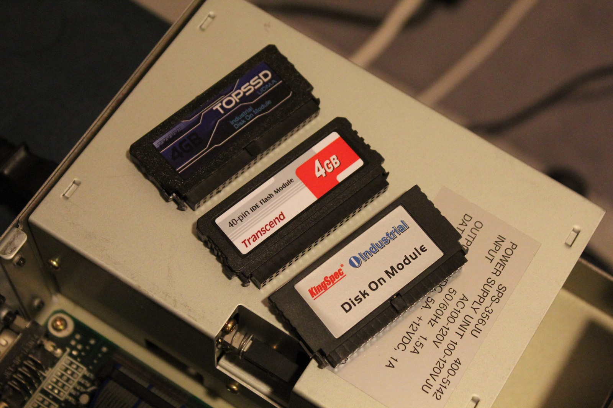
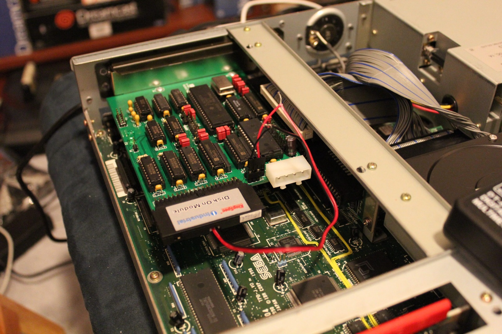
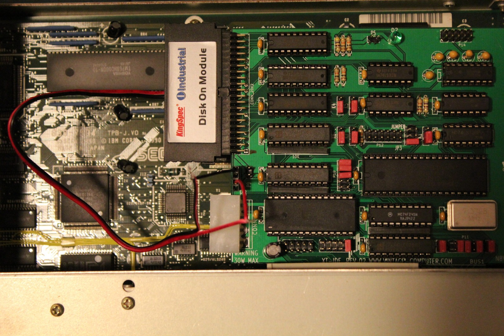

So many types of Disk on Module, so little time! I've been trying to find a suitable solid-state storage solution for my Sega TeraDrive, and what sounded like a fairly simple exercise has turned into another adventure in hardware compatibility.

While digging through the XTIDE Universal BIOS documentation, I found [this warning in the v2.0.0 manual](https://www.xtideuniversalbios.org/browser/xtideuniversalbios/wiki/Manual_v2_0_0.wiki?rev=329#Problems_with_Compact_Flash_cards_and_microdrives):

> Some CF cards and microdrives do not work properly with IBM 5150/5160 when using XTIDE rev 1 or rev 2. Some of the symptoms are improperly displayed drive name on boot menu or the drive appears to work on some occasions and sometimes not. This is a hardware related problem and cannot be fixed by software.

I've now tried three different brands or types of Disk on Module in the TeraDrive. What I'm looking for is a unit that can draw its 5 V power through IDE pin 20, preferably with around 2 GB of storage. That's plenty of room for a 286-class machine, and 2 GB is also the usual maximum size for a single FAT16 partition under the MS-DOS versions I've been using.

Here's how the three units behaved with XTIDE in my particular setup:

| DOM tested | 5 V from pin 20 | Recognised with XTIDE |
|---|---|---|
| Transcend 4 GB | Yes | No |
| KingSpec 2 GB | No | Yes |
| TopSSD 4 GB | Yes | Yes |

The TopSSD is the most frustrating result of the lot. It has the pin 20 power arrangement I want and the TeraDrive recognises it, but I can't seem to find another one for sale anywhere.

I had high hopes for the Transcend. It receives power through the correct pin, but XTIDE doesn't recognise it properly in this machine. Meanwhile, the KingSpec is recognised, but doesn't give me the pin 20 power arrangement I was after. Apparently asking for both features in the same device is being unreasonable.

It's worth keeping the XTIDE manual's warning in context. That passage specifically discusses CompactFlash cards and Microdrives, so it doesn't prove why this Transcend DOM isn't being detected correctly. All I can establish from these tests is that the Transcend receives power but isn't recognised in my setup, while the other two devices each demonstrate a different combination of compatibility and power requirements.

So I've managed to find three different ways for this little project to be troublesome. There can't possibly be a fourth, right? RIGHT?!?!?! :D

### Sources

- [XTIDE Universal BIOS - Documentation and known storage compatibility issues](https://xtideuniversalbios.org/)
- [XTIDE Universal BIOS v2.0.0 Manual](https://www.xtideuniversalbios.org/browser/xtideuniversalbios/wiki/Manual_v2_0_0.wiki?rev=329)
