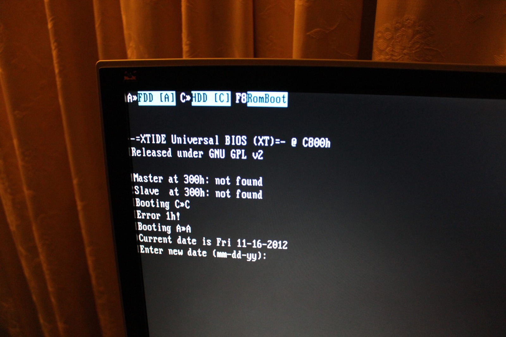
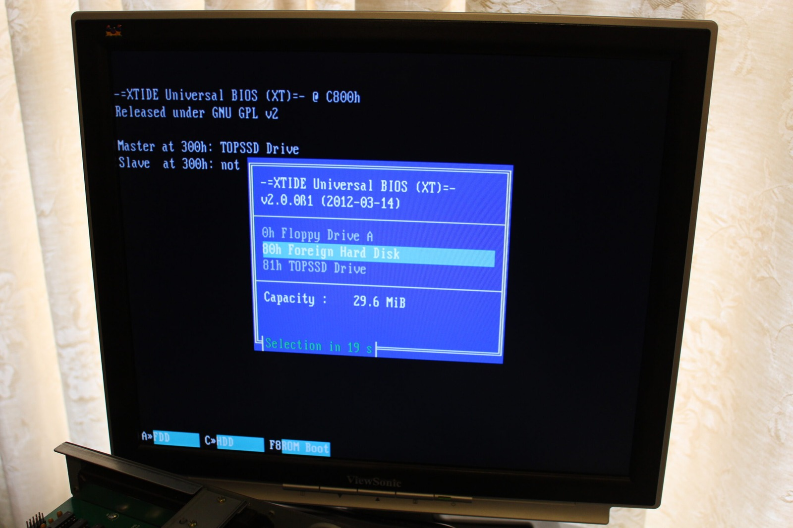
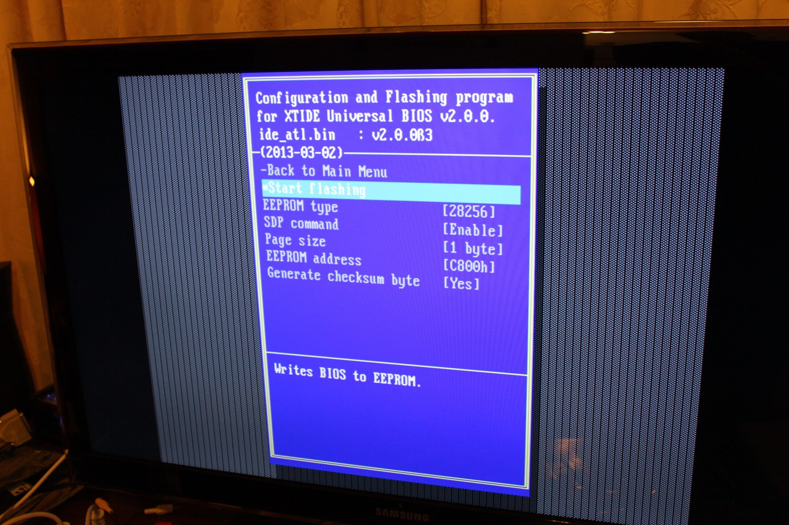

*This is not how I wanted the XTIDE experiment to go. No drives found, an error, and straight back to the DOS date prompt!*
{: .media-caption }

Time for a little more room in the XTIDE BIOS department. Both of my cards currently use Atmel AT28C64B EEPROMs. The AT28C64B stores 64 Kbit as 8K x 8, which gives me 8 KiB of ROM space. I'm replacing them with AT28C256 devices, which provide 32 KiB.

*The earlier XTIDE boot menu, with both the original hard drive and TopSSD available. A useful reference while changing EEPROMs.*
{: .media-caption }

Why the upgrade? Partly because I discovered that the XTIDE BIOS image I had been using was not as stock-standard as I had assumed, and partly because the larger EEPROM gives me considerably more breathing room for different builds and configuration options.

Thanks to Krille on the [Vintage Computer Forums](https://forum.vcfed.org/index.php?threads/sega-teradrive-286-with-xt-ide-v2-card.36040/) for the help on getting it to work. And there I was thinking I was doing something wrong! The problem was traced to the particular XTIDE BIOS build I was using, and Krille supplied a compiled r505 build that got me moving again.

*The larger 28256 EEPROM is selected in XTIDECFG. Finally, more room for the XTIDE BIOS experiments!*
{: .media-caption }

At the moment I am using `IDE_XTP.bin`. It works, but I would really like the boot-menu overlay back. Presentation is important, even when your storage controller lives inside a Sega 286 from 1991.

The XTIDE configuration also needs to match the actual EEPROM hardware. With the larger chip installed, the EEPROM type is configured as `28256`.

So the physical upgrade is straightforward:

| EEPROM | Capacity |
| --- | --- |
| AT28C64B | 8 KiB |
| AT28C256 | 32 KiB |

Four times the space for future experiments.

### Sources

- [Microchip: AT28C64B EEPROM (64 Kbit, 8K x 8, 8 KiB)](https://www.microchip.com/en-us/product/AT28C64B)
- [Microchip: AT28C256 EEPROM (256 Kbit, 32K x 8, 32 KiB)](https://www.microchip.com/en-us/product/AT28C256)
