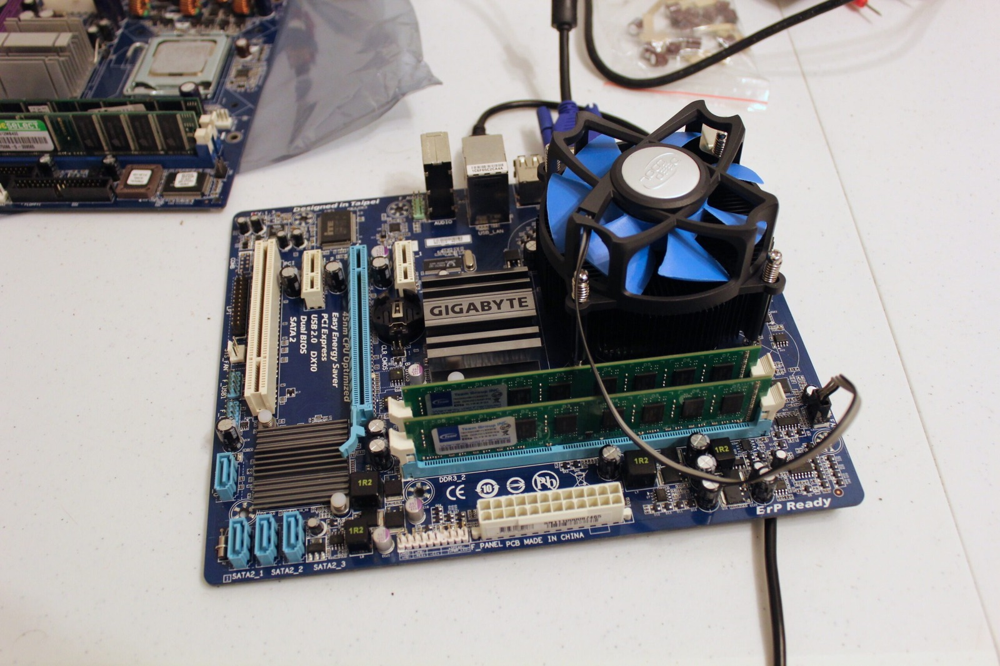
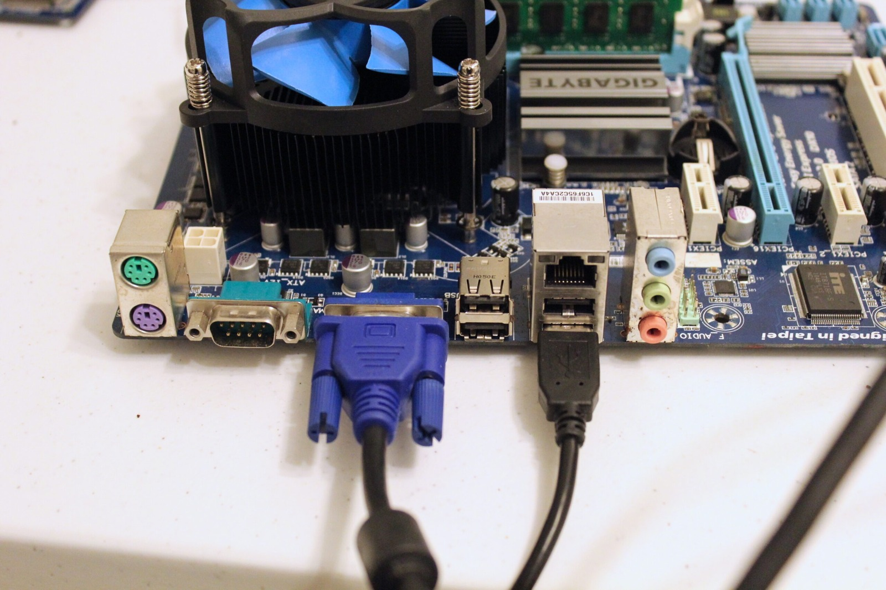

There's nothing more exciting than finding electronic rubbish on the side of the road. This morning, while leaving for work, I spotted a PC sitting out the front of my home. It had been raining overnight and the machine looked rather wet, but something caught my attention: two DVI ports occupying the space above two expansion slots. A double-width video card!

Unfortunately, I was already running late for work and couldn't stop to investigate. I had to leave the poor thing sitting there, wondering whether it would still be waiting when I got home.

Amazingly, it was. I grabbed the machine, brought it inside and dumped it in the bathroom before starting to pull it apart. The power supply contained a delightful collection of cockroaches, and then a lizard fell out and ran away. Apparently I'd rescued an entire ecosystem rather than a computer.

The power supply went straight out. Between the overnight rain and the rather enthusiastic wildlife population, I had no intention of plugging that thing into the mains. Any electrical inspection or testing would need to be done properly, and I wasn't going to risk it merely to find out whether a free PC still worked.

Judging by the components, much of the machine appears to date from somewhere around the late 2000s to early 2010s. I'm not going to pretend I can pin down the exact year from the surviving hardware, but there's still some interesting equipment in here.

Here's what I found:

- **Motherboard:** Gigabyte GA-G41MT-S2P
- **Processor:** Intel Core 2 Quad Q8400, 2.66 GHz, 4 MB L2 cache, 1333 MHz FSB
- **Graphics:** Gigabyte GV-R577UD-1GD Radeon HD 5770, 1 GB GDDR5
- **Memory:** 2 x 2 GB DDR3-1333 RAM

Unfortunately, there was no hard drive and the optical drive was badly corroded. The processor cooler uses those familiar Intel push-pin clips, which I've never particularly enjoyed wrestling with. They're one of those designs that seem easy enough until you're trying to convince all four pins to stay where they're supposed to.

Still, for a computer retrieved from the side of the road after spending a wet night outdoors, there's a surprising amount of potentially useful hardware. Even if the whole machine doesn't end up being salvageable, the components are worth a closer look. Not a bad deal for the price of free! ;)

### Sources

- [GIGABYTE: GA-G41MT-S2P Rev. 1.3 Specifications (G41, DDR3)](https://www.gigabyte.com/Motherboard/GA-G41MT-S2P-rev-13/sp)
- [Intel: Core 2 Extreme / Core 2 Quad Specification Update (Q8400)](https://www.intel.com/content/dam/www/public/us/en/documents/specification-updates/core-2-extreme-quad-45nm-process-spec-update.pdf)
- [GIGABYTE: GV-R577UD-1GD (Radeon HD 5770) Specifications](https://www.gigabyte.com/Graphics-Card/GV-R577UD-1GD/sp)
