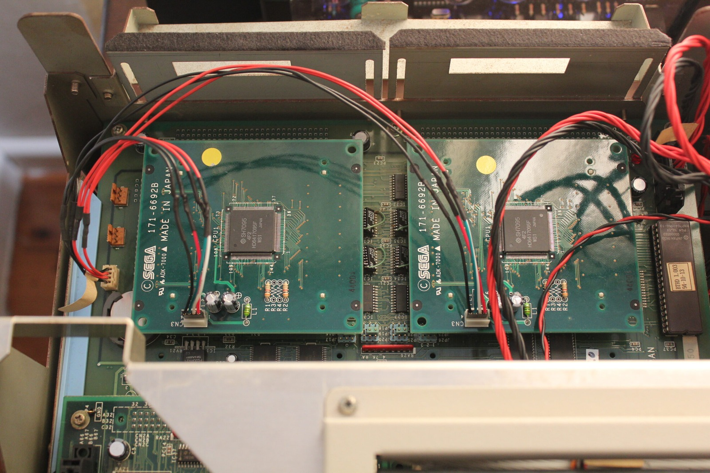



You heard correctly. These are 171-6692B SH-2 CPU boards, not the better-documented 171-6692D boards. Thanks to the generosity of an unnamed member from the forums, I've now got two of these lovely little things to experiment with. Fingers crossed they might help get my Sega Saturn Sophia Programming Box up and running again!

Both boards arrived safely and appear to be identical. They've got the SH7095 SH-2 processors I was looking for, although the part number isn't quite what I expected. I needed the 171-6692D version, but what I've received is the 171-6692B. B for Bob, not D for Dob! Close enough to be interesting.

There are some obvious differences between the two board revisions. Most noticeably, the B versions don't have the extra power connector header or the two jumper blocks visible on the better-documented D boards. There are also differences in the printed markings and their positions, although the overall layout looks remarkably similar.

I've been spending a fair bit of time looking through the Sophia programming-box manuals, which is becoming something of a hobby in itself. The documentation helped me work through the jumper and DIP-switch settings, but it didn't tell me everything I needed to know about these particular B boards. I was hoping the missing jumpers wouldn't be a major problem.

The power connector was another interesting complication. On the B board, the space where the header would normally sit is still visible, and there appear to be traces leading towards the same general area. I thought I might be able to rig up an adapter if the connections turned out to be compatible, although I hadn't measured the voltage at that point. Five volts was only a guess, and I'd rather not find out the hard way that it was wrong!

There were other little markings to compare too, including 44001, which appeared on both of the boards I'd received. None of that told me exactly where they had come from, but I was beginning to build up a picture of how these revisions differed.

Of course, there's still the possibility that the problem isn't with the CPU cards at all. I've had enough adventures with this Sophia to know there are plenty of other boards that could be causing trouble, including the mainboard and A-Bus board. Even if these SH-2 cards are perfectly good, something else in the box could still prevent it from starting.

I also came across some interesting variations of Saturn development hardware while searching around the internet and ASSEMbler Games. Some of the SH-2 boards appeared to have sections of the PCB cut down, and the identifying stickers weren't always the same colour. Quite why Sega made so many variations is anybody's guess, but it's fascinating looking at all these unusual pieces of hardware.

I was also wondering whether these B boards might have come from ST-V equipment or another development configuration. I hadn't found enough information to establish that, though. The important thing was that I'd finally obtained two more SH-2 boards, and they looked close enough to the Sophia versions to make further investigation worthwhile.

Initial testing wasn't particularly successful, although there were still unresolved faults elsewhere in my Sophia at the time. Sega's surviving Saturn development documentation identifies the 171-6692D as an SH-2 CPU board for the Programming Target Box, but doesn't explain precisely how the B and D revisions relate electrically. That's another mystery to investigate before I start connecting everything together.

I suppose if I got the wiring completely wrong, I could always say I'd owned a Sophia that caught fire. That would certainly give me something to show for the experiment! Preferably, though, I'd rather get this enormous collection of circuit boards doing something useful again.

These really are beautiful little boards, and I'm very grateful to the person who sent them over. With any luck they'll get me another step closer to bringing Sophia back to life. Time to see what I can make of them!

**Sources**

- [Sega DTS Archive: ST-4001 Saturn Programming Target Box (171-6692D SH-2)](http://docs.exodusemulator.com/Archives/SegaDTSMirror/hardware/core/PBOX.HTM)

**Related Posts**

- [Sega Saturn Sophia Programming Box Mainboard Repairs](/sega-saturn-sophia-programming-box-mainboard-repairs/)
- [Sophia Systems Sega Saturn Programming Box: Capacitor Restoration Complete](/sophia-systems-sega-saturn-programming-box-capacitor-restoration-complete/)
- [Sega Sophia Target Box PAL Switch Settings and Hardware Notes](/sega-sophia-target-box-pal-switch-settings-and-hardware-notes/)
