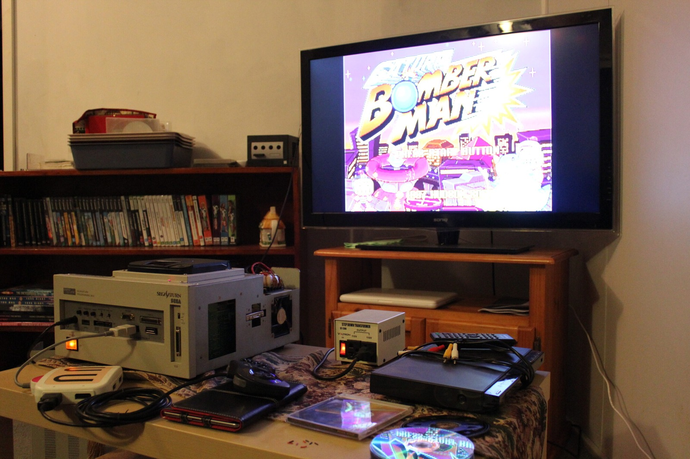
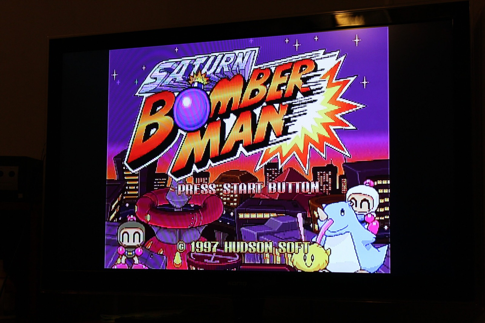
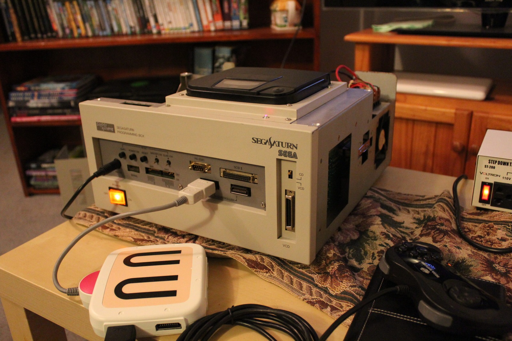
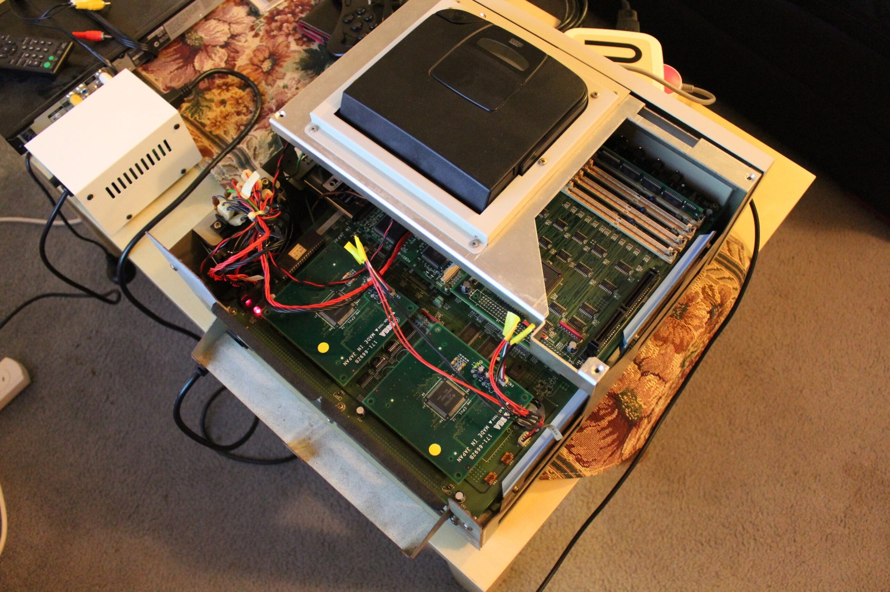
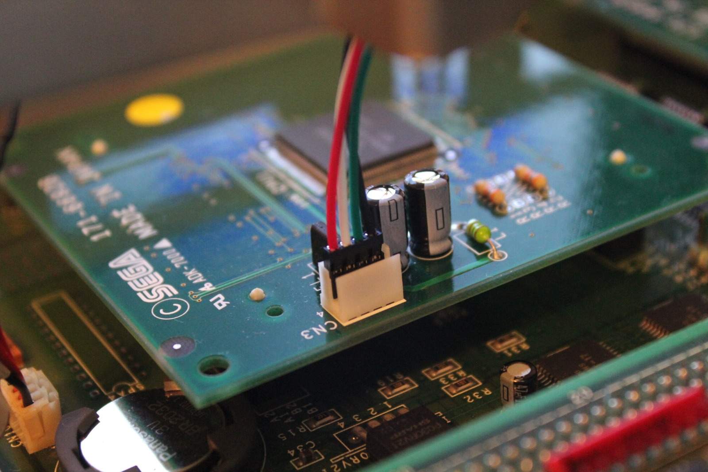
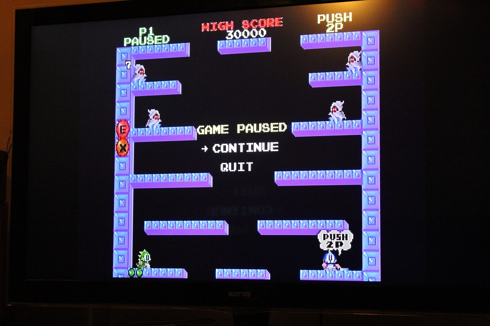



The final backordered capacitors are installed and Sophia is reassembled. The capacitor restoration was completed on 28th April 2013, after a rather long battle with ageing components, leaking electrolytics and the occasional shortage of replacement parts. It's nice to finally reach this point!

The earlier A-Bus recap had not noticeably changed the fault. Replacing the mainboard capacitors was the breakthrough, and completing the remaining capacitor work has now brought that phase of the restoration to an end. One capacitor in particular had leaked badly enough to leave visible residue on the board. Lovely stuff!

*A sight worth waiting for: Sophia hooked up to the television with Saturn Bomberman on screen!*
{: .media-caption }

There were capacitors scattered across just about everything. The mainboard, A-Bus board, SH-1 board, CD/VCD connector board and the two SH-2 CPU boards all received attention. Even the tiny capacitor on the CD/VCD board joined in the fun. I thought I'd never see the end of them.

*Saturn Bomberman on the big screen. After all the capacitor headaches, that logo looks especially lovely!*
{: .media-caption }

The mainboard was particularly enjoyable because I needed nineteen 220 uF capacitors and only sixteen were available initially. That meant splitting the work into two sessions while waiting for more to arrive. There were also 330 uF capacitors, smaller 1 uF replacements and various other values. Apparently Sophia wanted a little bit of everything.

*Sophia reassembled enough for testing, with the power light glowing and a controller ready to go.*
{: .media-caption }

With the boards finally recapped, it was time to put everything back together. The mainboard went in first, followed by the power supply, the CD/VCD board, SH-1 board, A-Bus board and the SH-2 cards. I've left the power supply recap for another occasion, as I'm considerably happier working with the lower-voltage parts of this beast.

*One last look at the packed interior. Two SH-2 cards, the CD drive and more wires than I care to count!*
{: .media-caption }

The optical drive needed attention too. I'd replaced the laser and noticed that the disc spindle was sitting a little higher than expected, which may have contributed to the earlier disc-spinning problems. Once everything was connected, we finally had video again. Setting the unit to NTSC mode also turned out to be rather important.

*Even the smaller boards have their own little capacitors. Sophia certainly kept the soldering iron busy!*
{: .media-caption }

Then came the moment I'd been waiting for: Bomberman! The machine reached the licence screen and ran the game from a burned disc. That's one of the lovely things about these development units. There's no need to install a modchip just to use a recordable disc.

And after all that work, what better way to celebrate restoring a Sega Saturn development system than playing a game? Not a particularly sophisticated use of all that processing power, but I wasn't complaining. It was wonderful seeing the machine running again.

*And now for the important test: Saturn Bomberman running on Sophia, paused just long enough for a photograph!*
{: .media-caption }

Isn't she lovely? More photos are in the [Photo Gallery](/goodies). Here's to another 20 years!

**Related Posts**

- [Sega Saturn Sophia A-Bus Capacitor Replacement](/sega-saturn-sophia-a-bus-capacitor-replacement/)
- [Sega Saturn Sophia Programming Box Mainboard Repairs](/sega-saturn-sophia-programming-box-mainboard-repairs/)
- [Sega Saturn Sophia 171-6692B SH-2 Power Cable Adapter](/sega-saturn-sophia-171-6692b-sh-2-power-cable-adapter/)
