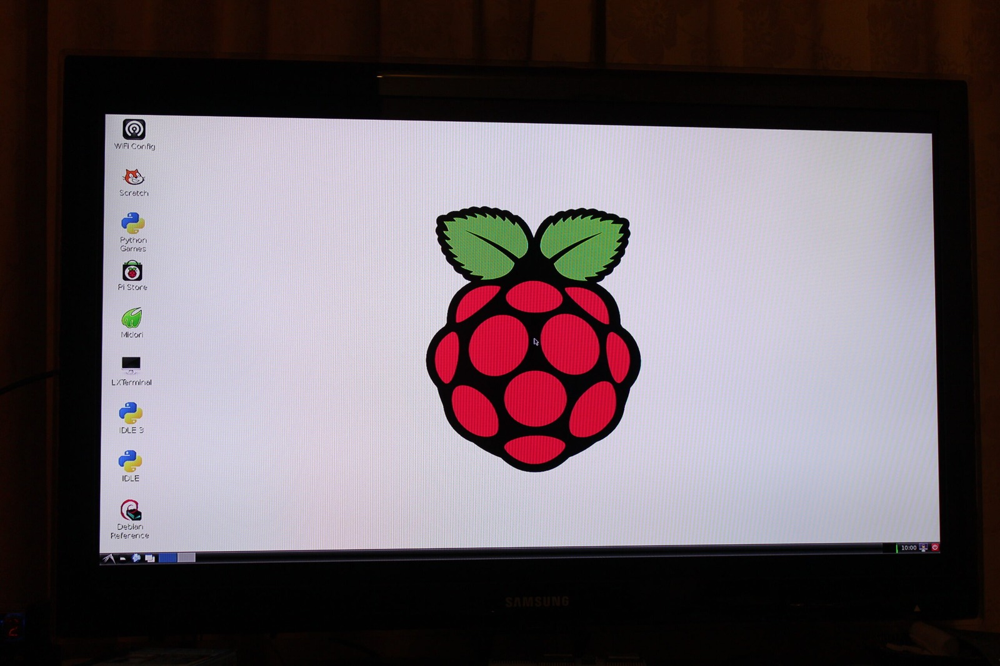



I've got a Raspberry Pi on the bench, and I'm wondering just how much work I can persuade this little Linux computer to do. It's small, quiet and hardly overflowing with processing power, which naturally makes me want to give it rather more jobs than it probably asked for.

I'm starting with BerryBoot and Raspbian Wheezy. BerryBoot provides the boot-selection and operating-system installation environment, starting from the SD card, while Raspbian Wheezy gives me a Debian-based system adapted for the Pi. The idea is to see whether I can eventually run the system from USB storage, rather than relying on the SD card for everything.

There are four jobs on my list: an FTP server, something to seed torrents, remote access so I can check what the Pi is doing, and that USB storage arrangement. The Pi doesn't simply boot from USB out of the box in this setup, which is one reason I'm giving BerryBoot a go. None of those server jobs is finished yet, but at least I've got a plan!

Naturally, I sat down to configure the thing with a mouse and no keyboard, because I couldn't find one. That went about as far as you'd expect. After tracking down a Dell keyboard and choosing my setup options, I did get Raspbian booted to the desktop, so the first part is working. FTP, remote access and the rest can come next.

The real end goal is a little more McRetro-specific: I want this machine to become the [File Server](/goodies/) for material that needs preserving for future generations. I'm also aiming for a static network address that's easy to remember, rather than having to hunt for the Pi whenever I want to connect to it.

*Raspbian Wheezy has made it to the desktop. Now to persuade the little Pi to become a useful file server!*
{: .media-caption }

Whether the Raspberry Pi is actually going to enjoy that job remains to be seen. But it is small, cheap, quiet and considerably more power efficient than leaving some old desktop running around the clock. Time to see how far an ARM board and unreasonable optimism can take us.

### Sources

- [Raspberry Pi: Raspbian Wheezy SD Card Image Announcement (30 October 2012)](https://www.raspberrypi.com/news/new-sd-card-image/)
- [BerryBoot: Raspberry Pi Multiboot Installer and Storage Documentation](https://www.berryterminal.com/doku.php/berryboot)
