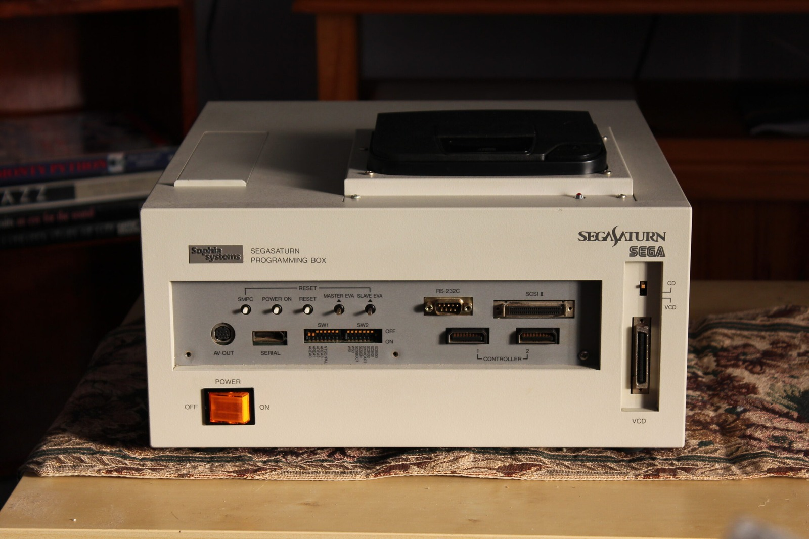
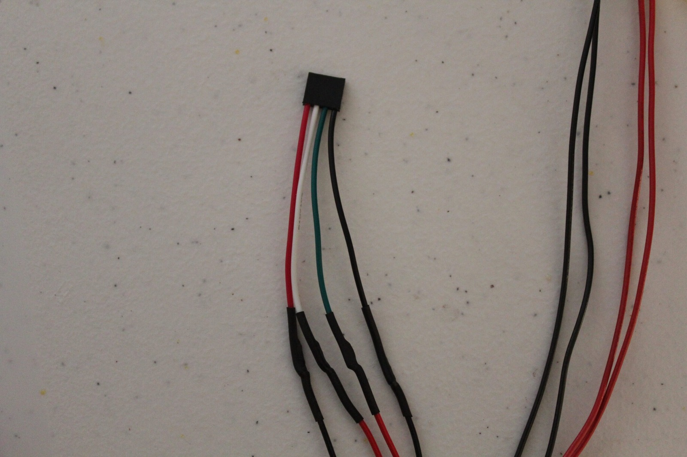
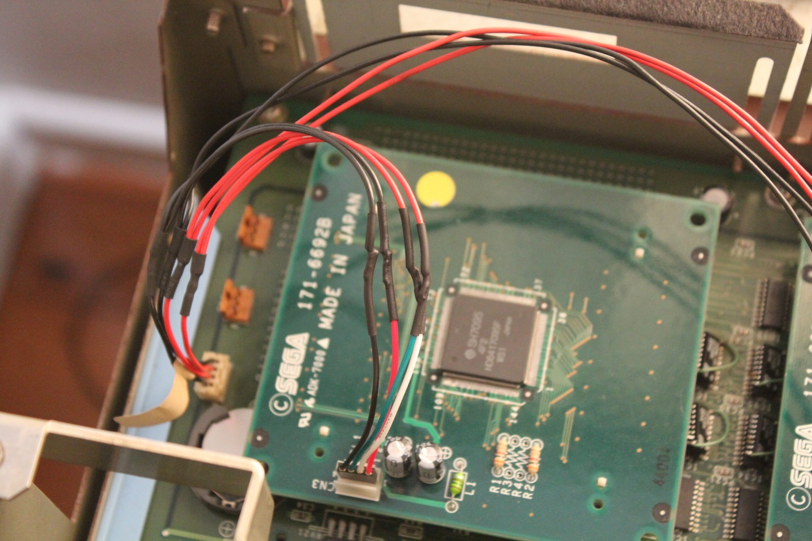
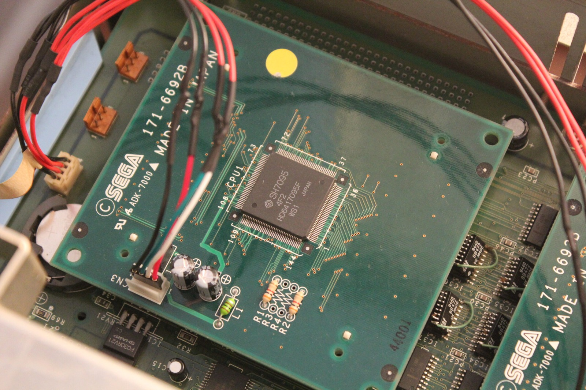

*Sophia looking respectable again from the front. The unusual SH-2 power wiring is hidden inside the box.*
{: .media-caption }

Any other console, I probably wouldn't bother mentioning this, but since it is Sophia, she gets a mention. My 171-6692B SH-2 CPU cards are not quite the same as the better-documented 171-6692D boards. Most importantly for this particular problem, they are missing the second power header used by the usual Sophia Programming Box arrangement.

The 171-6692B boards do have another header available, but its pin pitch is 2.0 mm rather than the 2.54 mm pitch commonly found on PC-style connectors. So I made a short adapter cable to connect the Sophia's power lead to the available headers on these CPU boards. A little heatshrink around my fantastic solder job and she works a charm.

*Here's my little four-wire adapter. The heatshrink is doing its best to make those solder joints look respectable!*
{: .media-caption }

*The improvised power wiring attached to one of the 171-6692B SH-2 cards. Not factory-fresh, but it fits the available header.*
{: .media-caption }

Visually, the differences between the 171-6692B and 171-6692D are easy to spot. The B revision lacks the second power header and the two jumper blocks normally seen beside the processors on the D revision.

*A clearer look at the SH7095 and CN3 connector on the 171-6692B card. The adapter is tucked in beside the chip.*
{: .media-caption }

More Sophia devkit photos can be found in the [Photo Gallery](/goodies).

### Related Posts

- [Sega Saturn Sophia SH-2 CPU Cards: 171-6692B vs 171-6692D](/sega-saturn-sophia-sh-2-cpu-cards-171-6692b-vs-171-6692d/)
- [Sega Sophia Target Box PAL Switch Settings and Hardware Notes](/sega-sophia-target-box-pal-switch-settings-and-hardware-notes/)
