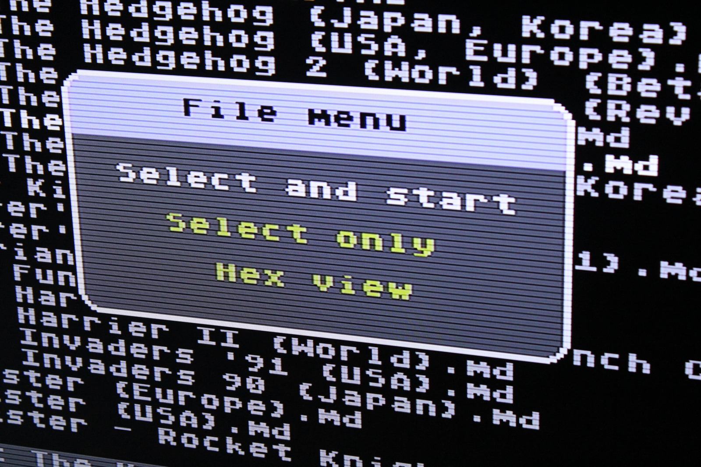
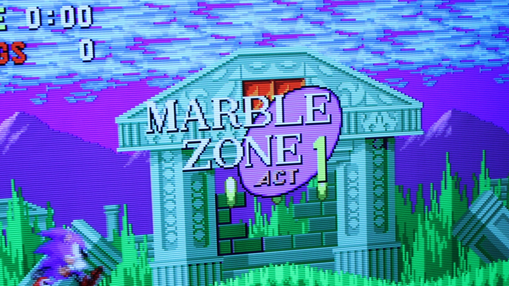

*This is the sort of crisp retro picture I was getting through the Framemeister. It's a shame the remote's Japanese labels weren't as easy to understand!*
{: .media-caption }

These photos show the great work the XRGB-mini Framemeister can do. Lovely picture, but there was still one small problem: the remote. My Japanese is rather limited, so figuring out what all those buttons did involved a fair amount of guesswork.

Fortunately, a very kind member of the System11 forums came to the rescue. I now have a marvellous looking vinyl decal overlay with the buttons labelled, so I don't have to keep guessing every time I want to change a setting.

*A little Sonic on the screen to show off the Framemeister's picture. Marble Zone is looking rather lovely!*
{: .media-caption }

Much better! At least now the remote makes a bit more sense, and I can get on with actually using the Framemeister. There's more information over at [ASSEMblergames.com](https://web.archive.org/web/20190806060722/https://assemblergames.com/threads/フレームマイスター-framemister-xrgb-mini-english-firmware-39000-yen-shipped.44220/).
