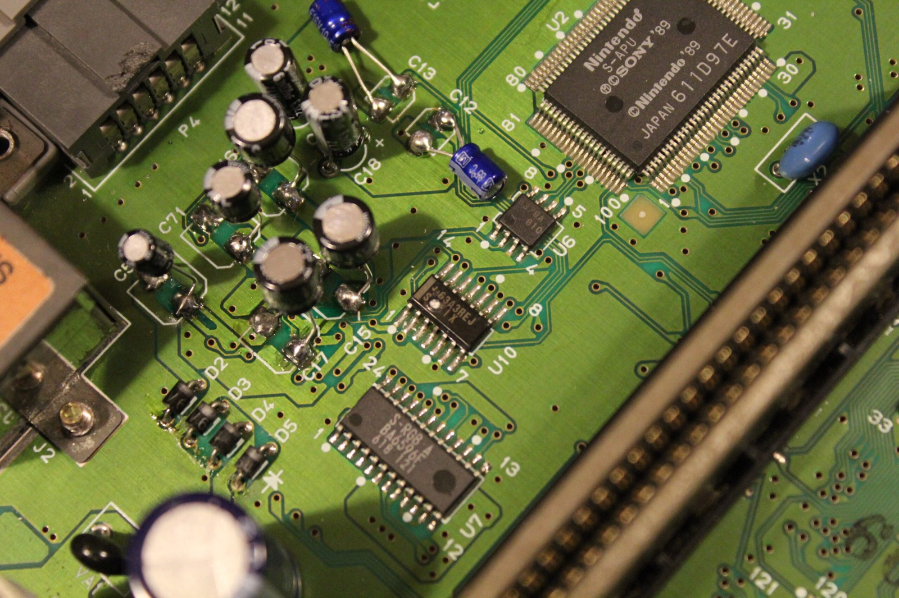

As you can see, there's a hole blown straight through the S-MIX chip at U10. That's probably not what you want to find on a Super Nintendo with no sound! I'm going to have a closer look at the circuitry and see whether there's a way to get this board making some noise again.

I originally labelled this board SNSP-CPU-02, but in my 2016 follow-up I identified the photographed board as SNSP-CPU-1CHIP-02. You can also see the S-APU at U2 in the photograph, which helps distinguish it from the older board arrangement.

I've been looking at the LM324 quad operational amplifier as a possible substitute for the damaged S-MIX. Here is the LM324 pinout I've been using for comparison:

```
     +---+--+---+
1OUT |1  +--+ 14| 4OUT
-1In |2       13| -4In
+1In |3       12| +4In
VCC  |4       11| VEE
+2In |5       10| +3In
-2In |6        9| -3In
2OUT |7        8| 3OUT
     +----------+

```

Both the S-MIX and the amplifier used on some earlier boards occupy U10, which got me wondering whether they might be electrically similar. Earlier PAL SNSP-CPU-02 boards used a quad op-amp there, while this later board has S-MIX. Of course, finding two chips in the same position doesn't mean their pins do the same thing!

My plan was to compare the outputs from a working S-MIX against a known-working LM324 and see whether a substitution might be possible. Was S-MIX simply a differently packaged or customised version of something familiar, or did Nintendo change rather more under the hood? Time will tell. Sooner or later, time will tell.

**EDIT:** Turns out it doesn't work! My LM324 substitution attempt failed, so that idea went out the window. I did manage to bypass the original audio mixing circuit and get some sound out of the console, which was a much nicer result than silence.

The bypass isn't the same as repairing the original mixing circuit, of course. I also wondered whether driving the output that way might put extra strain on the preceding audio circuitry, although I hadn't established that. Still, what are you going to do, game in silence? Unacceptable! ;)

I came back to the same problem in [S-MIX on the SNES SNSP-CPU-1CHIP-01 / SNSP-CPU-1CHIP-02](/s-mix-on-the-snes-snsp-cpu-1chip-01-snsp-cpu-1chip-02/).

### Related posts

- [Super Nintendo Serial UP17388130 - No Sound Update](/super-nintendo-serial-up17388130-no-sound-update/)

### Sources

- [Console5 Wiki - Quad Op Amp](https://console5.com/wiki/OpAmp_-_Quad)
- [Console5 Wiki - SNES](https://console5.com/wiki/SNES)
- [Texas Instruments - LM324 Quadruple Operational Amplifiers datasheet](https://www.ti.com/lit/ds/symlink/lm324.pdf)
