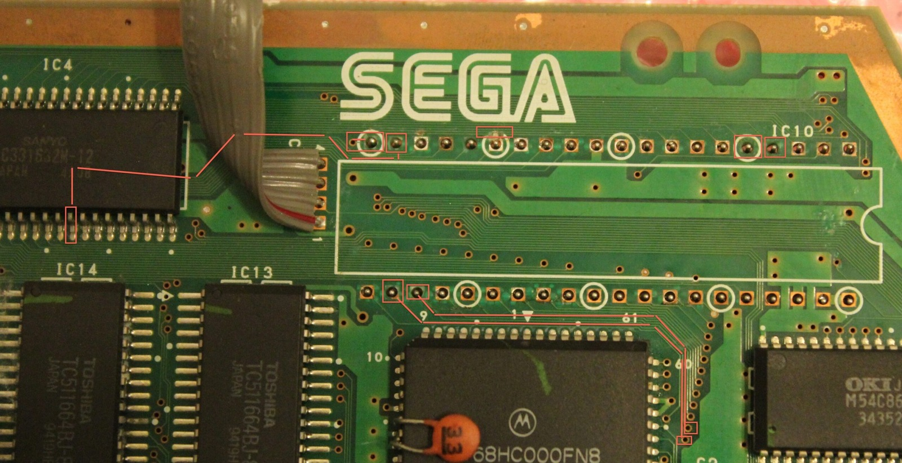
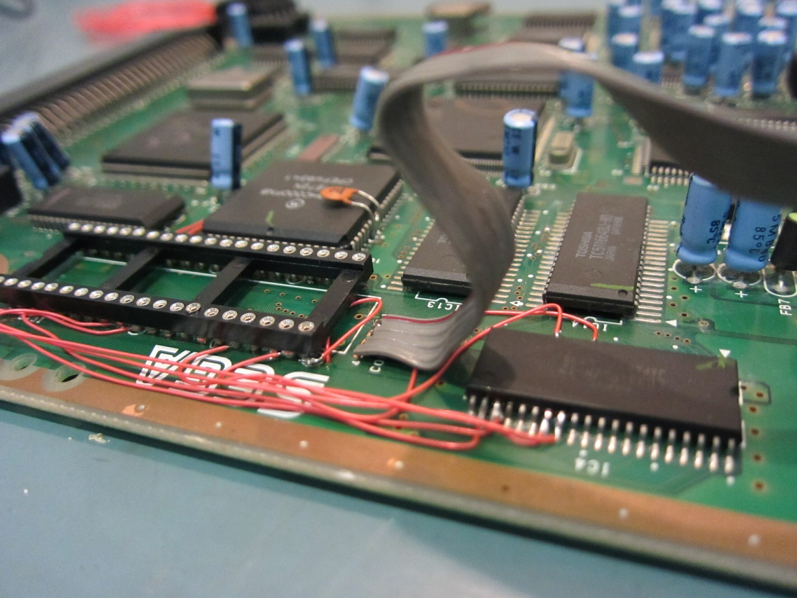



Here we are with the Aiwa Game Unit again, and this time we're actually getting somewhere with the repair! I've been reconnecting the damaged traces around the BIOS chip and fitting a proper socket. It took a while to work out where everything needed to go, but the result is looking rather promising.

I'd already started tracing the original copper connections, and the next step was to replace the damaged sections with short pieces of wire. Unfortunately, I made some of those wires a little longer than they really needed to be. In hindsight I could have shortened them by about a centimetre and a half, but at least they reached their destinations!

*Those little red boxes mark the traces I was tracking around the Aiwa BIOS position. Plenty of fiddly work in that corner of the board!*
{: .media-caption }

One particularly fiddly connection ran from a BIOS socket pin to a tiny via beside it. That via carries the signal through to the other side of the board, so I needed to get a good connection from both directions. Naturally, the camera decided there was absolutely no need to focus on anything that small. Thanks, camera!

I ended up feeding a little more solder through the connection to make sure everything was joined properly. It wasn't the prettiest thing in the world, but there were quite a few traces to recover and I was more interested in getting the electrical connections right than winning any prizes for beautiful soldering.

Once the work was finished, I went through the repaired traces with the multimeter. I checked continuity between the two sides of the board and followed the connections through to the appropriate chip pins. Everything I'd checked was connected where it should be, and I couldn't find any shorts between neighbouring pins.

Which is good, because it's the middle of winter and you wouldn't want to be wearing shorts anyway! At least something about this repair was going to plan.

*The BIOS socket and those rather enthusiastic red jumper wires. Not the prettiest repair, but the connections were finally coming together.*
{: .media-caption }

The next challenge is getting the rest of the Aiwa ready for testing. The boombox section still needs its own capacitor work, and I'll need a suitable EPROM or EEPROM for the new BIOS socket. There are still some decisions to make about the chip, particularly its pin compatibility, before I can go much further.

The Game Unit board itself will need recapping eventually as well, although it's nice to see the repaired traces and fresh battery arrangement looking more respectable. There's no point pretending the entire machine is fixed yet, but at least the parts I've been working on are behaving properly with the meter.

Having two of these Aiwa units has been enormously useful. Neither one is exactly perfect, but one was working well enough to help me work out where the damaged connections should go. There's something wonderful about having another example of obscure hardware to compare against, provided you're lucky enough to find one!

I'm also planning to compare the BIOS socket connections with the other Game Unit board before attempting the full test. If everything lines up, perhaps we'll finally get this strange Mega-CD hardware doing something more entertaining than occupying half the workbench.

There's still a fair bit to do, but the socket is installed, the damaged connections have been repaired and the continuity checks look good. More Aiwa repairs to come. There always are!

**Sources**

- [ASSEMblergames Archive - Region Free BIOS for Mega-CD version 2.00](https://web.archive.org/web/20191113105414/https://assemblergames.com/threads/region-free-bios-for-mega-cd-version-2-00.54254/)

**Related Posts**

- [Aiwa Mega-CD CSD-GM1 BIOS Dump: MPR-15768-T](/aiwa-mega-cd-csd-gm1-bios-dump-mpr-15768-t/)
- [Aiwa Mega-CD Game Unit BIOS Socket Preparation](/aiwa-mega-cd-game-unit-bios-socket-preparation/)
