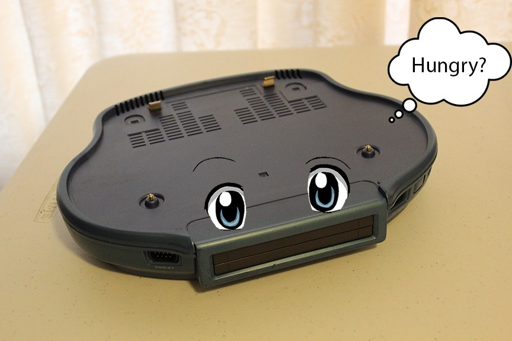
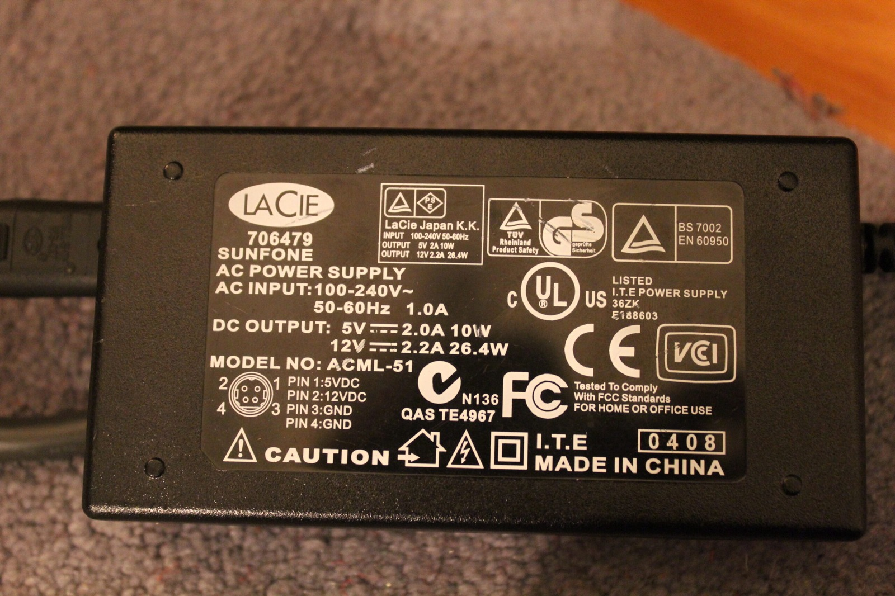
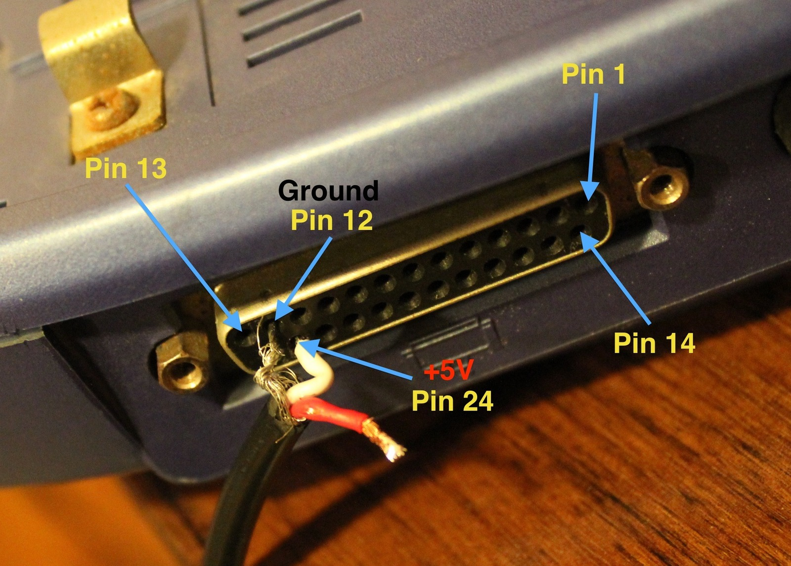
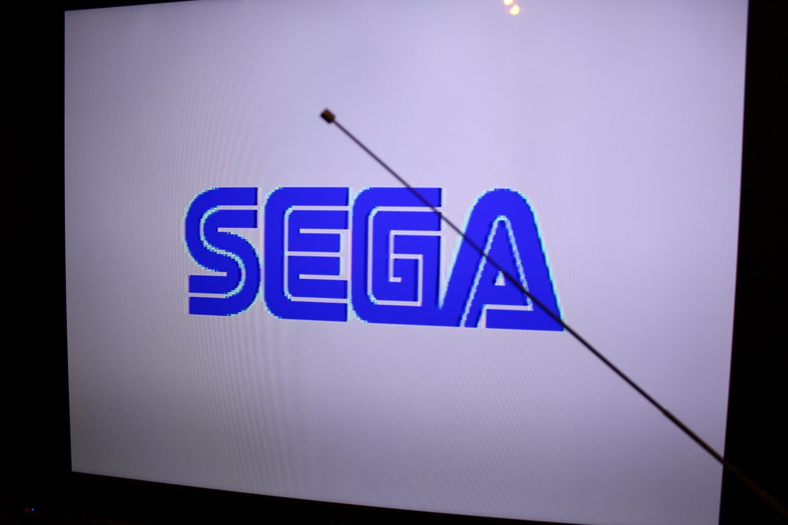
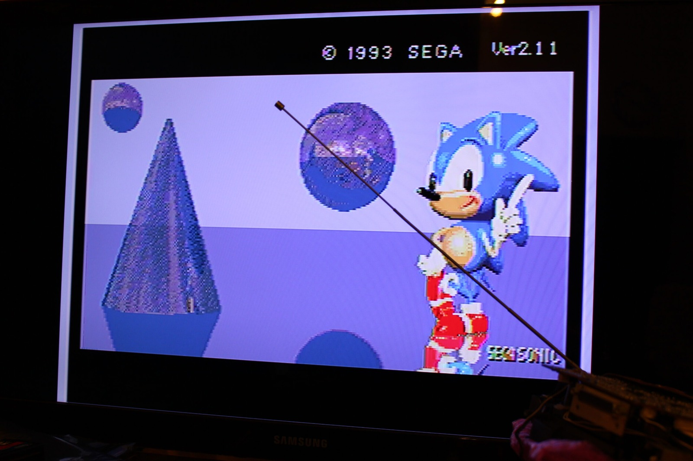



You don't need no stinkin' boombox to play Mega Drive games, just a suitable regulated 5 V power supply. I've been tracing the power connections on the Aiwa Mega-CD Game Unit, wondering whether I can run the Mega Drive section without the rest of the enormous boombox attached. Turns out that's a rather interesting experiment!

So you've got an Aiwa Mega-CD and want to make sure your Game Unit attachment is working? Good news, the Mega Drive section can be powered independently of the Aiwa Mega-CD boombox with a suitable regulated 5 V supply. I'm using the original connector arrangement to work out where the power needs to go.

First up you need a power source. I had an old LaCie ACML-51 external CD-ROM power brick hanging around, so I gave it a go. It provides an **amp**le 2 amps (Ha!) on the 5 V rail, although that's the current it can supply, not something it forces into the Game Unit.

We won't be using the 12 V rail for this one, unless we want a fire... ;) I checked the output with a multimeter before connecting anything, because getting the voltage or polarity wrong on a piece of hardware this unusual would be a particularly expensive mistake.

Here we have ground connected to pin 12 and 5 V (white) connected to pin 24 on the unit I tested, using the numbering shown in the photograph. The red 12 V lead is left unused. Before applying power, the pin numbering, polarity and voltage need to be checked against the actual hardware, and the unused lead and exposed connections must be insulated so they can't short.

Once the power was connected, I plugged in the AV cable and tried a cartridge. And there we have it, Sonic running again! Even better, the wavy lines I'd been seeing in the picture with the Aiwa assembled were gone. That gives me another clue about where some of those earlier problems might have been coming from.

With a cartridge inserted, you'll get the familiar SEGA splash screen and the game will start normally, assuming everything else is behaving. I was rather pleased to see that working after all the trouble these Game Units have been giving me.

Without a cartridge, the very beginning of the Sega Mega-CD introduction appears instead. Since the standalone setup isn't connected to the boombox's CD-ROM hardware, the introduction starts and then hangs.

There's still the question of the audio. At first I was only getting very faint sound and wasn't sure whether both channels were working, but I eventually managed to hear audio from both. Something in the normal Aiwa arrangement may be providing additional amplification, or there may be another part of the power or audio circuitry I'm overlooking.

For now, though, it's fantastic to have the Mega Drive section running on its own. At least I can test the Game Units without having the entire Aiwa spread across the bench every time!

### Sources

- [MEAN WELL - Notes on LED Drivers & Luminaires, Note 1.5](https://led.meanwell.com/productPre.aspx)

### Related Posts

- [Aiwa Mega-CD CSD-GM1 Unit-02 Mainboard Cross-Test with Both Game Units](/aiwa-mega-cd-csd-gm1-unit-02-mainboard-cross-test-with-both-game-units/)
