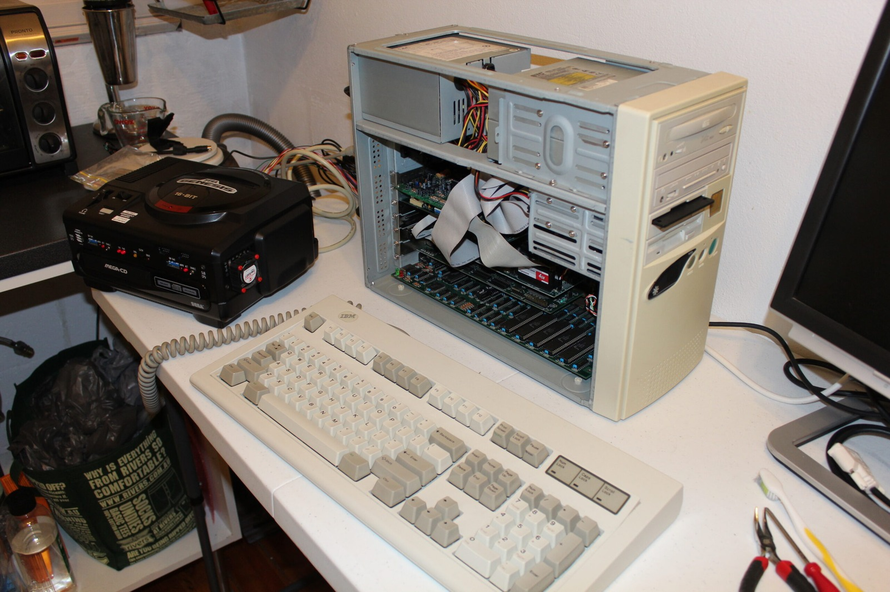

*The original Mega Drive shelf video has disappeared, so here's a photograph of my development hardware instead. Close enough for now!*
{: .media-caption }

Neighbours, everybody needs good neighbours. So why do mine play bongo drums? I live under a very thin roof/floor and my neighbours are inconsiderate. Please suggest some ways to get back at them!

I don't know what happened to the overview video, so there's a cool dev unit from the near future!
