These are my SuperCIC installation notes and photographs for an SNSP-CPU-02 board with the PAL F413A CIC. The original article left the PIC programming instructions and circuit diagram as placeholders, so it is not a complete standalone guide. Use Wolfsoft's installation guide and the SuperCIC project documentation linked below alongside these photographs.

**Console serial: UP15971140**

You can find the [full photo gallery](/goodies/). Look for Super Nintendo UP15971140.

The console-side SuperCIC lock uses a programmed PIC16F630 and provides switchless region control, with 50 Hz, 60 Hz and automatic modes.

### Parts I used

- PIC16F630 programmed with the SuperCIC lock firmware
- 30 AWG Kynar wire
- X-Acto knife or fine jeweller's flat-blade screwdriver for lifting pins
- PIC programmer (I used a GQ-4X)
- 5 mm dual-colour LED
- suitable current-limiting resistors for the LED

### Board connections

Locate PPU1, PPU2 and the F413A CIC. Don't mind the red wires leaving my PPU1. They were already there to repair corroded traces near the reset switch.

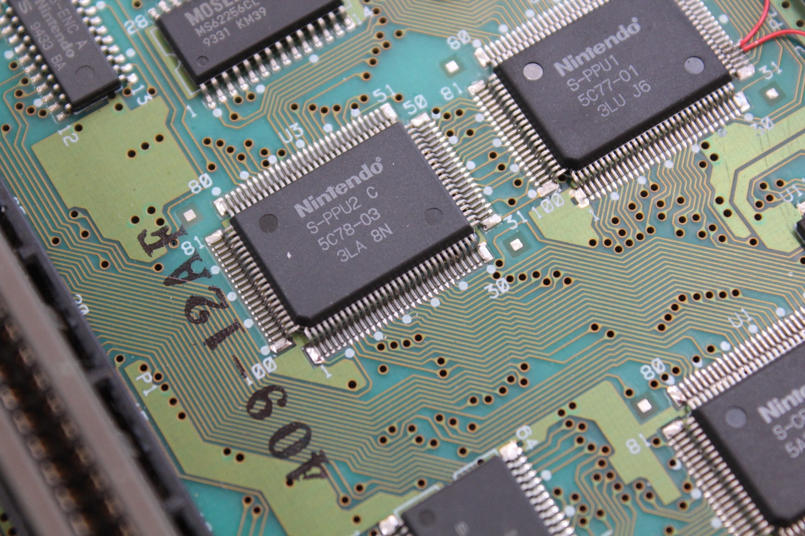

*Here's PPU2 on the SNSP-CPU-02 board, one of the chips that needs attention for the SuperCIC video mode wiring.*
{: .media-caption }

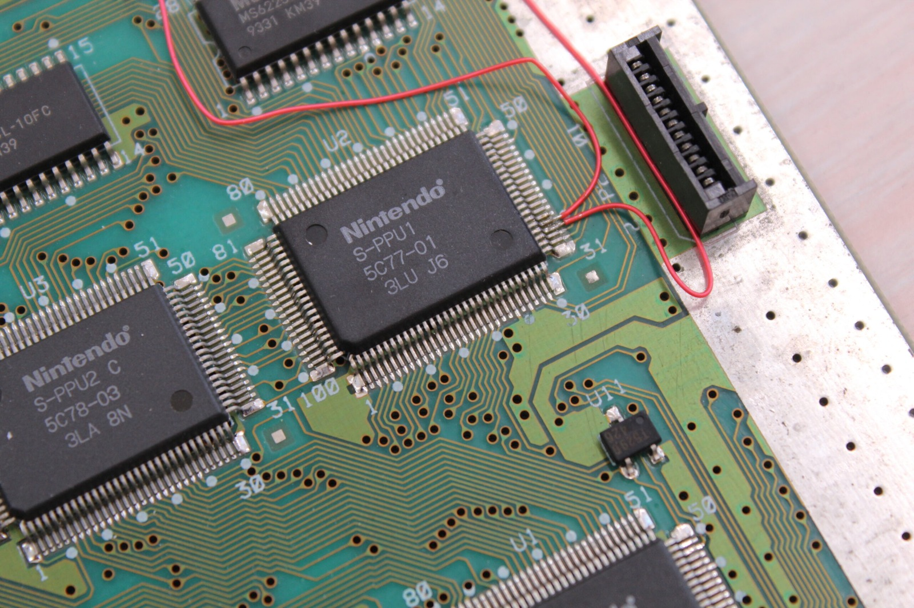

*PPU1 and those existing red wires. They were already repairing corroded traces near the reset switch before this SuperCIC adventure.*
{: .media-caption }

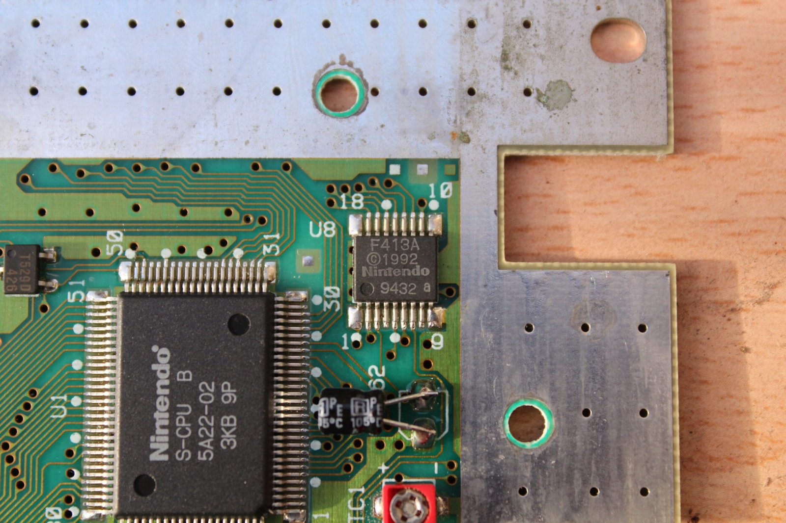

*There's the original F413A CIC at U8, before the fun begins with isolating its pins.*
{: .media-caption }

### F413A CIC

On this installation I left the original F413A on the board and lifted pins 1, 2, 10 and 11 so that they no longer contacted their pads. Wolfsoft's guide describes this as one of two approaches; the other removes the original CIC completely.

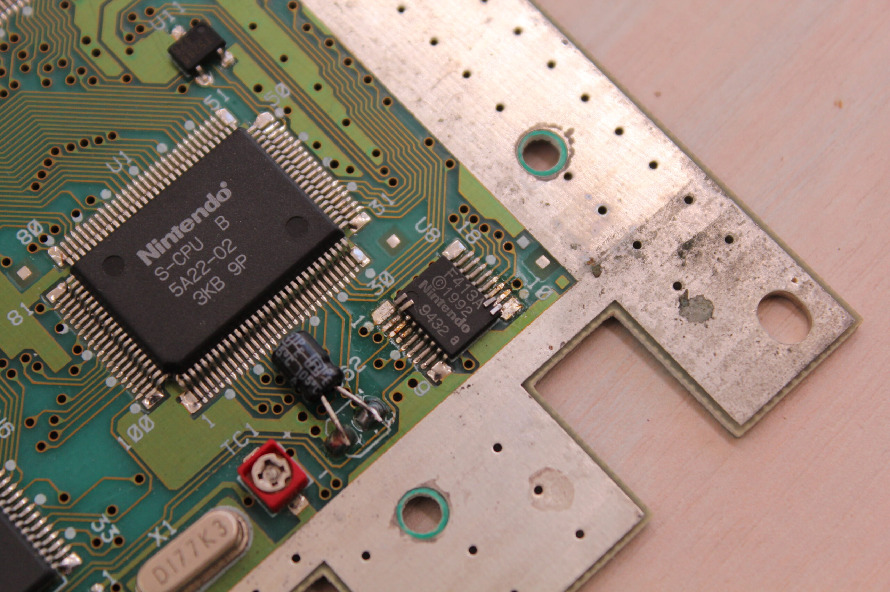

*A closer look at that tiny F413A. I left it on the board and isolated the required pins rather than removing the chip entirely.*
{: .media-caption }

### Video mode connections

On this multi-chip board, lift PPU1 pin 24 and PPU2 pin 30 so that both are isolated from their original board connections before wiring them to the SuperCIC.

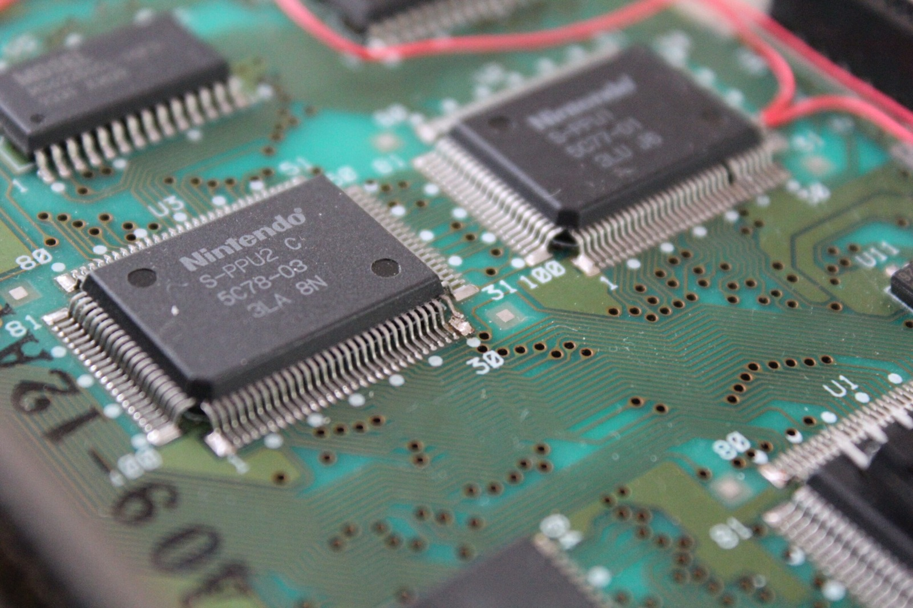

*PPU2 and its rather intimidating row of tiny pins. Pin 30 is the one discussed in the video mode connections.*
{: .media-caption }

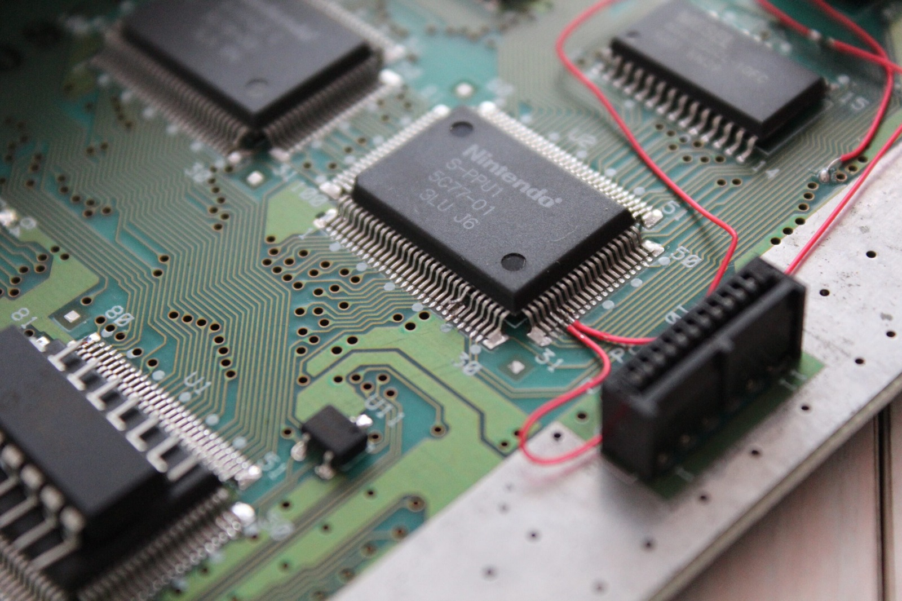

*And here's PPU1 with the red wiring already in place. Tiny pins, steady hands, and no shortage of patience required.*
{: .media-caption }

### PIC placement

I mounted the PIC16F630 over the CPU. It doesn't have blast processing so it shouldn't overheat. ;)

If you are confident your chip has been programmed successfully, consider trimming the legs down. In this example I simply bent them outward slightly. Note the notch on the chip is at the top facing the back of the console.

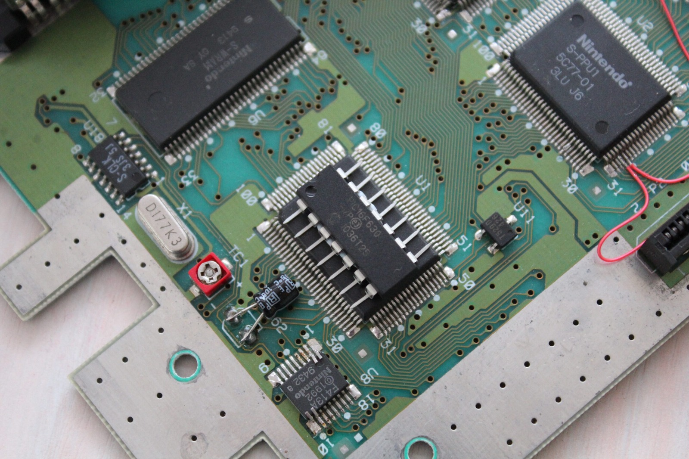

*The PIC16F630 perched over the CPU. No blast processing here, so I wasn't too worried about it getting hot. ;)*
{: .media-caption }

### Wiring

Check every connection and check for shorts before powering the console. Use Wolfsoft's guide and the SuperCIC documentation for the wiring diagram missing from my original article; these photographs record my installation.

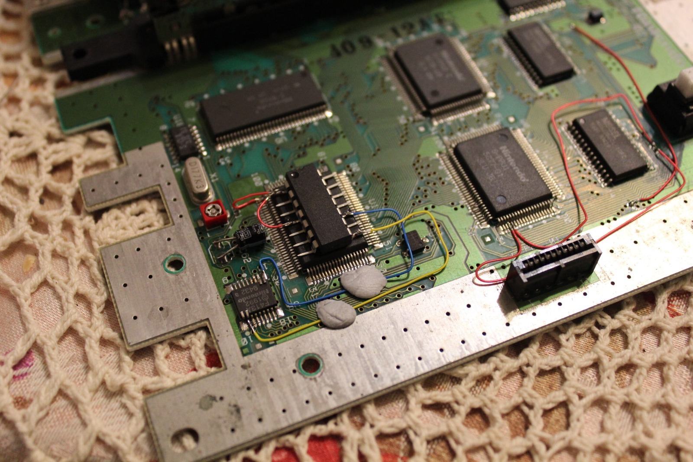

*The SuperCIC wiring is beginning to take shape, with the PIC sitting over the CPU and the first coloured wires in place.*
{: .media-caption }

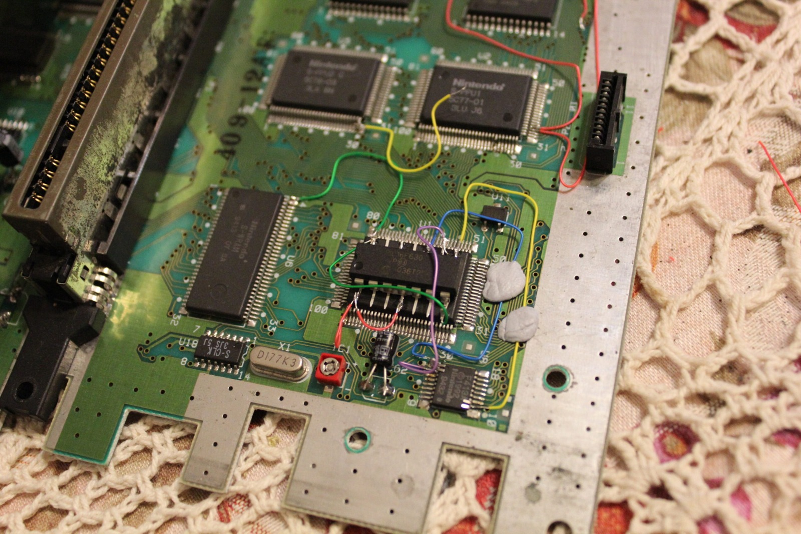

*A few more connections added. It's starting to look like the usual tangle of colourful Kynar wire!*
{: .media-caption }

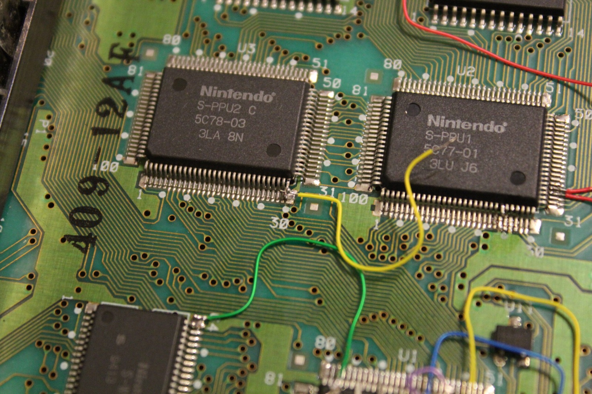

*The new video mode connections running to PPU1 and PPU2. Best not to confuse those pins halfway through soldering.*
{: .media-caption }

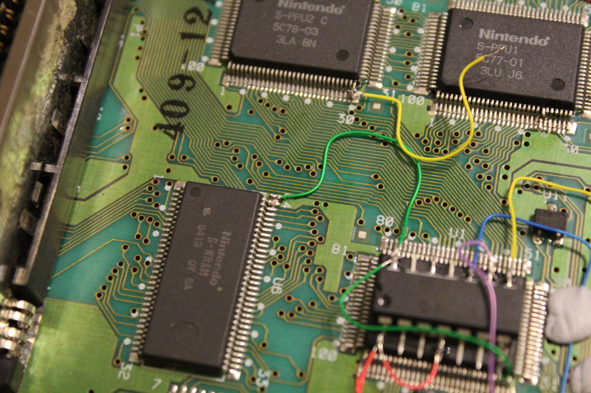

*Another angle on the wiring, this time showing the RAM and the connections leading towards the PIC.*
{: .media-caption }

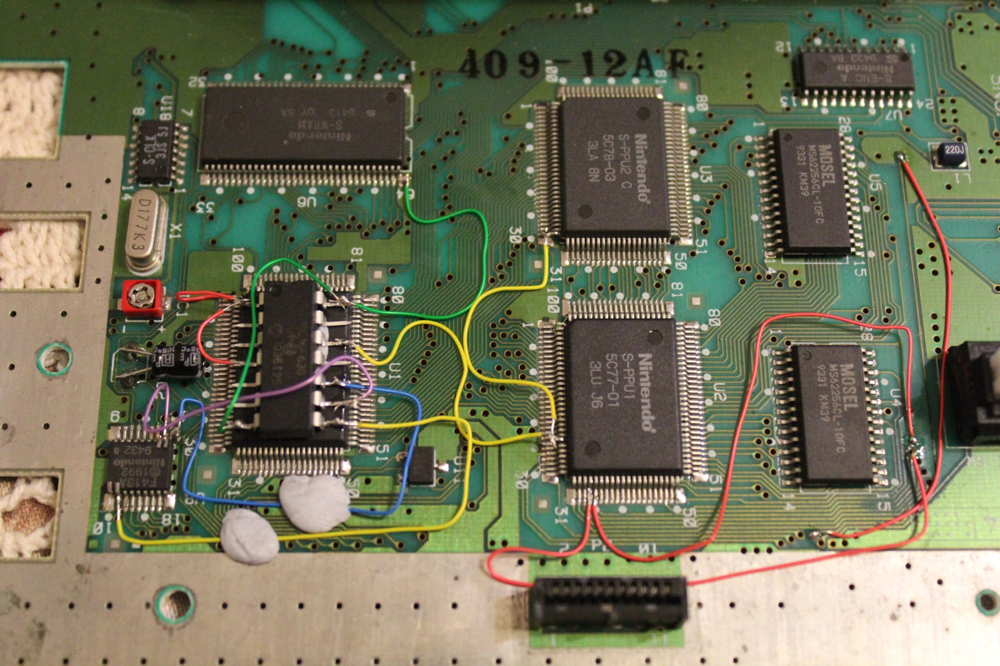

*A wider look at the installation. Plenty of coloured wires, but at least the layout is easier to see from above.*
{: .media-caption }

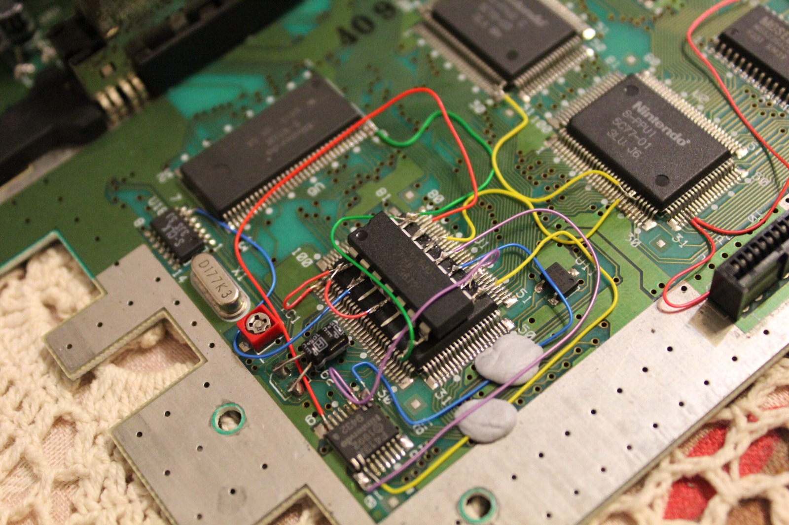

*One last angled look at that PIC wiring. It certainly doesn't look factory-fitted, but that's half the charm of these projects.*
{: .media-caption }

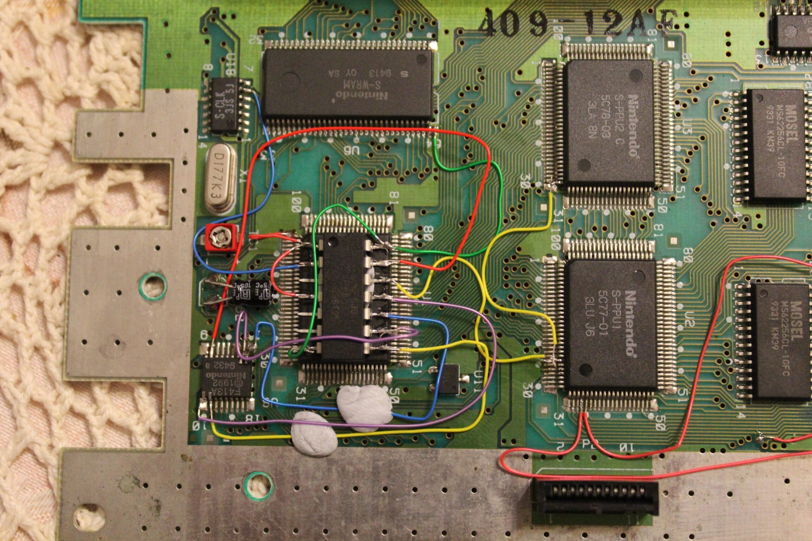

*The completed-looking wiring layout from above. I'd still check every joint and look for shorts before powering it up.*
{: .media-caption }

### LED

I chose a 5 mm red/green dual-colour LED and had 220 ohm resistors on hand, which worked well. The SuperCIC uses the LED to indicate the selected operating mode.

### Sources

- [SuperCIC - ikari's project page](https://sd2snes.de/blog/cool-stuff/supercic)
- [SuperCIC lock firmware source and pin configuration](https://github.com/mrehkopf/sd2snes/blob/master/cic/supercic/supercic-lock.asm)
- [Wolfsoft - SuperCIC SNES switchless MOD (PAL)](https://web.archive.org/web/20130906130345/http://wolfsoft.de:80/wordpress/?p=603)
- [LED calculator for single LEDs](https://web.archive.org/web/20131016112311/http://led.linear1.org:80/1led.wiz)

### Related Posts

- [SNES SuperCIC Switchless Modchip - Installation (Part 1)](/snes-supercic-switchless-modchip-installation-part-1/)
- [SNES SuperCIC Switchless Modchip - The Test (Part 2)](/snes-supercic-switchless-modchip-the-test-part-2/)
- [SNES SuperCIC Switchless Modchip - More Testing (Part 3)](/snes-supercic-switchless-modchip-more-testing-part-3/)
