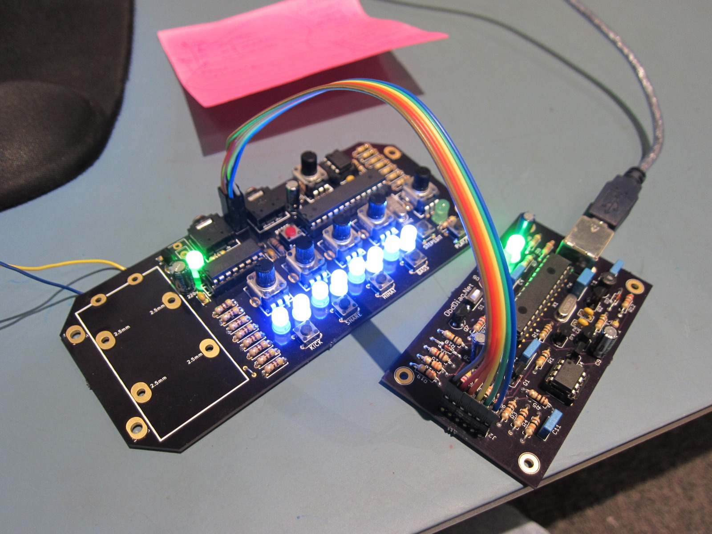

PICkit 2 is a Microchip programmer/debugger designed primarily for PIC chips. The fun part is that AVRDUDE can also use it as an ISP programmer for supported AVR microcontrollers, including the ATmega328P I'm working with here. That AVR support comes from AVRDUDE rather than Microchip's PICkit 2 application.

Atmel is one of Microchip's competitors, so I have to wonder whether that's why Microchip doesn't seem particularly interested in supporting the PICkit 2 anymore. After all, you wouldn't want your own programmer helping sell your biggest competitor's chips! That's just my theory, of course.

What I used:

- PICkit 2
- the programmer / adapter hardware linked from [obddiag.net](https://web.archive.org/web/20140217175948/http://www.obddiag.net/picprog.html) in the original post
- [PIC12F508](http://ww1.microchip.com/downloads/en/DeviceDoc/41236E.pdf), useful for checking that the PICkit 2 setup is functioning
- [ATmega328P](https://web.archive.org/web/20130928215235/http://www.atmel.com/Images/doc8161.pdf) as the AVR target
- AVRDUDE on the Mac

Compiling all of this has been particularly entertaining because I have very little idea what I'm doing! 😅 More to come when I find the time...

**Update 2023:** I'll probably never find the time. However, it's worth mentioning that this was all done for the Lunchbeat project. More of that hot mess can be found in the Projects folder in the [photo gallery](/goodies). Enjoy! 🙃

### Sources

- [Microchip Technology - PICkit 2 Development Programmer/Debugger](https://www.microchip.com/en-us/development-tool/pg164120)
- [AVRDUDE - Version 6.0 Manual (2013)](https://download-mirror.savannah.gnu.org/releases/avrdude/avrdude-doc-6.0.1.pdf)

### Related Posts

- [Lunchbeat 1-bit Groovebox by Buranelectrix: Introduction](/lunchbeat-1-bit-groovebox-by-buranelectrix-introduction/)
- [Lunchbeat 1-bit Groovebox by Buranelectrix - Demo](/lunchbeat-1-bit-groovebox-by-buranelectrix-demo/)
- [Lunchbeat / PICkit 2 - PCB Arrival (Part 1)](/lunchbeat-pickit-2-pcb-arrival-part-1/)
