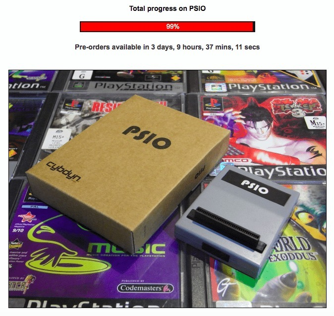

*99% and a countdown to pre-orders. One more percent to go, and then the fun begins!*
{: .media-caption }

They are edging closer and closer by the day. Pre-orders are coming up, so keep your eyes on the [PSIO website](https://psio.cybdyn-systems.com.au/) for more!

### Related PSIO progress posts

- [Thoughts on PSIO 2.x Recent Updates](/thoughts-on-psio-2x-recent-updates/)
- [PSIO for Sony PlayStation Nearing Completion](/psio-for-sony-playstation-nearing-completion/)
- [PSIO for Sony PlayStation Reaches 100%, Pre-Orders Soon!](/psio-for-sony-playstation-reaches-100-percent-pre-orders-soon/)
