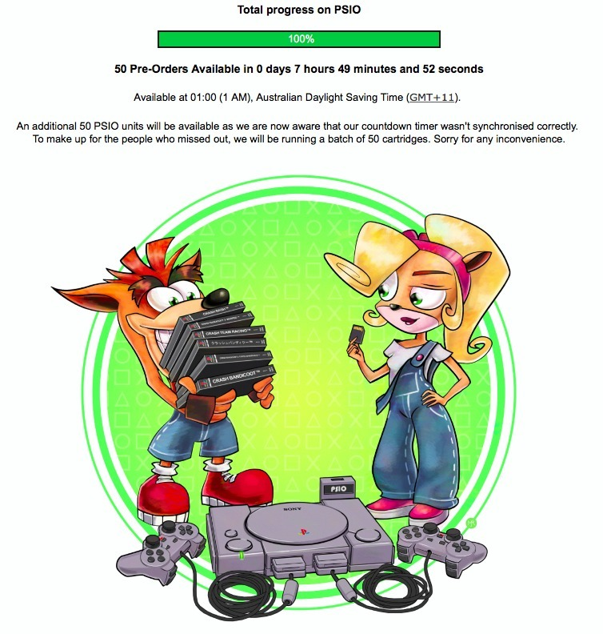
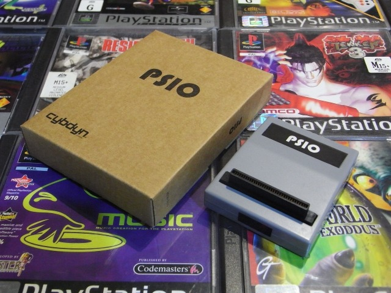

*PSIO finally hit 100%! The first 50 pre-orders were on the horizon, although the countdown needed a little correcting.*
{: .media-caption }

It's taken a while, but it's great to see the project's status bar finally turn green and reach **100%**. Congratulations [Team PSIO](https://psio.cybdyn-systems.com.au/)! I don't doubt those first 50 pre-orders will disappear quickly.

*The PSIO box and cartridge among a pile of PlayStation games. It certainly looked ready for the big time!*
{: .media-caption }

Looks good, doesn't it? Don't forget to drop by my [PSIO YouTube playlist](https://www.youtube.com/playlist?list=PLJAZP-TLMPj7dBOErfc4g8Rj0vqPnbBUF) to see the project in action.

### Related PSIO progress posts

- [Thoughts on PSIO 2.x Recent Updates](/thoughts-on-psio-2x-recent-updates/)
- [PSIO for Sony PlayStation Nearing Completion](/psio-for-sony-playstation-nearing-completion/)
- [PSIO for Even Closer to Nearing Completion](/psio-for-even-closer-to-nearing-completion/)
