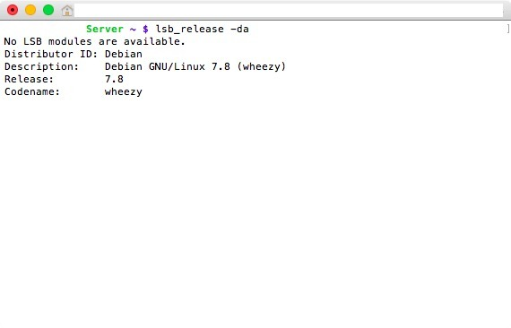
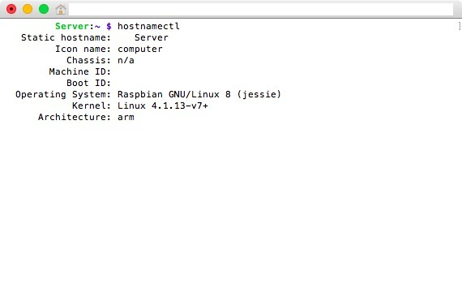
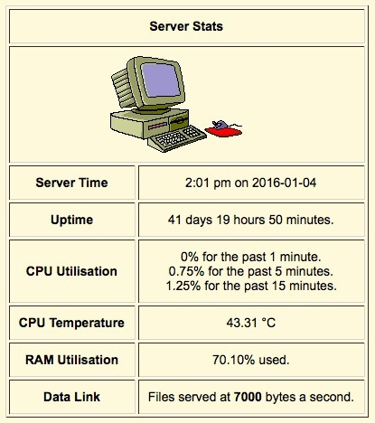

This one has always been tricky for me, remembering which Raspberry Pi was running which version of Raspbian / Debian.

Two handy commands from this period were:

`lsb_release -da`

*The older server reports Debian 7.8 Wheezy. That explains which version of Debian I was looking at here!*
{: .media-caption }

and:

`hostnamectl`

*The hostnamectl output from the Jessie machine. Two commands, two different installations, and now I can finally keep track of which is which!*
{: .media-caption }

They overlap a little, but they are not exactly the same thing. `lsb_release` focuses on Linux distribution information, while `hostnamectl` also reports hostname and operating-system details on systems using systemd. The captures show different releases: Debian GNU/Linux 7.8 (Wheezy) above the Raspbian GNU/Linux 8 (Jessie) capture.

*41 days, 19 hours and 50 minutes of uptime before I decided to rebuild the server. Because apparently I can't leave a perfectly good setup alone!*
{: .media-caption }

In other news, we hit **41 days uptime** before I decided to rebuild the server using Raspbian Jessie Lite. The smaller Lite image suited this little Raspberry Pi web-server setup much better than the larger desktop image I had been using.

I guess the full Jessie image was getting a bit too beefy for 4 GB cards with all that bloat! Every day is a good day to rebuild! Most of the Take Back the Darknet guide was online by then too, although it still needed plenty of refining.

### Sources

- [Debian Jessie - lsb_release(1)](https://manpages.debian.org/jessie/lsb-release/lsb_release.1.en.html)
- [Debian Jessie - hostnamectl(1)](https://manpages.debian.org/jessie/systemd/hostnamectl.1.en.html)

### Related Posts

- [Take Back the Darknet: The Complete 2016 Guide](/take-back-the-darknet/)
