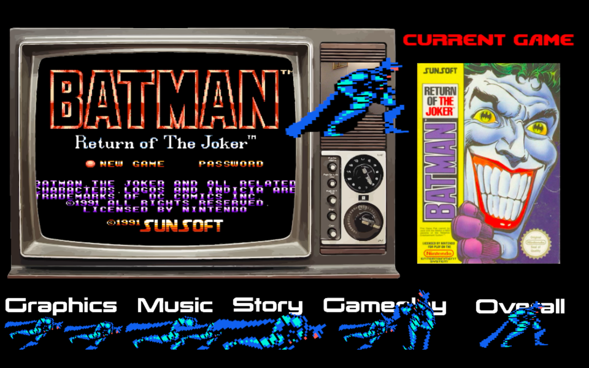

*A colourful Game Reviews collage brings together a game controller, a racing car, fantasy artwork, and a menu screen.*
{: .media-caption }

It has recently occurred to me that being a full-time student (and unemployed) has really stopped me from having any disposable income like I had previously while employed full time. Ahhh, being a student gives you all the "freedoms" of working without the pay day at the end of the week.

Now, this was quite a problem to have since most of the repairs I do are on old, overpriced hardware - especially when dealing with development gear. I have downsized my console collection significantly over the last year since moving house and have been working on a way to keep the videos coming.

First I tried out live streaming from the PS4 here, only to find our internet is barely sufficient for 480p streaming and then there's the dropouts...! So I kept looking around and found that you can share clips from the PS4 in (at least) 720p, fantastic! That's the direction that the McRetro Gaming channel will take from now on. Perhaps when the internet is upgraded (five times the upload speed) in the next six months or so live streaming might be back on the menu - but probably not.

So that sorts out McRetro Gaming. What about Nix McRetro and the RetroJunkie2020 channel you ask?

Reviews! Specifically, game reviews - with a twist of course, as is the spirit of myself, Nix McRetro! Half-baked reviews with the score just being a number I pluck out of the air and a point system that makes no sense at all. If you can make sense of the scoring system, you probably need to be medicated! :P

*How many Batmen can a single Batman score?*
{: .media-caption }

So stay tuned, I should be able to generate a couple of these a week if we are all lucky enough. I just need to work on streamlining the review process. So far it's looking good and can only get better, right?

### Sources

- [Original Twitter post (17 January 2016)](https://twitter.com/i/web/status/688670726052646913)

**Related Posts**

- [F-15 Strike Eagle (NES) Review](/f-15-strike-eagle-nes-review/)
- [Batman: Return of the Joker (NES) Review](/batman-return-of-the-joker-nes-review/)
- [Kirby's Adventure (NES) Review](/kirbys-adventure-nes-review/)
