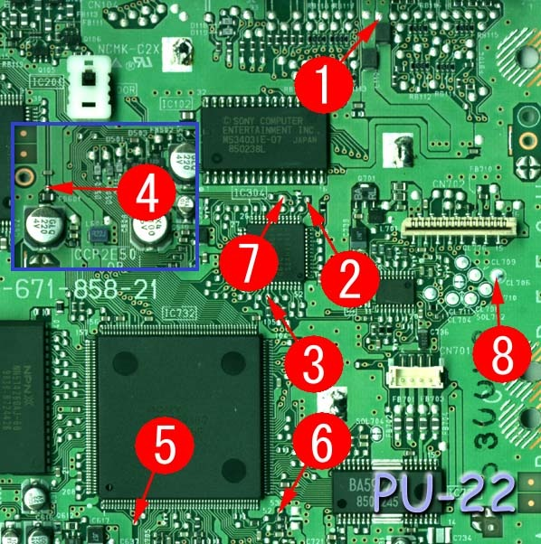
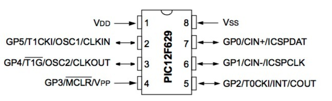

This is the Mayumi 4 installation I used with a PIC12F629 on an SCPH-7502 PlayStation with a PU-22 motherboard.

*The eight Mayumi 4 solder locations on the PU-22 motherboard for this PIC12F629 installation. Definitely not a diagram to use on just any PlayStation!*
{: .media-caption }

There are eight solder points in this installation.

*The PIC12F629 pinout, including its power and multifunction GP pins. Handy to have next to the PU-22 wiring reference.*
{: .media-caption }

The mode sequence I recorded for this PIC12F629 build on the SCPH-750x / PU-22 setup was:

`Strongest Mode -> Old Modchip Mode -> Disable Mode`

Hold reset for around two seconds to change modes.

The configuration shorthand recorded with this build was:

`WDT_OFF, ExtRC_OSC, MCLR_OFF`

This page does not identify the exact HEX file or configuration word used, so the shorthand above is preserved as recorded rather than validated for every PIC12F629 port. Do not assume the same wiring or configuration applies to every PlayStation revision.

Credit and thanks to Mord.Fustang for the PIC12F629 port of the Mayumi code.

### Sources

- [ConsoleMods - PS1 Modchips](https://consolemods.org/wiki/PS1:Modchips)
- [Assembler Games - PS1 Mayumi 4.0 PIC12F629 port](https://web.archive.org/web/20170626102038/https://www.assemblergames.com/threads/ps1-mayumi-4-0-12f683-12f675-12f629.54179/)
- [MCUmall - Update the PIC chip OSCCAL value](http://www.mcumall.com/forum/topic.asp?TOPIC_ID=4858)
- [Microchip - PIC12F629/675 Data Sheet](https://ww1.microchip.com/downloads/en/DeviceDoc/41190G.pdf)

### Related Posts

- [Sony PlayStation Modchip Overview](/sony-playstation-modchip-overview/)
- [Mayumi 4: PIC12C508A, SCPH-7502 (PU-22)](/mayumi-4-pic12c508a-scph-7502-pu-22/)
- [Mayumi 4: PIC12C508A, SCPH-5502 (PU-18)](/mayumi-4-pic12c508a-scph-5502-pu-18/)
- [Creating a Sony PlayStation Modchip](/creating-a-sony-playstation-modchip/)
