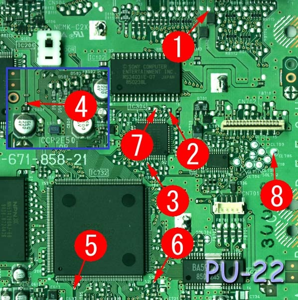
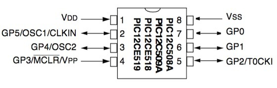

This is the Mayumi 4 installation I used with a PIC12C508A on an SCPH-7502 PlayStation with a PU-22 motherboard.

*The eight connection points for this PIC12C508A Mayumi 4 installation on a PU-22 motherboard. Same board, but mind the PIC differences!*
{: .media-caption }

There are eight solder points in total.

*The PIC12C508A family pinout. Eight legs sounds easy until you're checking every single signal and oscillator setting!*
{: .media-caption }

The mode sequence is:

`Strongest Mode -> Old Modchip Mode -> Disable Mode`

Hold reset for around two seconds to change modes.

Configuration recorded for this build:

`WDT_OFF, ExtRC_OSC, MCLR_OFF`

This installation is specific to the motherboard and PIC combination shown here.

[Back to the modchip installation guide list](/sony-playstation-modchip-installation-guides/)

### Related Posts

- [Sony PlayStation Modchip Overview](/sony-playstation-modchip-overview/)
- [Mayumi 4: PIC12F629, SCPH-7502 (PU-22)](/mayumi-4-pic12f629-scph-7502-pu-22/)
- [Mayumi 4: PIC12C508A, SCPH-5502 (PU-18)](/mayumi-4-pic12c508a-scph-5502-pu-18/)
- [Creating a Sony PlayStation Modchip](/creating-a-sony-playstation-modchip/)
