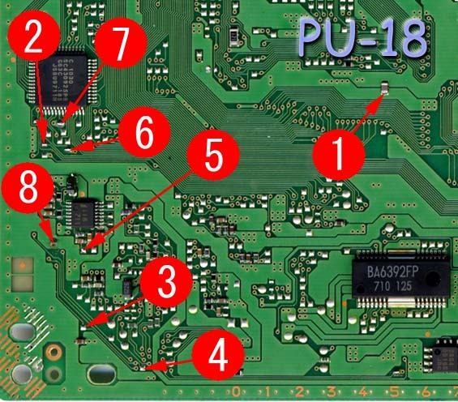
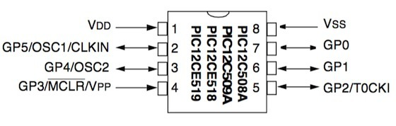

*The eight Mayumi 4 points on a PU-18 board, this time for the SCPH-5502 and PIC12C508A combination. Different PlayStation, different wiring!*
{: .media-caption }

There are eight solder points in total.

*The same PIC12C508A pinout used for this PU-18 install. The motherboard changes, but it's still worth checking every leg!*
{: .media-caption }

This is the Mayumi 4 installation I used with a PIC12C508A on an SCPH-5502 PlayStation with a PU-18 motherboard.

Mayumi V4 supports PU-18 and later boards. On PU-18 / PU-20 it uses timing-based stealth behaviour rather than the XLAT method available on PU-22 and later boards.

The mode sequence I recorded for this setup was:

`Mayumi v0.9 Mode -> Mayumi v1.0 Mode -> Old Modchip Mode -> Disable Mode`

Hold reset for around two seconds to change modes.

Configuration recorded for the PIC:

`WDT_OFF, ExtRC_OSC, MCLR_OFF`

Those are the settings I recorded, rather than a verified recommendation. Microchip documents external clock input in XT or LP mode and does not recommend driving this family with an external clock in RC mode. The exact Mayumi HEX and configuration word for this build have not been recovered, so the oscillator setting needs checking before reproducing it.

This page applies to the specific PU-18 installation shown here.

### Sources

- [ConsoleMods - PS1 Modchips](https://consolemods.org/wiki/PS1:Modchips)
- [Microchip - PIC12C5XX Data Sheet](https://ww1.microchip.com/downloads/en/DeviceDoc/40139E.pdf)

### Related Posts

- [Sony PlayStation Modchip Overview](/sony-playstation-modchip-overview/)
- [Mayumi 4: PIC12F629, SCPH-7502 (PU-22)](/mayumi-4-pic12f629-scph-7502-pu-22/)
- [Mayumi 4: PIC12C508A, SCPH-7502 (PU-22)](/mayumi-4-pic12c508a-scph-7502-pu-22/)
- [Creating a Sony PlayStation Modchip](/creating-a-sony-playstation-modchip/)
