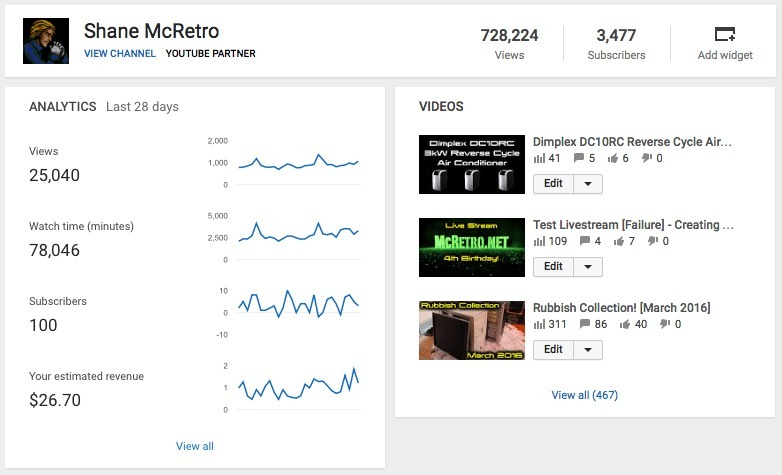
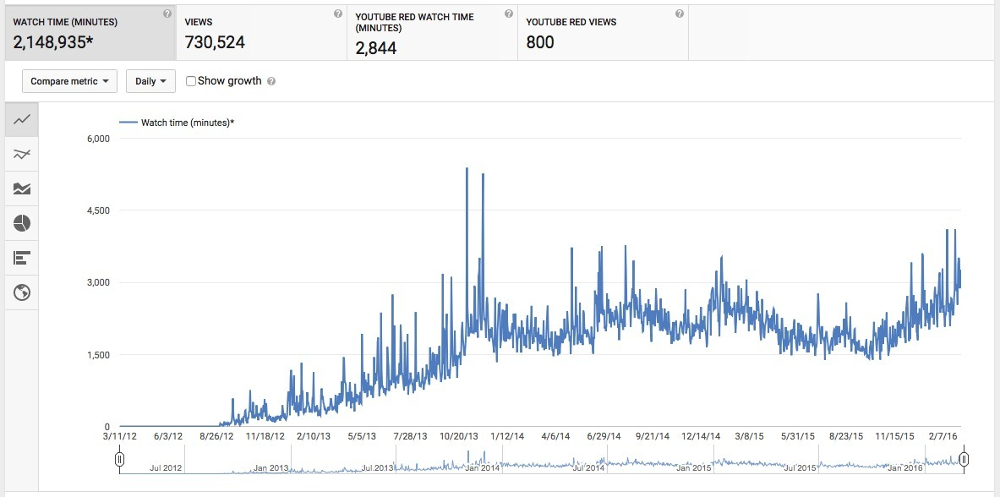

*Four years on YouTube and the dashboard was getting rather exciting! Just look at those numbers for the last 28 days.*
{: .media-caption }

Well it's been four years since I decided on 11th March 2012 to fire up RetroJunkie2020 and signed up to [ASSEMblergames.com](https://web.archive.org/web/20170919030325/https://www.assemblergames.com/). What have we achieved? Let's have a quick look at the Nix McRetro YouTube dashboard. Lots of numbers. Let's break them down!

Over the last 28 days:

- **25,040 views**, about **894 views each day!**
- **78,046 minutes watched**, about **46 hours of video watched each day!**
- **100 subscribers**, about **3.6 subs each day!**
- **$26.70**, about **95c a day!**

That last one lets me buy a fresh loaf of bread each day!

It's absolutely insane when you crunch the numbers like this. **46 hours of video watched every 24 hours.** Incredible.

I reckoned around 10% of the subscriber base visited often, with the rest of the viewers probably just passing through. It's all thanks to everyone who watched. Amazing! Thank you all for the last four years, and here's to another four!

*More than two million minutes of watch time since I started. That's over four years of people watching the videos I cobbled together!*
{: .media-caption }

But let's have a quick peek at the total watch time ever: **2,148,935 minutes.** That's about **35,816 hours**, **1,492 days**, or **4.09 years**. Incredible!

In four years, people have watched more than four years of videos I knocked together. Just wow!
