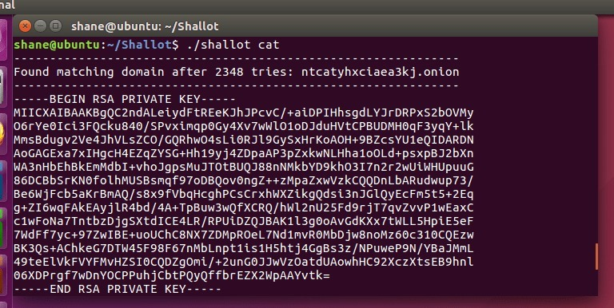

I've been playing around with Shallot 0.0.3-alpha to generate a vanity onion address for McRetro. My old address was [http://mcretro35qepy5cy.onion](https://mcretro.net/goodies/), and I thought I'd see what else I could come up with. Time for a little tinkering!

For this experiment I'm using Ubuntu 16.04 (64-bit). Shallot needs the OpenSSL development headers to build, something I discovered after running into the rather cheerful error **"fatal error: openssl/bn.h: No such file or directory"**. Right. That explains a few things.

First, update the package lists:

`sudo apt-get update`

Then install the missing development headers:

`sudo apt-get install libssl-dev`

With those out of the way, build Shallot:

`./configure && make`

Now for the fun part. Running `./shallot cat` searches for an onion address containing `cat`, while `./shallot ^cat` looks for one beginning with `cat`. The caret is doing its usual job of anchoring the match to the beginning of the string. Simple enough!

There's one important catch, though. Shallot generates a private key along with the address, and that key is what identifies the onion service. The screenshot above includes an example key, but because I've published it here, that particular key should never be used for a real service. Keep the private keys for your actual onion services private!

**Update (2026):** This was written for the old 16-character version 2 onion address format. Tor removed support for v2 onion services in 2021, so Shallot is no longer suitable for setting up a modern onion service. Version 3 onion addresses are 56 characters long and require v3-compatible tooling. The commands above are preserved as historical documentation, not instructions for creating a current onion service.

For a modern onion service, refer to the current Tor documentation and tools instead.

### Sources

- [Tor Project - Onion Service version 2 deprecation timeline](https://blog.torproject.org/v2-deprecation-timeline/)
- [Tor Project - Vanity Addresses](https://community.torproject.org/onion-services/advanced/vanity-addresses/)
- [Shallot developer README (archived GitHub repository)](https://web.archive.org/web/20230331011246/https://github.com/katmagic/Shallot)

### Related Posts

- [Take Back the Darknet (Part 13)](/take-back-the-darknet-part-13/)
- [The Darknet (Day 36)](/the-darknet-day-36/)
- [ZeroNet, BitTorrent and Another Darknet](/zeronet-bittorrent-and-another-darknet/)
