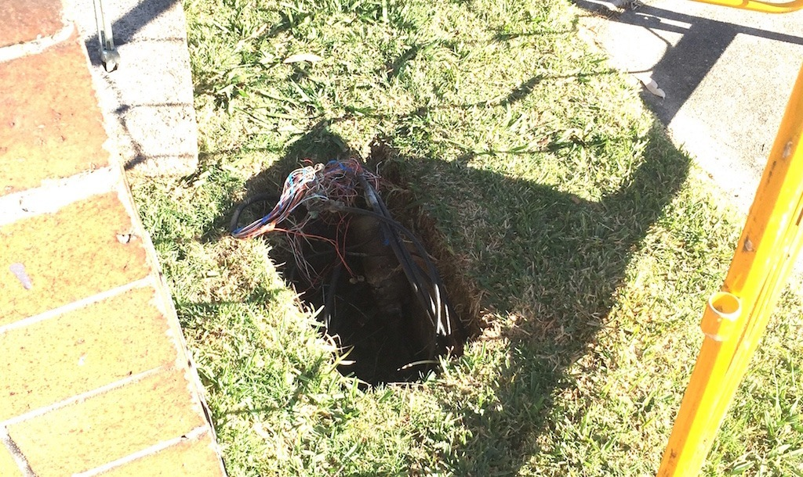

Some friends recently had their NBN Fibre to the Node connection installed, and compared with the old connections I'd been dealing with, it felt extremely fast. This website was even being hosted there for a while, which might explain some of the downtime. ;)

Technically, FTTN runs fibre to a nearby street node and uses the existing copper telephone network for the final section to the premises. The photograph above shows one particular section of old copper I encountered. I'm not saying every FTTN line looks like that, but look at it! It looks 100-odd years old, doesn't it? Distance from the node and the condition of the copper can affect VDSL2 performance, and that's part of why this whole arrangement frustrates me.

I hope we get a government in that can fix this mess up. The copper should have been done away with completely. FTTN might work well for my friends, but I'd much rather have fibre all the way instead of depending on more old telephone wire.

Dropouts every...

*disconnected*

### Sources

- [nbn - Fibre to the Node Explained](https://www.nbnco.com.au/learn/network-technology/fibre-to-the-node-explained-fttn)
- [nbn - Setting the Facts Straight on Fibre to the Node](https://www.nbnco.com.au/blog/the-nbn-project/setting-the-facts-straight-on-fibre-to-the-node)
