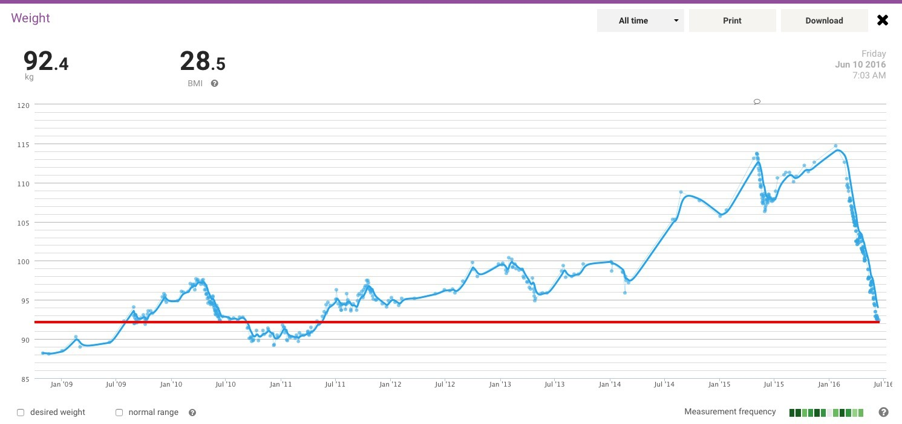

*The Withings chart from June 2016, with the blue weight trend heading down and my current reading marked by the red line.*
{: .media-caption }

Not much happening here, but I did manage to find a much better looking graph on the Withings HealthMate website. Just figured you should enjoy it. The red line shows where I am currently. I'm hoping the trend (solid blue line) keeps dropping as time goes on. At this rate, I could be the lightest I've been in probably close to a decade.

Only then will I be able to pull together enough energy to do some more YouTube videos. So many distractions in life currently. Did you see the [online shop](/) I've been tinkering with? Then I rebuilt this website a few times only to discover WordPress and the darknet/onion address no longer play nicely together.

Anyone want to buy a Canon MP610 or Epson something-or-other multifunction? Maybe save me the hassle of selling them? Nope? Didn't think so... maybe once my to-do list has less than 32 items on it I'll kick out something incredible. Stay tuned! :D
