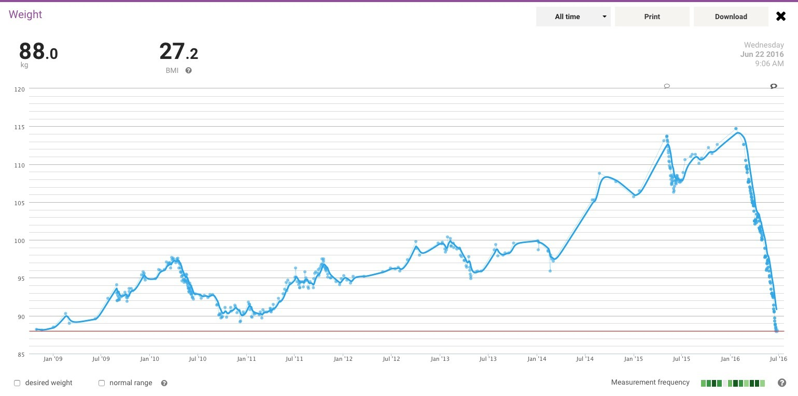
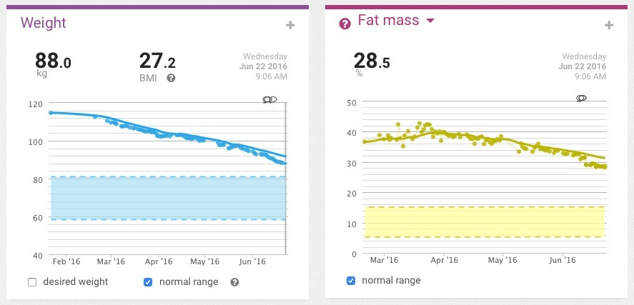
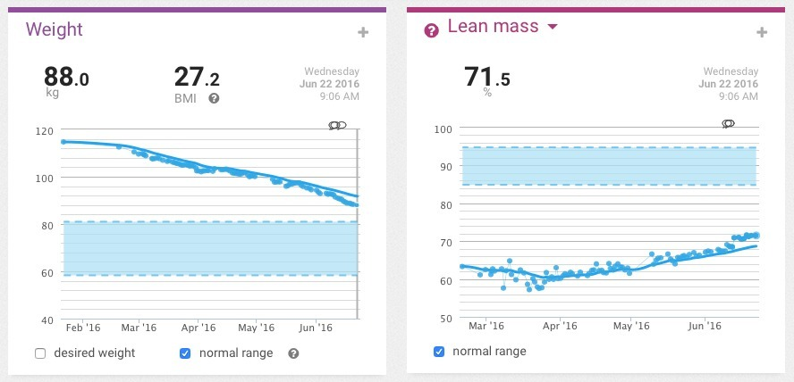
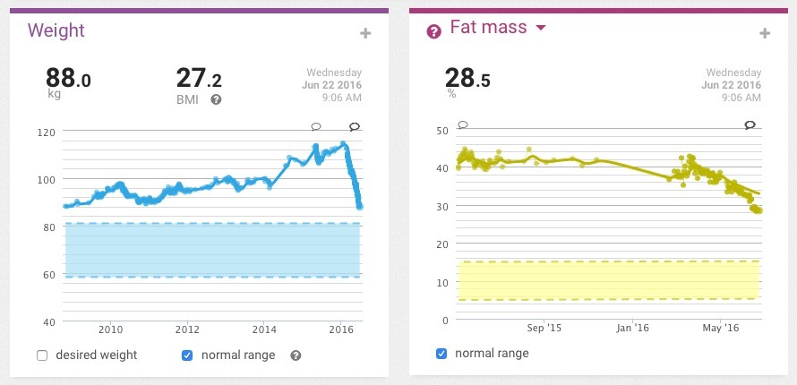
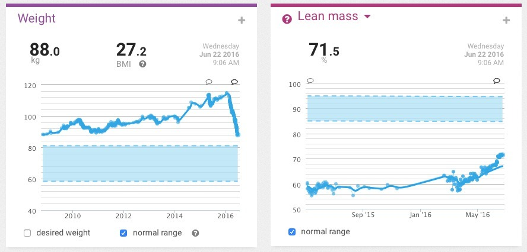
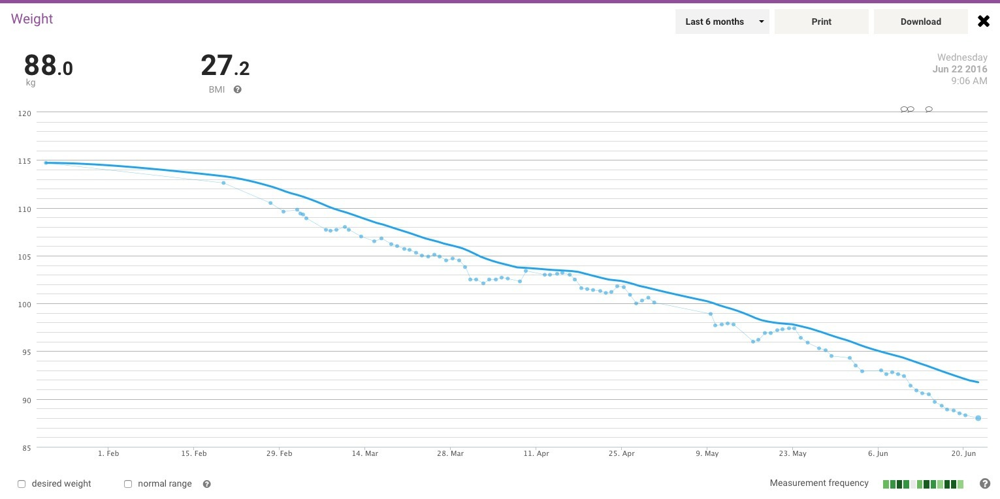

Mission accomplished. Today on the 22nd June 2016 I have finally reached 88.0 kg. This puts me at the lowest weight in my recorded history. Records date back to October 2008, a mere eight years ago. Alright, almost eight, and maybe not that mere. Chicken and milk. That's how it was _mostly_ done.

Let's have a look at some more cool screen caps though. First up, the last six months (or thereabouts) of lean / fat percentages. I like where the trends are heading.

You'll have to take those lean / fat percentages with a pinch of salt, though. They're coming from my consumer body-composition scale, and I'm much more interested in watching the lines head in the right direction than pretending the exact numbers are medical measurements.

Next we have the weight history since late 2008 crammed onto tiny charts to make it look dramatic, alongside the more recent body-composition readings.

Up next is the last six months where I sat at a massive 114.7 kg and have shed 26.7 kg to date.

The goal though is to have lost around 35 kg, putting me around the 80 kg mark and into the BMI "healthy weight" category I was aiming for. Yep, bragging rights will be mine. Thanks BMI scale. To think I was happy to go from "Obese" to "Overweight", imagine what it will be like when I hit "Healthy"! Might be a good day for... cake? Or was that all a lie...

**Full steam ahead to the magical 80 kg mark!**

### Sources

- [Healthdirect Australia - BMI and Waist Circumference](https://www.healthdirect.gov.au/body-mass-index-bmi-and-waist-circumference)
