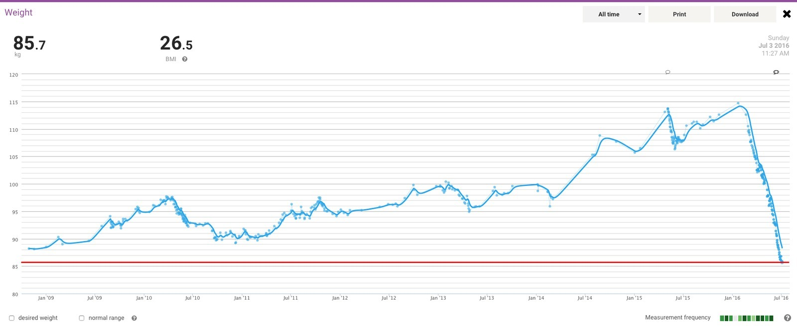
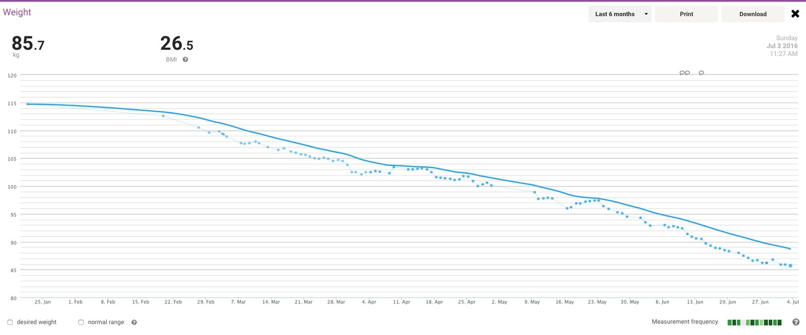

*The longer view of the weight graph, now down to 85.7 kg. Quite a change from those earlier peaks!*
{: .media-caption }

That's a much clearer picture of the journey I'm on. Happy I'm heading in the right direction, hope I can continue to trend downwards!

*Six months of measurements make that downward trend rather obvious. Another new record in early July 2016!*
{: .media-caption }

The six-month view makes the shorter-term trend much easier to see.
