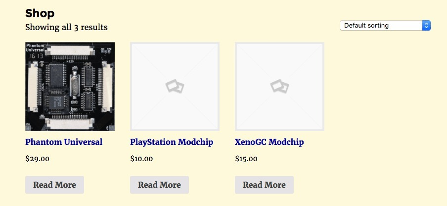
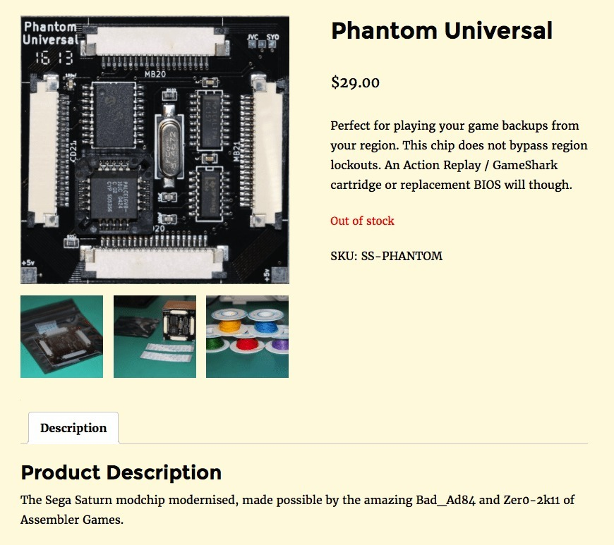
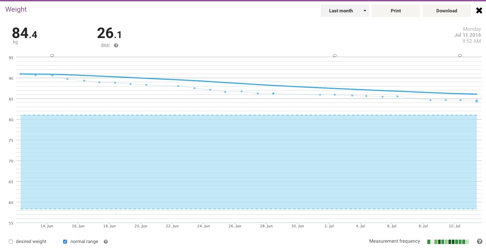
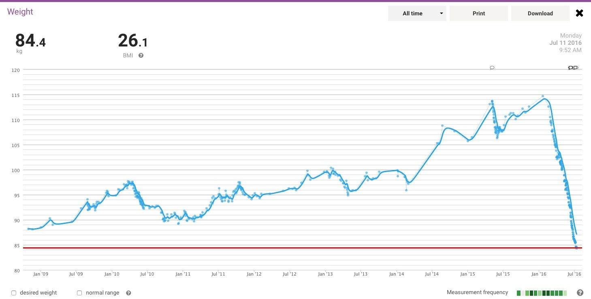

*The little shop, initially offering three modchips. A modest start, but WooCommerce made it look rather respectable!*
{: .media-caption }

The shop is starting to come together quite well. I'll only be selling a small selection to start with, but it looks like it should scale nicely if I need to add more products. The XenoGC is one example: I picked up a few for myself and a few for the store.

*Phantom Universal for the Sega Saturn, as it appeared in the new shop. Out of stock already? Apparently!*
{: .media-caption }

So all should be ready for an August launch. Thanks again to WooCommerce and WordPress for making it so easy, especially compared with that beast OpenCart... open doesn't always mean good. Errr, not you WordPress, you're good, don't worry!

*The one-month graph on 11th July 2016, down to 84.4 kg. That shaded target range was getting closer!*
{: .media-caption }

I know, I know... I did say I wouldn't report on my weight-loss efforts until I reached the goal of 80 kg, but it's incredible to watch the weight just disappear. The graph above shows the BMI "healthy weight" range, with my target just inside the blue zone.

*All those years of measurements, and then the plunge towards 84.4 kg in 2016. Quite the dramatic finale to the graph!*
{: .media-caption }

Look at that decline. 2016 has clearly been the year to lose weight. I'm at least 3 kg below where I was when I first started to notice my weight gain. That's the only reason someone weighs in, right? Since January I've been losing an average of 1.08 kg a week. As I get closer to the range I was aiming for, I'm moving back to three meals a day from two and gradually increasing my food intake.



I've promised myself to do some more YouTube videos this week, and I usually do what I say I'm going to do. Usually... :) Oh, and I fixed that darn lightbox (image zooming) on individual posts. I did lose it somewhere else, but that's fine.

### McRetro Gaming Shop

- [eBay - Open for Business](/ebay-open-for-business/)
- [McRetro Gaming Shop Grand Opening!](/mcretro-gaming-shop-grand-opening/)
- [eBay, You Glorious Beast](/ebay-you-glorious-beast/)
- [The Shop is Closed!](/the-shop-is-closed/)
