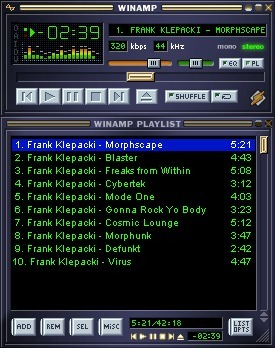
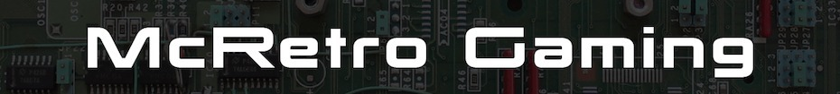
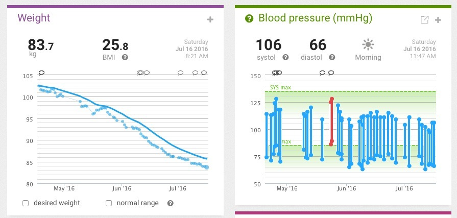

*Winamp 2.95 still playing Frank Klepacki through CrossOver. It really whips the llama's ass! :)*
{: .media-caption }

First off let's start the day by reporting that Winamp 2.95 works great with CrossOver 15.1. I'm sure I'd used it in the past and it wouldn't output audio, but now - it does! Pretty important for an MP3 audio player to be able to play MP3s.

On the software front, I also upgraded to the macOS Sierra Public Beta and iOS 10 Public Beta. Both are quite lacklustre.

macOS may have Siri, but it can't set timers yet, only reminders. That's all I use Siri for... timers. What wonderful times we live in... 10.12 is essentially a tuned 10.11 with more iTunes crashes than I can count on one hand. Maybe it will polish up nicely by the final release. Then again, this is Apple we're talking about, so maybe by 10.14! 😉

*The McRetro Gaming banner used for the little eBay adventure. Nothing says retro like a circuit board and enormous lettering!*
{: .media-caption }

Now onto eBay. The eBay shop will have some things, but there won't be any modchips due to the eBay / PayPal stance on them. No modchips! Anyway, find me on eBay to see the items for sale. Nothing retro gaming yet, although I think a RetroN 5 might be listed a bit later. My new seller account is limited to 10 items, so I'll have to build up my feedback by selling odds and ends around the place before starting this "business venture".

*Weight at 83.7 kg and a blood-pressure reading on the same screen. Another pair of graphs to pore over!*
{: .media-caption }

In other news, weight loss is progressing well. Down to 83.7 kg, which is a minuscule 2.7 kg, or about 0.8 BMI points, above the BMI category I was aiming for. I should be there within the next two months, then it's all about maintenance and sticking around that range instead of dropping off and fading into the distance.

My 4XL jacket has to go in the clothes recycling pile, it's just waaaay too big now. Very interesting to see the difference in not being able to fit my own clothes. It used to only be in the other direction - size increases, not decreases! My pants have dropped... literally, from a size 42 to a size 36 / 34. My shirts are down to 2XL or even just XL which is definitely where I remember being in 2008. Party on! :-D

### McRetro Gaming Shop

- [Ye Olde McRetro Gaming Shoppe](/ye-olde-mcretro-gaming-shoppe/)
- [McRetro Gaming Shop Grand Opening!](/mcretro-gaming-shop-grand-opening/)
- [eBay, You Glorious Beast](/ebay-you-glorious-beast/)
- [The Shop is Closed!](/the-shop-is-closed/)
