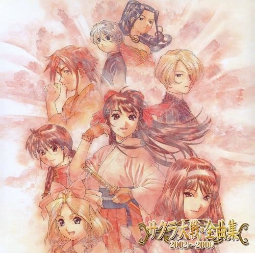
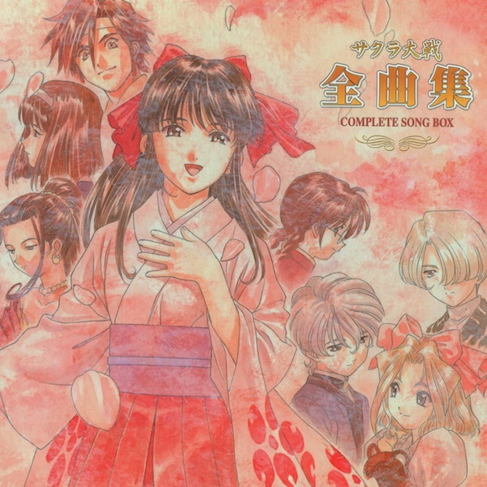

*The Sakura Wars 2002-2006 collection. Eight lovely discs, and I thought that was the complete story!*
{: .media-caption }

The first box was released in December 2006, and the music was fantastic. But what's this next image?

*And then I discovered the earlier Sakura Wars Complete Song Box. Another eight discs! How had I missed this?*
{: .media-caption }

The earlier **Sakura Wars Complete Song Box** was released in December 2002, covering the material I'd been missing. You can imagine my delight. Put both collections together and that's **sixteen discs** of amazing music!

**Sakura Taisen forever!** On a related note, I have never played a Sakura Taisen game... I should probably do that, shouldn't I?

### Sources

- [Sakura Taisen official catalogue - Complete Song Box (2002)](https://sakura-taisen.com/archives/goods/avex12.html)
- [Sakura Taisen official catalogue - All Songs Collection 2002-2006](https://sakura-taisen.com/archives/goods/wavemaster14.html)
