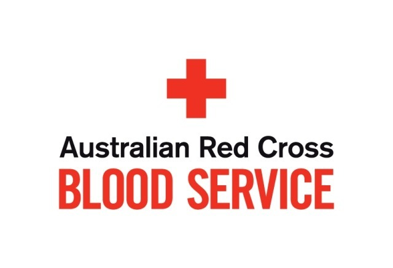
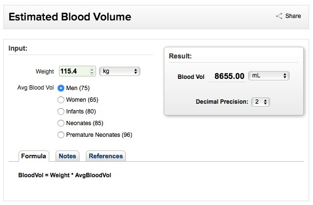
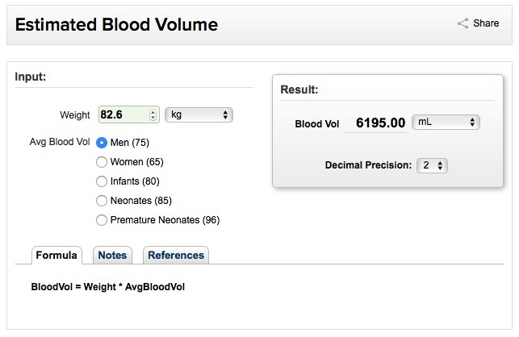
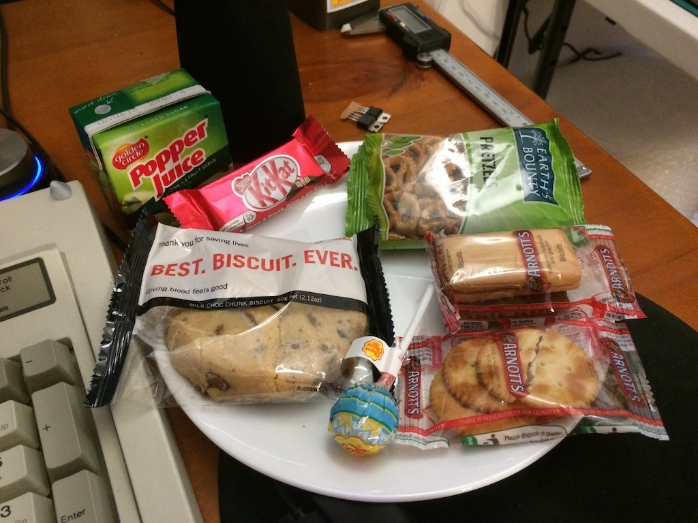

*The Australian Red Cross Blood Service logo, before I got into the numbers and the donation adventure itself.*
{: .media-caption }

Since late 2014 I'd noticed the blood-donation van turning up every few months, so I figured why not give some blood? Wish I had discovered this thing earlier, as giving blood can even be kind of fun and, at the very least, FREE CANDY! It is not entirely without its problems though.

*The calculator's estimate using 115.4 kg and 75 mL/kg: 8.655 L. A formula, mind you, not a measured blood volume!*
{: .media-caption }

At my largest recorded weight, 115.4 kg, this calculator estimated my blood volume at 8.655 L. These days though...

*Same calculator, now using 82.6 kg for an estimate of 6.195 L. Interesting arithmetic, but not a diagnosis of anything.*
{: .media-caption }

At 82.6 kg, the same calculator gives me 6.195 L, a difference of 2.46 L between the two estimates. Mind you, it's simply using a fixed 75 mL/kg formula, not actually measuring the blood sloshing around inside me. With a 500 mL donation, that gives the rough 5.8% and 8.1% figures I originally quoted. Interesting numbers, but they don't tell me for certain why I nearly fainted.

This particular donation did not go quite as smoothly. About half an hour after getting home I was checking emails and chatting away on the old [ASSEMblergames.com](https://web.archive.org/web/20170628092428/https://assemblergames.com/) forums when I realised I'd been drinking so much water that my bladder was about to explode. Naturally, off to the bathroom.

Partway through I felt a sudden rush leave my head. I looked in the mirror, noticed my pupils looked rather dilated, then my vision started fading towards black and my ears began ringing. Instinctively I headed back to the bedroom and flopped onto the bed. Consciousness was never lost.

I noted the time, 3:46 pm, and spent the next 20 minutes lying there listening to some tunes. What an experience!

At the time I thought 150 g of salmon and Savoury Shapes hadn't been enough to eat beforehand. I also wrote that one of my lessons should be to reduce or skip my propranolol dose before donating.

Nope. That wasn't something I should have decided for myself. Prescription medication isn't something to adjust on a whim before donating blood, and I should have checked with my prescriber and the donor service instead. Following Lifeblood's preparation and aftercare instructions, discussing medications and previous reactions, and telling the staff when something feels wrong make a lot more sense.

*Some of the magnificent post-donation snacks. Free biscuits, chocolate, juice and a lollipop. Worth photographing, obviously!*
{: .media-caption }

I also managed to reopen the needle site and bleed on the driveway before getting into the car. Which was actually excellent timing because at least I wasn't bleeding all over the car and my fancy jeans. Donating still helps people who need it, so I'm happy to keep doing it when eligible.

Plus you get all those junk foods! :) Cheat day!

### Sources

- [Australian Red Cross Lifeblood - Fainting or feeling faint](https://www.lifeblood.com.au/donors/blood-plasma-platelets/making-a-donation/prepare-and-aftercare/fainting)
- [Australian Red Cross Lifeblood - Prepare and aftercare](https://www.lifeblood.com.au/donors/blood-plasma-platelets/making-a-donation/prepare-and-aftercare)
- [Australian Red Cross Lifeblood: Prescribed Medications and Donation Eligibility](https://www.lifeblood.com.au/faq/eligibility/medications-vaccines-treatments/prescribed-medication)
