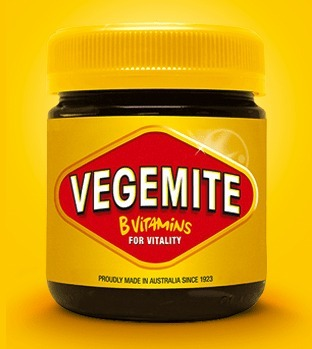
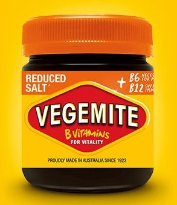
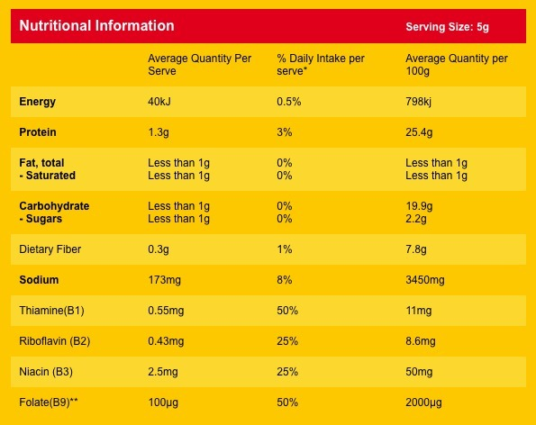
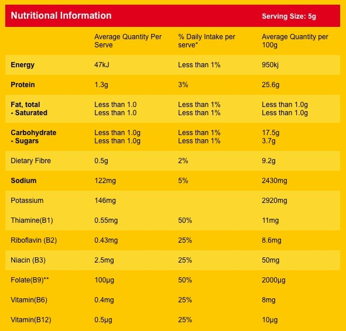

*Good old regular Vegemite. Australia in a jar, provided you don't try eating it by the spoonful.*
{: .media-caption }

Vegemite. It is in our blood. Too bad it's owned by the multinational Mondelez... That aside, while recently expanding my **palate** to include foods such as salmon, lemons and garlic powder... ha!... I came across this beast:

*Salt Reduced Vegemite, now with extra B6 and B12 on the label. Could it possibly taste like the original?*
{: .media-caption }

**Salt Reduced Vegemite.** What really caught my eye was not the reduced salt but the added vitamin B12. B12 is an important vitamin that I was lacking mid-last year. As you should know from being awesome and reading my blog, B12 has a cobalt atom sitting in the middle of a very complex-looking web of a molecule. Very cool cobalt!

*The nutritional panel for regular Vegemite, including 173 mg of sodium per 5 g serve. Science on toast!*
{: .media-caption }

*The Salt Reduced Vegemite nutrition panel: 122 mg sodium and added B6 and B12 per serve. More labels to investigate!*
{: .media-caption }

The nutrition panels above show more fibre and energy per 5 g serve in this salt-reduced version, with newly added B6 and B12. This is great news. I wonder how it tastes? It's hard to imagine Vegemite tasting anything but salty. We'll know soon enough, stay tuned!

### Sources

- [Bega Cheese Limited - Annual Report 2017](https://begagroup.com.au/wp-content/uploads/2017/08/2017-Bega-Annual-Report.pdf)
- [NIH Office of Dietary Supplements: Vitamin B12 Health Professional Fact Sheet](https://ods.od.nih.gov/factsheets/Vitaminb12-HealthProfessional/)
