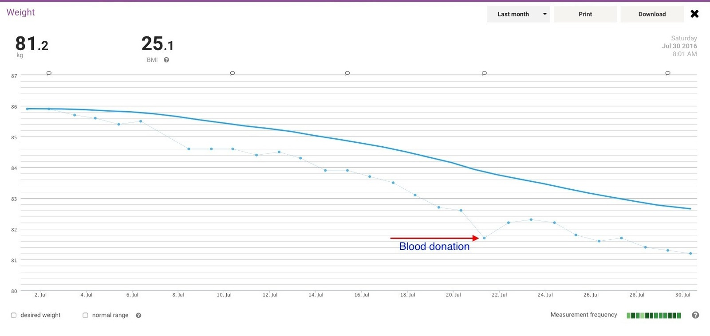
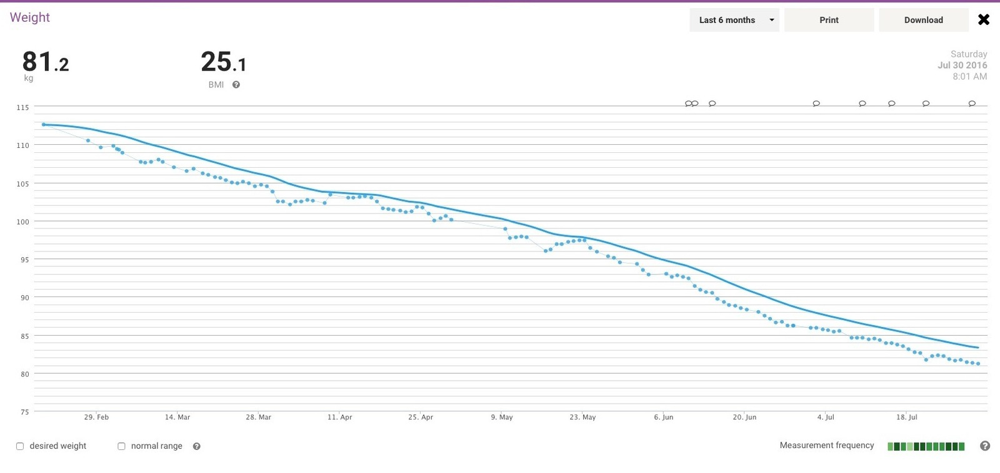

I've been using roughly 500 g to 1 kg per week as my target for losing weight. So far this year's running average is around 1.13 kg per week, which is a little faster than I'd planned.

There's a curious little movement in the graph around my blood donation. I wonder how much of that is simply fluid balance changing? Between water, food, glycogen and everything else, the scale can't really tell me exactly what's responsible for a particular bump. Interesting to watch, though!

So why not average everything since my first recorded weigh-in in late October 2008? On my rough calculation, that gives around 0.017948718 kg per week. All that weight gain in between? Clearly just part of the master plan to lose weight at a slower average rate. 0.02 kg is about four servings of Vegemite per week in weight.

Maybe I'm using the wrong sort of average. Oh, that's right. I purged all that information from my mind when the university bridging course ended six months ago.

Did I mention I'm at 81.2 kg? Just 200 g outside the BMI category I've been aiming for. Muahahaha! :D
