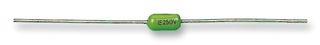

*One of those little axial PICO-style fuses. The shape is familiar, but selecting a replacement means checking more than just the current rating!*
{: .media-caption }

Back in March 2012 I replaced a fuse in a [Sega Mega-CD](/fuse-replacement-on-the-sega-mega-cd-model-1/), and the good news is these PICO parts are still around. This time I'm looking at the fuses used in the Super Nintendo and Super Famicom, and there's an interesting difference in the ratings.

First things first, though. Before replacing one of these fuses, I need to make sure it's actually blown. A multimeter should settle that question, although finding out why it failed in the first place is another matter entirely!

I'd been wondering whether PAL consoles needed 250 V fuses because of our higher mains voltage in Australia, while NTSC machines should use 125 V parts. Nope! It doesn't work quite like that.

The fuse is in the console's low-voltage circuit after the external power supply. Its voltage rating is the maximum circuit voltage it can safely interrupt, so a 250 V rated fuse can also be suitable for a much lower-voltage circuit. It doesn't mean the Super Nintendo somehow has 250 V running through it!

There's more to choosing a replacement than matching the current rating, too. I need to consider:

- The required current rating.
- The operating speed or time-current characteristic.
- The voltage and interrupting ratings for the actual AC or DC circuit.
- The correct physical package.

The 1.5 A, 250 V Littelfuse PICO parts I've found look like candidates, provided their other characteristics match what the particular board requires. Certainly not something to assume for every Super Nintendo and Super Famicom ever made!

The parts I've been looking at include the ["LITTELFUSE 026301.5WRT1L FUSE, PCB, 1.5A, 250V, VERY FAST ACTING"](https://docs.rs-online.com/d2e5/0900766b8146424d.pdf) and ["LITTELFUSE 026301.5MXL FUSE, PCB, 1.5A, 250V, VERY FAST ACTING"](https://au.element14.com/littelfuse/026301-5mxl/fuse-pcb-1-5a-250v-very-fast-acting/dp/1183391).

```text
Product Range: PICO II Series Fuse
Current: 1.5A
Voltage Rating V AC: 250VAC
Blow Characteristic: Very Fast Acting
Fuse Case Style: Axial Leaded
Breaking Capacity Current AC: 50A at 250VAC
```

If the replacement fuse blows straight away, that's a fairly good sign there's another fault to investigate. No point feeding the console a never-ending supply of fresh fuses!

Replace those caps, you know you want to! ...after actually diagnosing the problem. ;)

### Sources

- [Littelfuse: PICO II 263 Series 250 V Very Fast-Acting Fuse (2013 Datasheet)](https://docs.rs-online.com/d2e5/0900766b8146424d.pdf)
- [Littelfuse - Fuseology Selection Guide](https://www.littelfuse.com/assetdocs/fuseology-selection-guide?assetguid=e0a12d55-c89a-4e06-94e0-9fe3281f889f)

### Related Posts

- [Fuse Replacement on the Sega Mega-CD Model 1](/fuse-replacement-on-the-sega-mega-cd-model-1/)
- [PICO Fuses by Littelfuse](/pico-fuses-by-littelfuse/)
