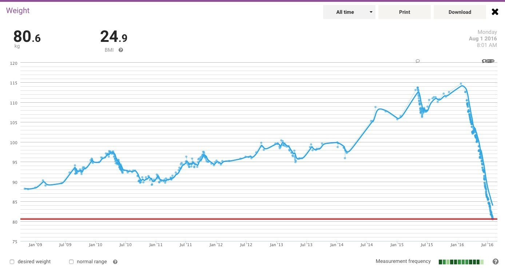
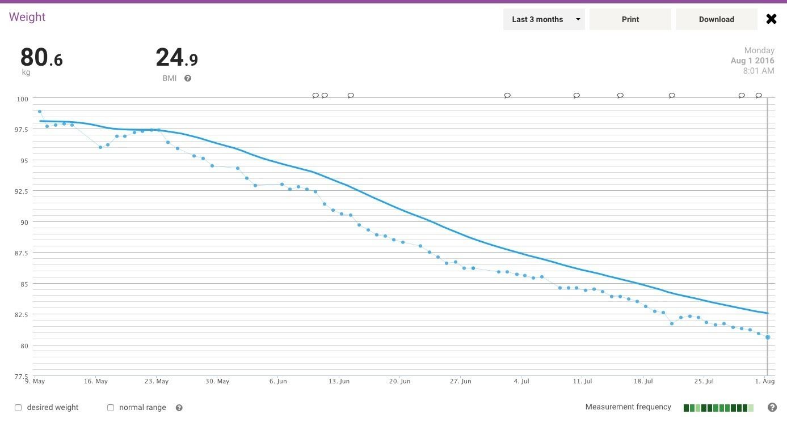

Johnny Five is alive!

I think I've won this particular 2016 game. I've finally entered the **healthy weight** BMI category after starting out with an "obese" BMI of thirty-five-point-something. Incredible!

For most adults, the healthy BMI category runs from 18.5 to 24.9. BMI isn't the whole story, of course. It doesn't distinguish muscle from body fat, and there's considerably more to being healthy than a number on the scale. Still, reaching this particular goal feels rather good!

In my head, this means I've reached a nice place to live for the rest of my salmon, chicken, milk, high-grain and low-carb-bread days. At least I'm enjoying what I'm eating!

Above is a snapshot of the last three months. My master plan is to start putting the brakes on by gradually increasing my energy intake, 5% at a time, until my weight stabilises.

That should make for an interesting little experiment. I'll have to see how the numbers behave rather than assume they'll do exactly what I want.

Johnny Five NEED INPUT!

### Sources

- [Healthdirect Australia - Body mass index (BMI) and waist circumference](https://www.healthdirect.gov.au/body-mass-index-bmi-and-waist-circumference)
