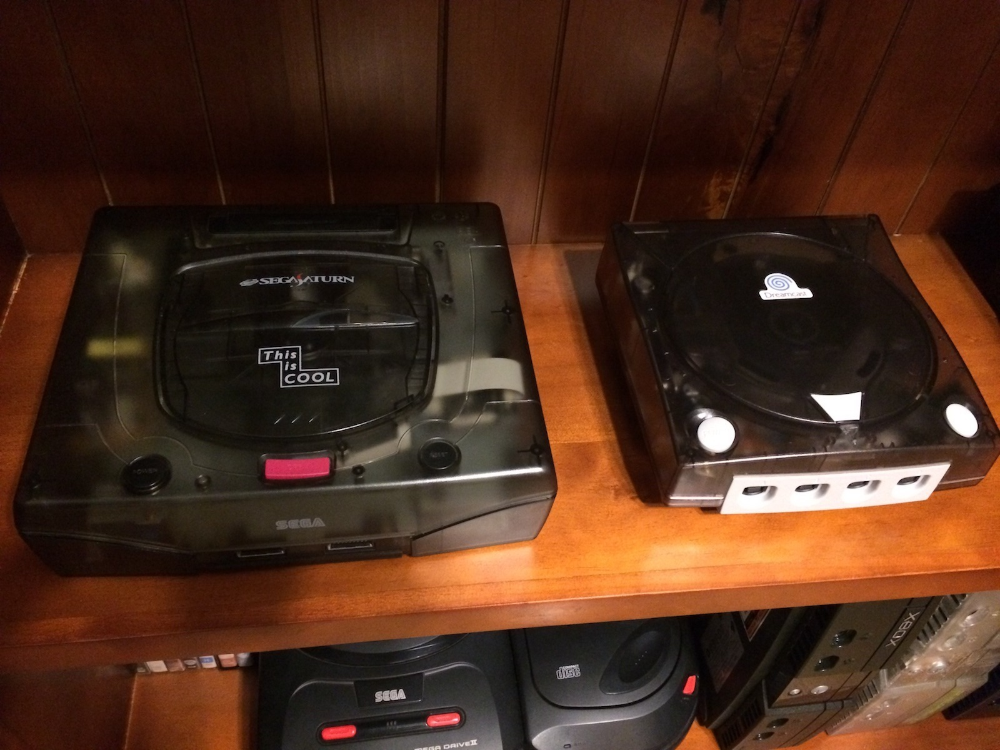

I've moved a smoke (and sun) discoloured Dreamcast into a fresh translucent grey shell. It fits in pretty well with the This is COOL Saturn.

I had a Broadband Adapter (BBA) in this particular Dreamcast, so I Dremelled away at the modem opening in the replacement shell to make room for the BBA's RJ45 ethernet socket.

For once... it worked. Usually when I try to make things look tidy I end up melting something, or at least starting some sort of firestorm. Not today, not today. ;)
