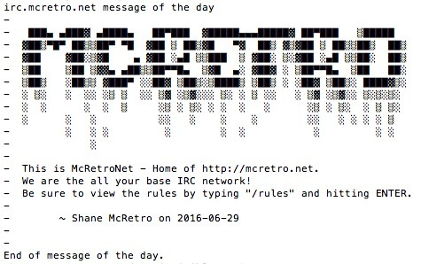

*Farewell, McRetroNet IRC! At least that block-letter welcome banner lived up to the occasion.*
{: .media-caption }

Running an IRC server was an interesting experiment, and I eventually got the whole thing working properly. It is now defunct and has been removed from the McRetro.net server. Nothing much happened on it and it was taking up space in my dock, so with very little regret we bid the McRetroNET IRC Server farewell.

**Update 17th August 2016:** The next little web experiment was [Eleventy7.net](/the-birth-of-eleventy7-net/), a site dedicated to the old!

You will always live on in our hearts.

Plus, it was fun getting it all working!

### McRetroNet IRC server

- [Initial Tests for a McRetroNet IRC Server](/initial-tests-for-a-mcretronet-irc-server/)
- [SSL / TLS / HTTPS Enabled, IRC Server Running](/ssl-tls-https-enabled-irc-server-running/)

### Sources

- [Original Twitter post (765828779847454724)](https://twitter.com/i/web/status/765828779847454724)
