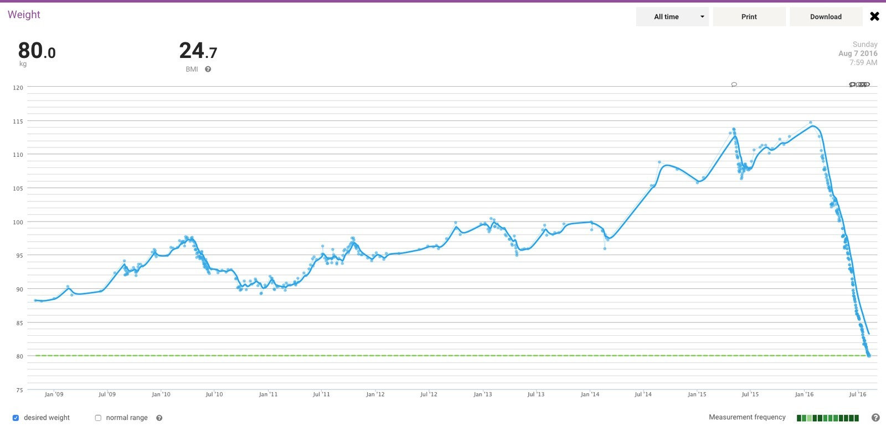
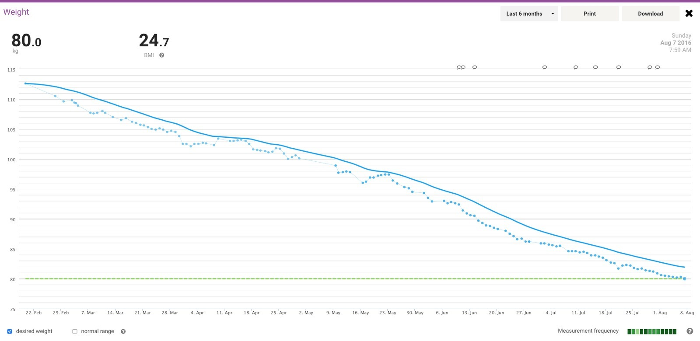
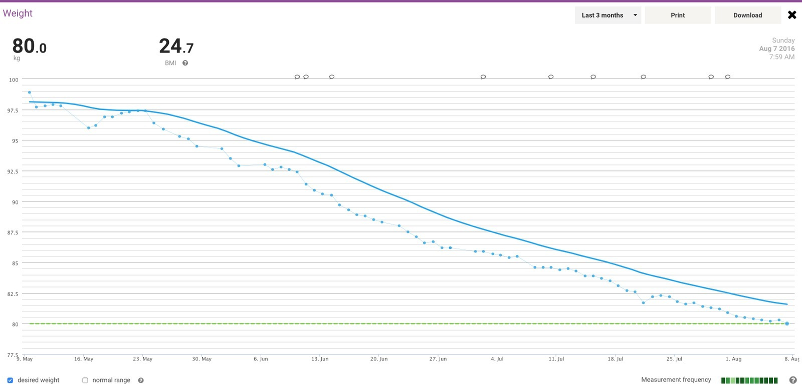
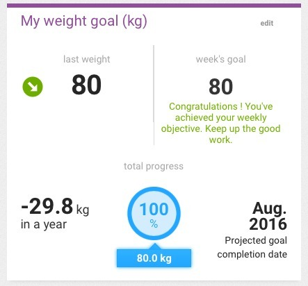

*The all-time Withings chart finally touches my 80 kg goal line. Mission accomplished!*
{: .media-caption }

Look at that! I don't need to slap a red line on this one. The goal line in green is more than enough to show I've hit my target, at an average rate of 1.14 kg per week for the past seven months. 35.4 kg shed and my meals 30% tastier. (I miss you, deep-fried potato chips.) From 115.4 kg to a mere 80 kg in seven months and one week.

*Six months of blue dots and a green goal line at the bottom. That's a lot of numbers!*
{: .media-caption }

Dots, lots and lots of dots. Above is the six-month look back. I'll update the blog with my current diet as of August in the next few hours. It's quite interesting to see what 60% of an 8200 kJ diet consists of. Most of the things are delicious, as in I could eat them every day!

*Three months of progress, all the way to 80 kg. Now, back to those retro projects and YouTube videos!*
{: .media-caption }

Above is the last three months. One important thing for me is eating food I actually want to eat, not sacrificing chicken for celery. No one wants to eat salad. If they do, there's probably a screw loose or a crossed wire!

Salad ain't got no energy... well except maybe the dressing, so why not just have chicken with mayo? Peri-peri mayo, that is. That's the sort of food that's making this whole thing a lot easier to stick with. ;)

*The goal dashboard even gave me a 100% progress circle. It would have been rude not to take a screenshot! :)*
{: .media-caption }

Mission accomplished, now I have to get making and editing some YouTube videos like I promised! :)
