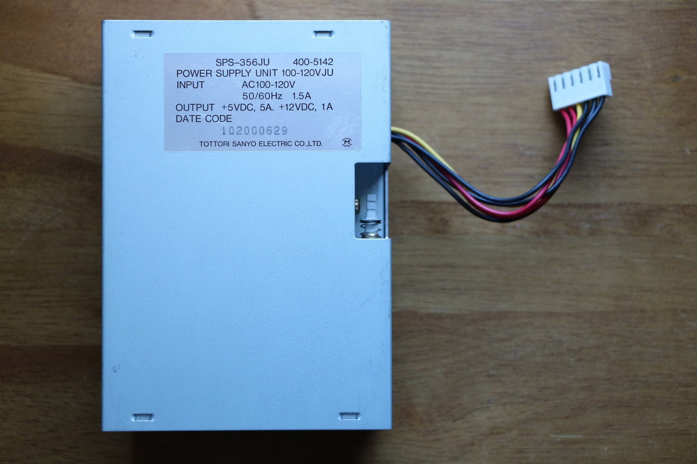
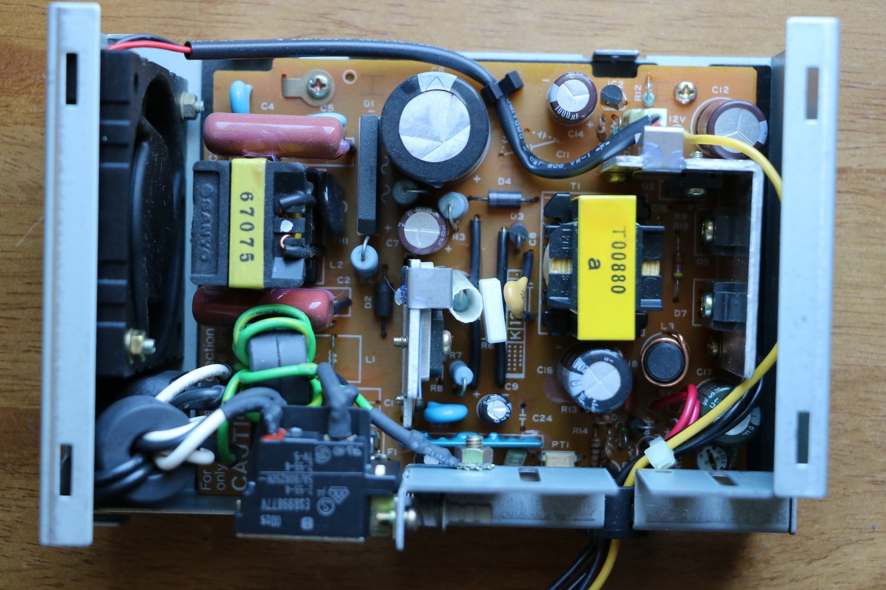
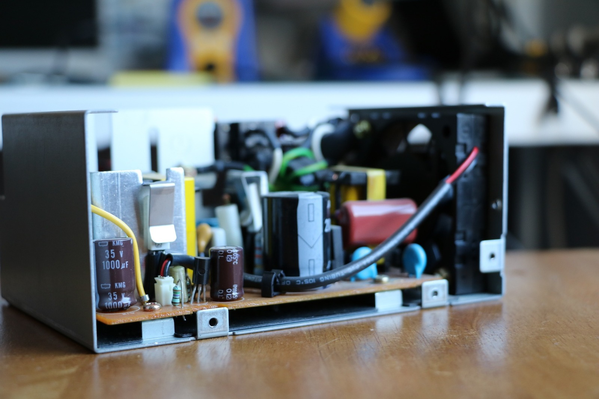
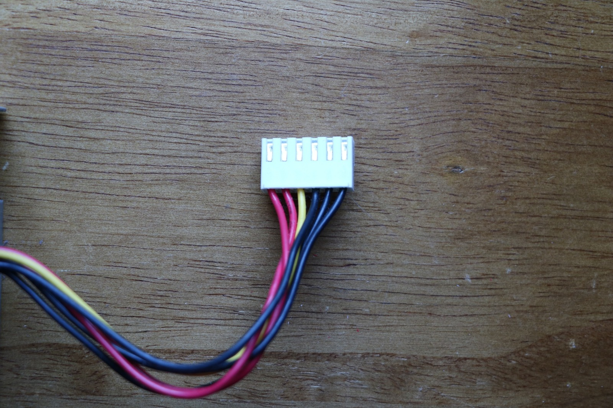
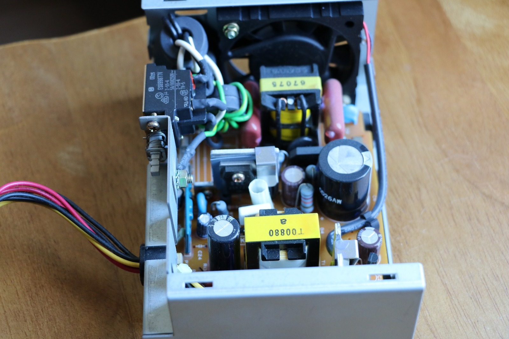
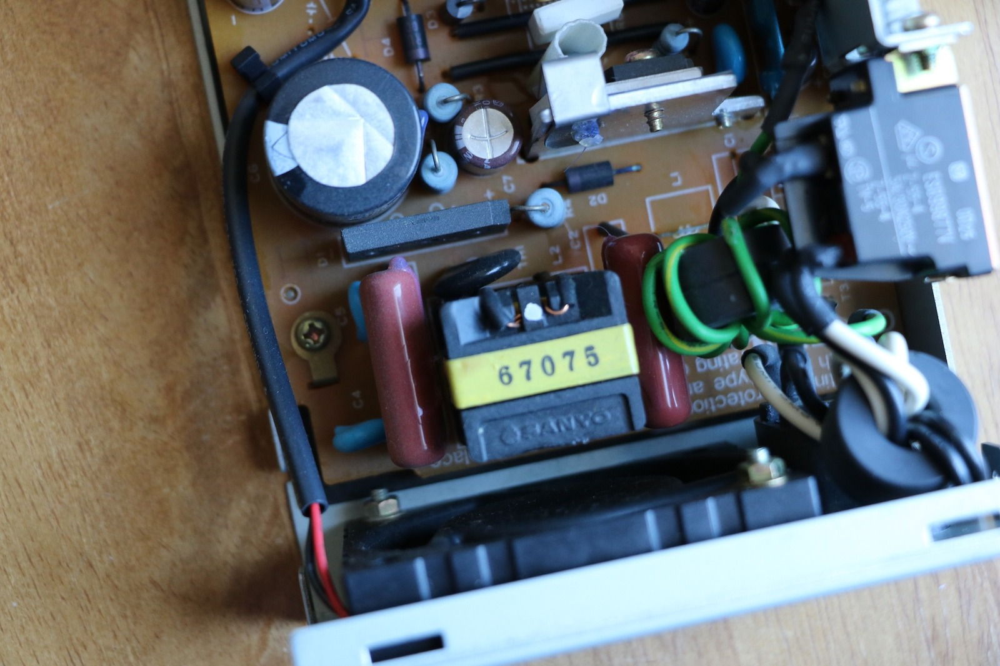
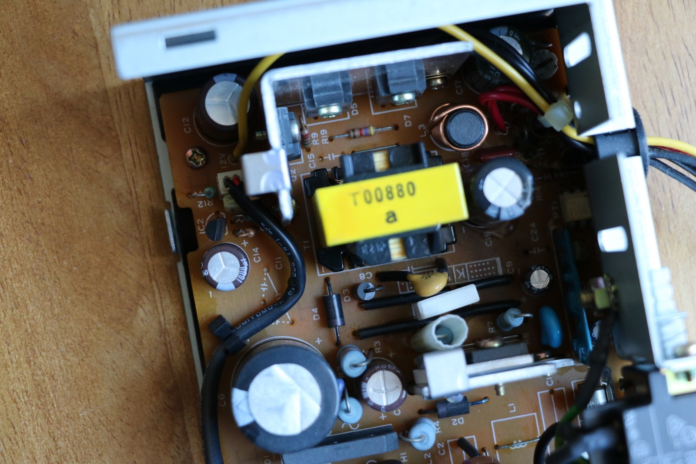

*The TeraDrive power supply's SPS-356JU label, including its +5 V and +12 V outputs. At least identifying the troublesome module was straightforward!*
{: .media-caption }

The troublesome power supply here is an SPS-356JU, part 400-5142. Its label gives +5 VDC at 5 A and +12 VDC at 1 A, and the TeraDrive's serial number is 102000629. I've got two TeraDrives to play with, which is rather handy when one of them decides it doesn't want to cooperate!

There's a Model 2 with dual floppy drives and a Model 3 with its original 30 MB WDL-330P hard drive, hilarious edge connector and one floppy drive. Both have XTIDE cards installed with at least 2 GB of storage, so I've got a few options when it comes to swapping parts around.

*A look inside the TeraDrive power supply. Nothing obviously exploded, which made the buzzing fault all the more annoying.*
{: .media-caption }

One of the machines has been producing a buzzing or clicking hum through the internal speaker and refusing to complete POST. I've stripped it back to a minimal configuration without any improvement, so it's time to start swapping things around.

And would you believe it? With the other power supply installed, the machine roars back to life! That narrows the problem down rather nicely. Unfortunately, knowing which module is faulty doesn't tell me which component inside it is responsible.

*The capacitors and heatsink seen from the side. The failing supply's voltage dropped under load, but this photograph alone doesn't tell us why.*
{: .media-caption }

I've labelled the faulty supply 0629 and the working reference supply 1135. There's nothing obviously wrong with the faulty one to my naked eye, no great big blown capacitors or anything else jumping out at me.

Have a look at the photos below and see if you can spot anything peculiar. In the meantime, here are the measurements I've taken.

**1135 - Working Reference PSU**

- 12 V rail, no load: 11.46 V
- 5 V rail, no load: 5.00 V
- 12 V rail, powered on: 12.16 V
- 5 V rail, powered on: 5.17 V

**0629 - Faulty PSU**

- 12 V rail, no load: 11.14 V
- 5 V rail, no load: 4.93 V
- 12 V rail, powered on: 10.73 V
- 5 V rail, powered on: 3.10 V

Well, there's something interesting! The faulty supply is losing a considerable amount of voltage under load, particularly on the 5 V rail. Bad capacitor? Transformer? Transistor? Search me! At least I've got a symptom to start chasing.

I've called on the folk at [ASSEMblergames.com](https://web.archive.org/web/20170628092428/https://assemblergames.com/) to see whether somebody has an idea. Fingers crossed!

Plan B is to pay somebody who actually enjoys working on mains power supplies to repair it. Frankly, that sounds rather sensible to me. I'm not terribly fond of working on mains power devices, especially when they can contain lethal voltages and retain charge after being unplugged.

*The TeraDrive supply's six-position connector and its bundle of wires. I'll want the proper pinout before contemplating a replacement supply!*
{: .media-caption }

Actually, there's a Plan C as well: somehow adapting a PicoPSU. The -5 V and -12 V rails are giving me something to think about, although I need to work out what the actual TeraDrive wiring and expansion hardware require before deciding whether an ATX-derived supply would be suitable.

Hopefully my knight in shining armour answers the call! In the meantime, here's a closer look at the troublesome hardware.

*Another angle of the TeraDrive supply internals. Plenty to inspect, although I'm not volunteering to poke around live mains circuitry!*
{: .media-caption }

*A close-up of one of the yellow-marked components and its neighbouring circuitry. No obvious villain revealed itself in the photograph.*
{: .media-caption }

*One last look around the power-supply board. The known-good swap identified the bad unit, not the individual component responsible.*
{: .media-caption }

If you want to follow the discussion, have a look at the archived [Sega TeraDrive PSU Repair - Trinity! Help!](https://web.archive.org/web/20191113051221/https://assemblergames.com/threads/sega-teradrive-psu-repair-trinity-help.62709/) thread on [ASSEMblergames.com](https://web.archive.org/web/20170628092428/https://assemblergames.com/).

### Related Posts

- [Sega TeraDrive Model 3 Power Supply Failure](/sega-teradrive-model-3-power-supply-failure/)
- [Sega TeraDrive Model 3 - Faulty Power Supply (Part 1)](/sega-teradrive-model-3-faulty-power-supply-part-1/)
- [Sega TeraDrive Model 3 - Faulty Power Supply (Part 2)](/sega-teradrive-model-3-faulty-power-supply-part-2/)
- [Sega TeraDrive - Retrofitting a Mean Well PT-65B PSU](/sega-teradrive-retrofitting-a-mean-well-pt-65b-psu/)
