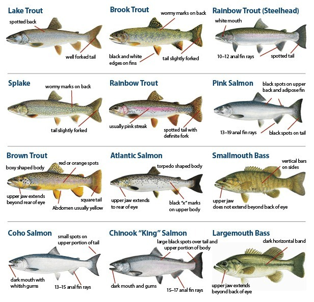
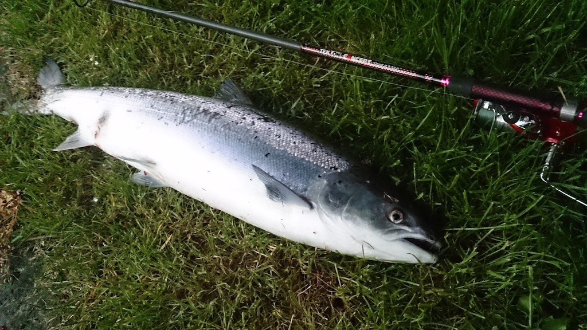
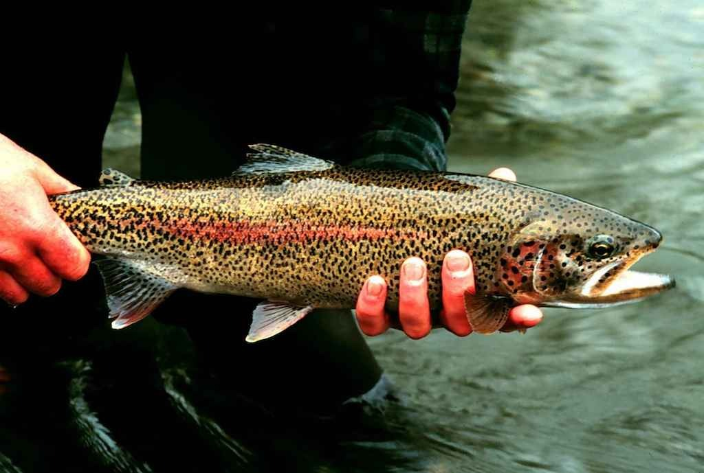
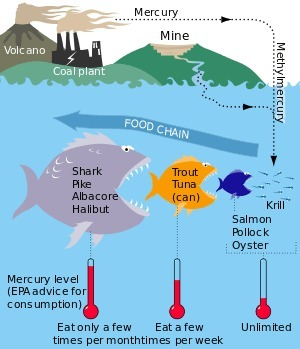

*An illustrated identification guide for trout, salmon and a couple of bass species. I promise this started as a serious comparison!*
{: .media-caption }

I know a lot of you enjoy reading this blog and I can't help but blog utter rubbish. Today the topic is salmon, or rather trout and the similarities it shares with salmon. There's been a lot of misinformation going around and I'd like to help stir that pot of chaos.

*Salmon, apparently preparing to do some fishing itself. There's a fishing rod right next to it, after all!*
{: .media-caption }

Salmon is just like trout shown above in its natural environment on a grassy knoll with its favourite fishing rod at fins reach. It's called fishing for a reason. Just like humaning, or peopling.

*A spotted trout being held above the water. Still no actual evidence that it works as a rifle, thank goodness.*
{: .media-caption }

Trout is just like salmon and can often be used in place of a rifle. While only 70% as effective as a rifle, it sure does look spectacular.

*The mercury food-chain illustration used in the article. It's a simplified guide, not a universal mercury reading for every fish.*
{: .media-caption }

In my thoroughly unscientific fish battlefield, salmon is such a terrible predatory creature that it gets eaten by trout. Eaten by a fish it could have shot!

There is an actual scientific point hiding somewhere under all this fish-related nonsense. Mercury can move through the food chain, as the diagram above illustrates, and the concentrations aren't necessarily the same for every species.

The FDA's monitoring figures from 1990 to 2012 give fresh or frozen salmon a median mercury concentration of **0.015 ppm**, compared with **0.025 ppm** for freshwater trout. The corresponding means are **0.022 ppm** for salmon and **0.071 ppm** for freshwater trout.

Those are figures from the fish sampled, of course, not some sort of universal mercury rating stamped onto every fish in existence. Still, it makes for an interesting comparison!

I vote salmon. Mostly because it tastes better and appears to be more effective as a fictional rifle substitute.

### Sources

- [US FDA: Mercury Levels in Commercial Fish and Shellfish (1990–2012)](https://www.fda.gov/food/environmental-contaminants-food/mercury-levels-commercial-fish-and-shellfish-1990-2012)
