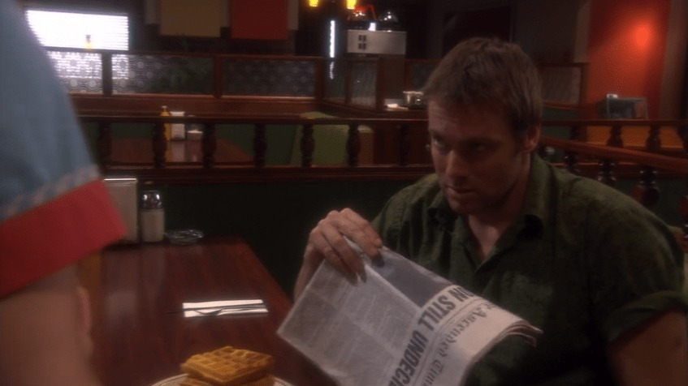
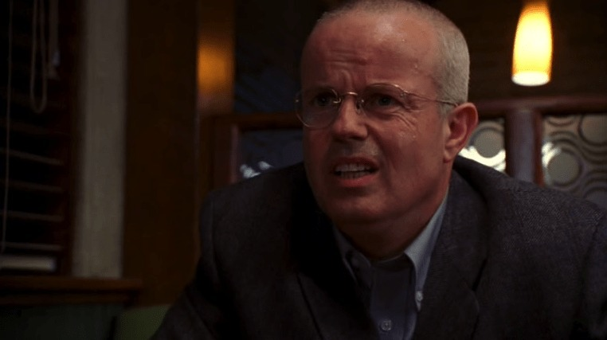
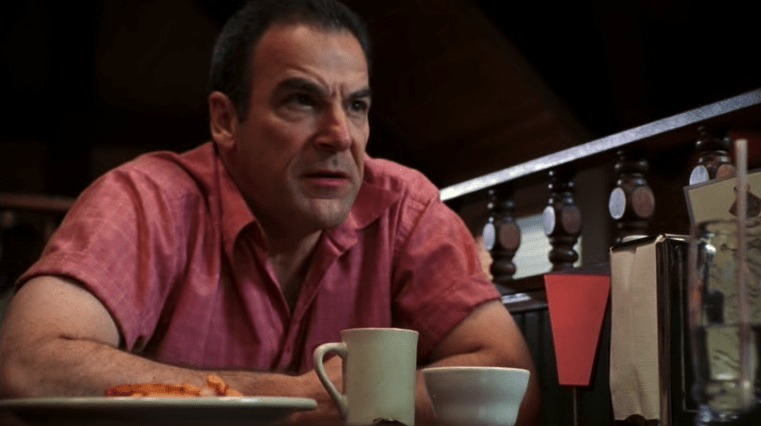

*A diner scene with a newspaper and waffles. Two favourite television shows sharing a familiar-looking set!*
{: .media-caption }

Well I'll be. *Stargate SG-1* reused *Dead Like Me*'s Der Waffle Haus set for "Threads" (S08E18). Not entirely sure why Daniel isn't eating his waffles though. The *Dead Like Me* cast ate there for two whole seasons and he can't even do it for one episode? This is clearly pure fiction! Good on whoever set it all up though to have throwbacks to *Dead Like Me*. Both are great shows.

*And another diner visitor. I was starting to recognise rather a lot about that restaurant!*
{: .media-caption }

Speaking of *Dead Like Me*... Errr... Walter? What are you doing there?

*Back at the diner again. Really makes me want to rewatch the series!*
{: .media-caption }

Boy do I miss Rube! Actually now that I think about it I might have to rewatch *Dead Like Me* or at the very least the second season after I complete my run of *Stargate SG-1*. Rockin'!

### Sources

- [Mental Floss - 10 TV Shows That Recycled Their Sets](https://www.mentalfloss.com/entertainment/tv/10-tv-shows-recycled-their-sets)
