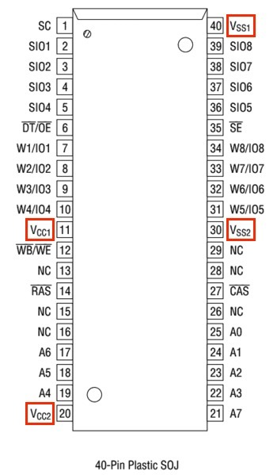
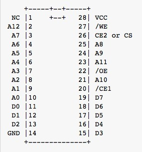
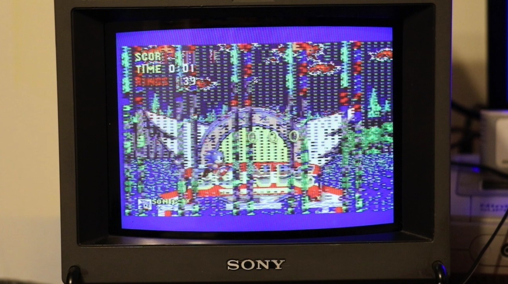



I finally got around to doing some soldering on a somewhat faulty Mega Drive 2 I had lying about. I've been having a look at the old [gieskes.nl](https://web.archive.org/web/20160219222212/http://www.gieskes.nl/) circuit-bending diagram and the VRAM pinout, trying to work out which signals might produce some interesting results.

One thing I'm definitely staying away from is the VCC and VSS power pins. Shorting those isn't my idea of a particularly entertaining experiment, even on a console I'm deliberately trying to make behave strangely!

*The 40-pin VRAM pinout again, with the power and ground pins highlighted. Circuit bending should not involve randomly shorting those!*
{: .media-caption }

On the VRAM I've been concentrating on the address inputs, grounding them to see what happens. The pinout above labels the address lines A0 through A7, and interfering with them produces some wonderfully broken graphics.

Of course, this is circuit bending, not repairing anything. I'm deliberately interfering with the signals, and just because one pin produces an interesting effect doesn't mean the one next to it is safe to short. Best not to confuse a successful glitch with a good electrical idea!

Next up is the Z80 RAM. I've been playing around with address lines A8, A9, A10 and A11, along with /OE and possibly a dash of /CE1. Those last two are control signals rather than address lines, so there's quite a bit more to investigate here.

*Here is the Z80 RAM pinout, with address lines and separate control signals marked. Another source of wonderfully unpredictable glitches!*
{: .media-caption }

Messing with the data lines tends to hang the console completely, which means turning it off and back on again. Plenty more address lines to play with there, though. Let's see just how much of a mess I can make!

I've decided to put circuit bending over on the McRetro Gaming YouTube channel since technically it's some sort of gaming. I'll be doing one of these a week if I remember and people show enough interest in staring at all the pretty patterns and odd sounds. It'll be very interesting to see what each game can do.

*Sonic the Hedgehog in a magnificent state of graphical disrepair on the old Sony CRT. Glorious purple chaos!*
{: .media-caption }

Big thanks to [Console5](https://console5.com/store/) for the pinout reference.

### Sources

- [Gijs Gieskes - Personal Home-Page (archived)](https://web.archive.org/web/20160219222212/http://www.gieskes.nl/)
- [Sega - Genesis II / Mega Drive II Service Manual, 1993 supplements](https://consolemods.org/wiki/images/9/9e/Sega_Genesis_Model_2_VA1_Service_Manual.pdf)

### Related Posts

- [Circuit Bending a Sega Mega Drive 2](/circuit-bending-a-sega-mega-drive-2/)
- [Circuit Bending VRAM on a Sega Mega Drive / Genesis 2](/circuit-bending-vram-on-a-sega-mega-drive-genesis-2/)
