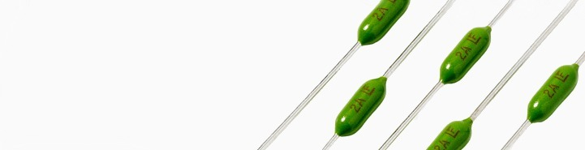

There I was sitting at my workbench replacing a fuse in a Super Famicom when I noticed the original part was marked **1.5 A, 125 V**. My first thought was: "125 V? But this is Australia! We have 250 V fuses here!"

Hang on a minute. That's not quite how it works!

A fuse's voltage rating is the maximum circuit voltage it can safely interrupt. So a 250 V rated fuse can be used in a 125 V, 12 V or other lower-voltage circuit, provided all its other characteristics are suitable. It doesn't mean the Super Famicom somehow has Australian mains voltage running through its internal fuse!

A compatible **1.5 A, 250 V** PICO fuse can replace an appropriate **1.5 A, 125 V** fuse, but matching the amperage isn't the whole story. Fuse speed, interrupting capability, AC or DC suitability and physical size all matter too. Increasing the current rating just because it's convenient would be a rather poor idea.

And no, I am not about to wire a Super Famicom into three-phase power. Apart from blowing everything up, I'd also have the advantage of having no idea how to achieve that!

Capacitors have their own collection of rules, too. Using the specified capacitance with an equal or higher voltage rating is often fine, but there's still polarity, capacitor type, ESR, ripple-current capability, temperature rating and physical size to think about. Just when you think you've got everything worked out, along comes another specification!

Maybe electronics does work according to rules after all. How would I know? I'm just the weekend staff! ;)

### Sources

- [Littelfuse - Fuseology Selection Guide](https://www.littelfuse.com/assetdocs/fuseology-selection-guide?assetguid=e0a12d55-c89a-4e06-94e0-9fe3281f889f)

### Related Posts

- [Fuse Replacement on the Super Nintendo and Super Famicom](/fuse-replacement-on-the-super-nintendo-and-super-famicom/)
