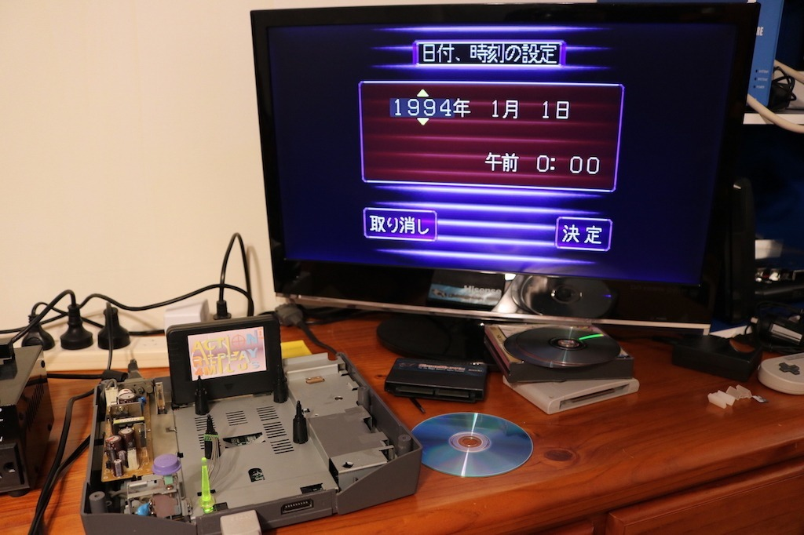
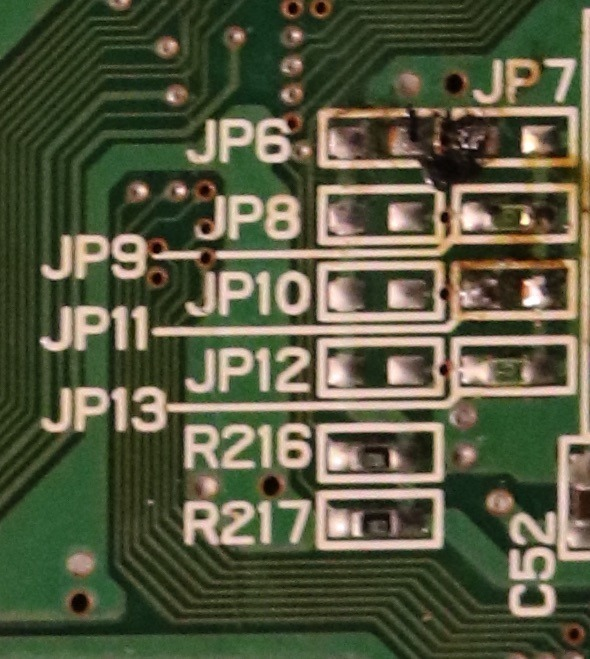
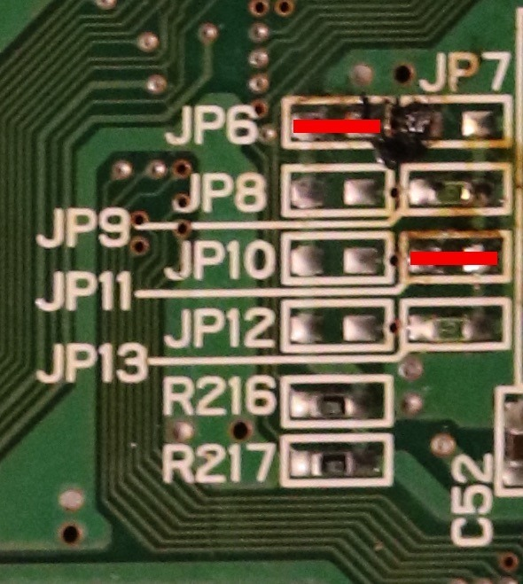

*The Victor Saturn asking for its date and language settings again. Something about that region configuration was not behaving properly!*
{: .media-caption }

How did I get to this point? Error after error: "Cartridge unsuitable for this system" and "Game disk unsuitable for this system". Stop whining already, Segata! The console was also asking for its language every time it powered on rather than behaving like a normal Japanese unit.

This particular Victor RG-JX2(Y) VA9 appeared to have been left in a strange state, possibly after previous modification work was removed. Before fixing it, both the Action Replay and GameShark produced "Cartridge unsuitable for this system", while retail NTSC-U, NTSC-J and PAL game discs produced "Game disk unsuitable for this system". Audio CDs still worked normally.

That combination was one of the clues that the console's region configuration had been left in a strange state rather than the optical drive simply being unable to read discs.

Saturn region selection is controlled by a group of motherboard jumpers. Different high / low combinations identify the console's region. With help from Nopileus on [ASSEMblergames.com](https://web.archive.org/web/20191113141823/https://assemblergames.com/threads/sega-saturn-victor-va9-modchip-mess.62691/), I restored the Japanese jumper configuration on this particular VA9 by bridging JP6 and JP11 with bare Kynar wire... so just... wire. The photographs show what I did on this board.

*The region jumpers on the Saturn VA9 motherboard before the fix, with the JP6 and JP11 areas visible.*
{: .media-caption }

*The same jumper area with two red lines marking the bridges used to restore this particular console's Japanese region configuration.*
{: .media-caption }

Once that was restored, the console returned to Japanese behaviour and the cartridge / game-region errors disappeared. Perfect! This is the repair record for **this particular VA9 board**, not an instruction to bridge those same points blindly on every Saturn revision.

It also booted the CD-Rs I tried, but restoring the region jumpers does not itself bypass Saturn disc authentication. I hadn't established what was allowing those discs to boot.

TriMesh also discussed the wider set of Saturn region combinations. He described 14 usable combinations plus two marked "do not use", making 16 in total. Who knows, maybe I had ended up on one of those! Big thanks to Nopileus, TriMesh and the other Saturn modding references linked below.

### Sources

- [ASSEMblergames.com - Sega Saturn (Victor) VA9 Modchip Mess](https://web.archive.org/web/20191113141823/https://assemblergames.com/threads/sega-saturn-victor-va9-modchip-mess.62691/)
- [Sega Saturn UK - Game disk unsuitable for this system](https://segasaturngroup.proboards.com/thread/1393/game-disk-unsuitable-system)
- [Wolfsoft - Sega Saturn switchless MOD Pal bigger mainboard](http://wolfsoft.de/wordpress/?p=354)
- [Sebastian Kienzl - The ultimate Sega Saturn Switchless Mod](https://knzl.at/saturnmod/)
