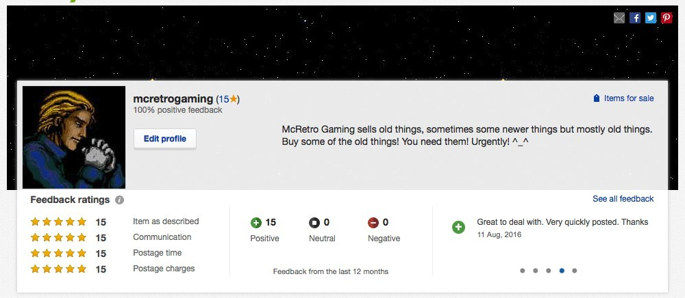

15 positive feedbacks! Apparently describing things accurately and taking lots of photos is a good way to keep people happy. Who knew? Which reminds me, I can finally move onto selling some of the consoles. I've also received a giant roll of bubble wrap, so hopefully everything will make it from point to point without being smashed to pieces. That would be nice!

I'll aim to list the consoles by the weekend, or perhaps Thursday if I run some 10-day auctions. That way they'll get two weekends' worth of views. Everything goes to auction from $0.99 plus shipping! I just wish that guy who bought printer ink off me would pay... I've had to open a dispute. What a waste of time for everyone involved. Anyway, back to fixing all the things to sell most of the things! :)

### McRetro Gaming Shop

- [Ye Olde McRetro Gaming Shoppe](/ye-olde-mcretro-gaming-shoppe/)
- [eBay - Open for Business](/ebay-open-for-business/)
- [McRetro Gaming Shop Grand Opening!](/mcretro-gaming-shop-grand-opening/)
- [The Shop is Closed!](/the-shop-is-closed/)
